# Cinderella

A Brothers Grimm tale • A bedtime story about a kind-hearted kitchen-maid, a hazel tree, two white pigeons, and a golden shoe that fits only one foot.

Source: https://seiyaku.com/lit/grimm/en/021.html

## 1. A Mother's Blessing

There was once a rich man whose wife lay sick, and when she felt her end drawing near she called her only daughter to her bed, and said, “Dear child, be pious and good, and God will always take care of you, and I will look down upon you from heaven, and will be with you.” And then she closed her eyes and died.

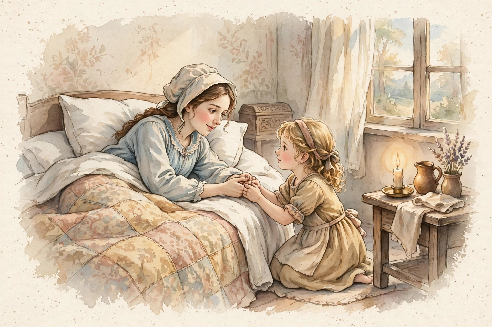

“Dear child, be pious and good.”

## 2. The Grave, and a New Wife

The maiden went every day to her mother's grave and wept, and was always pious and good. When winter came, the snow covered the grave with a white covering, and when the spring sun melted it away, the man took himself another wife.

The new wife brought two daughters into the house. They were beautiful and fair of face, but black and ugly of heart.

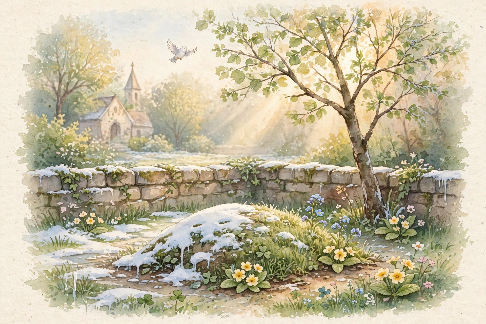

Winter passed, spring came — and with it, a stepmother.

## 3. The Kitchen-Maid

Then began a very evil time for the poor step-child. “Is the stupid creature to sit in the same room with us?” said they. “Those who eat food must earn it. Out with her, for a kitchen-maid!” They took away her pretty dresses, and put on her an old grey kirtle, and gave her wooden shoes to wear.

There she had to do heavy work from morning till night: get up before daybreak, draw water, make the fires, cook, and wash. Besides this, the sisters did their utmost to torment her, mocking her, and strewing peas and lentils among the ashes for her to pick out again. In the evenings, when she was tired out, she had no bed to lie on, but had to sleep by the fireside in the cinders. And as she always looked dusty and dirty, they named her Cinderella.

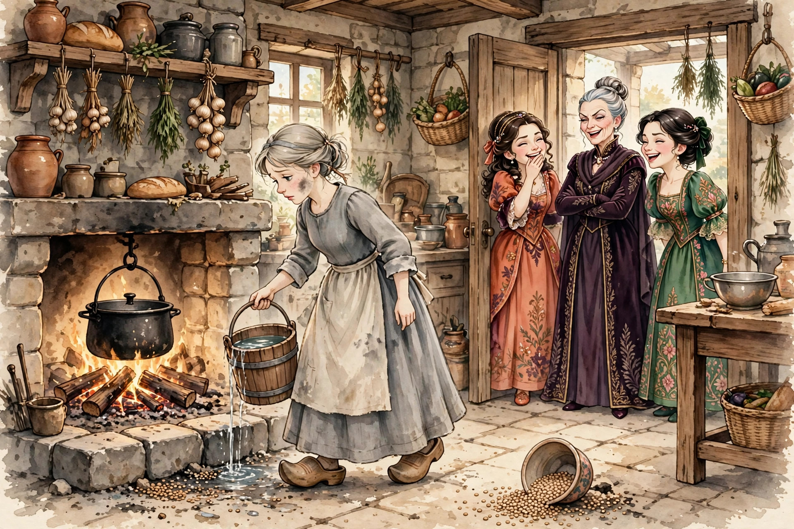

Dusty and dirty from the cinders — so they named her Cinderella.

## 4. What Shall I Bring You?

It happened one day that the father was going to the fair, and he asked his two step-daughters what he should bring back for them. “Fine clothes!” said one. “Pearls and jewels!” said the other. “But what will you have, Cinderella?” said he. “The first twig, father, that strikes against your hat on the way home; that is what I should like you to bring me.”

So he bought fine clothes, pearls, and jewels for the two step-daughters, and on his way back, as he rode through a green lane, a hazel-twig struck against his hat, and he broke it off and carried it home.

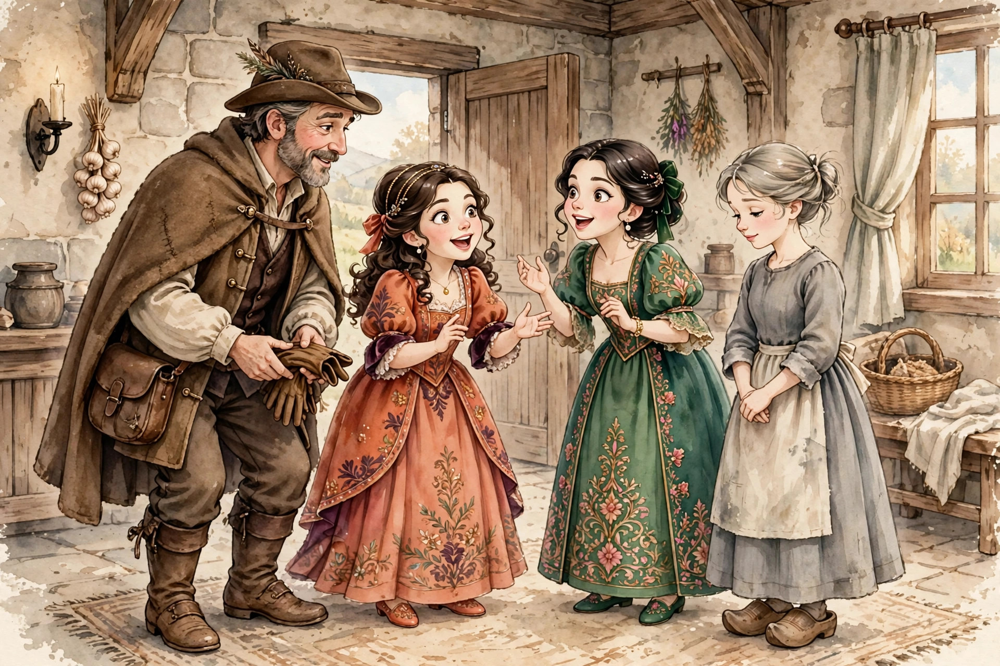

“The first twig that strikes against your hat.”

## 5. The Hazel Tree

When he reached home he gave the step-daughters the things they had wished for, and to Cinderella he gave the hazel-twig. She thanked him, and went to her mother's grave, and planted the twig there, weeping so bitterly that her tears fell upon it and watered it, and it flourished and became a fine tree.

Cinderella went to it three times a day, and wept and prayed, and each time a white bird rose up from the tree, and if she uttered any wish, the bird brought her whatever she had wished for.

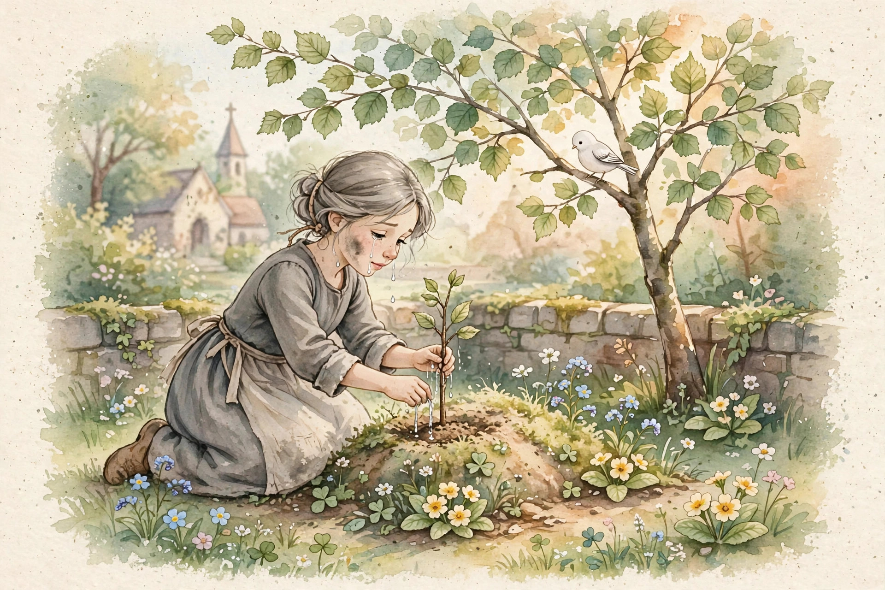

Watered with tears, the twig became a fine tree.

## 6. The King's Festival

Now it came to pass that the king gave a festival that should last for three days, and all the beautiful young women of the country were invited, so that the king's son might choose a bride from among them. When the two step-sisters heard that they too were invited, they were delighted, and they called Cinderella and said, “Comb our hair, brush our shoes, and make our buckles fast — we are going to the festival at the king's castle!”

Cinderella could not help crying, for she too would have liked to go to the dance, and she begged her step-mother to let her. “What, you Cinderella!” said she. “In all your dust and dirt, you want to go to the festival? You who have no dress and no shoes — you want to dance!” But as Cinderella kept on asking, at last the step-mother said, “I have strewed a dishful of lentils in the ashes; if you can pick them all up again in two hours, you may go with us.”

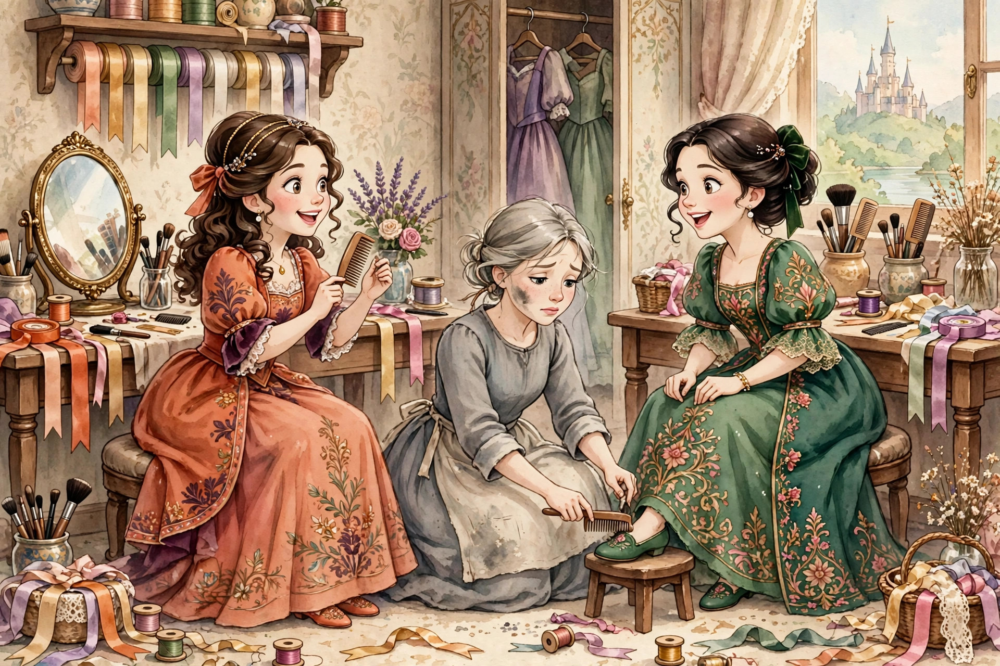

“Comb our hair, brush our shoes — we are going to the festival!”

## 7. The Birds Pick the Lentils

Then the maiden went out by the back door into the garden, and called. Then through the kitchen window came two white doves, and after them the turtle-doves, and at last a crowd of all the birds under heaven, chirping and fluttering, and they settled among the ashes. The doves nodded their little heads and began: pick, peck, pick, peck — and all the others began: pick, peck, pick, peck — and put all the good grains into the dish. Before an hour was over, all was done, and they flew away.

Then Cinderella brought the dish to her step-mother, feeling joyful, thinking that now she might go to the feast. But the step-mother said, “No, Cinderella, you have no proper clothes, and you do not know how to dance; you would be laughed at!” And when Cinderella cried, she added, “If you can pick two dishes full of lentils out of the ashes, clean and whole, you shall go with us” — thinking to herself, “for that is not possible.”

“O gentle doves, O turtle-doves, and all the birds that be, the lentils that in ashes lie, come and pick up for me! The good must be put in the dish, the bad you may eat if you wish.”

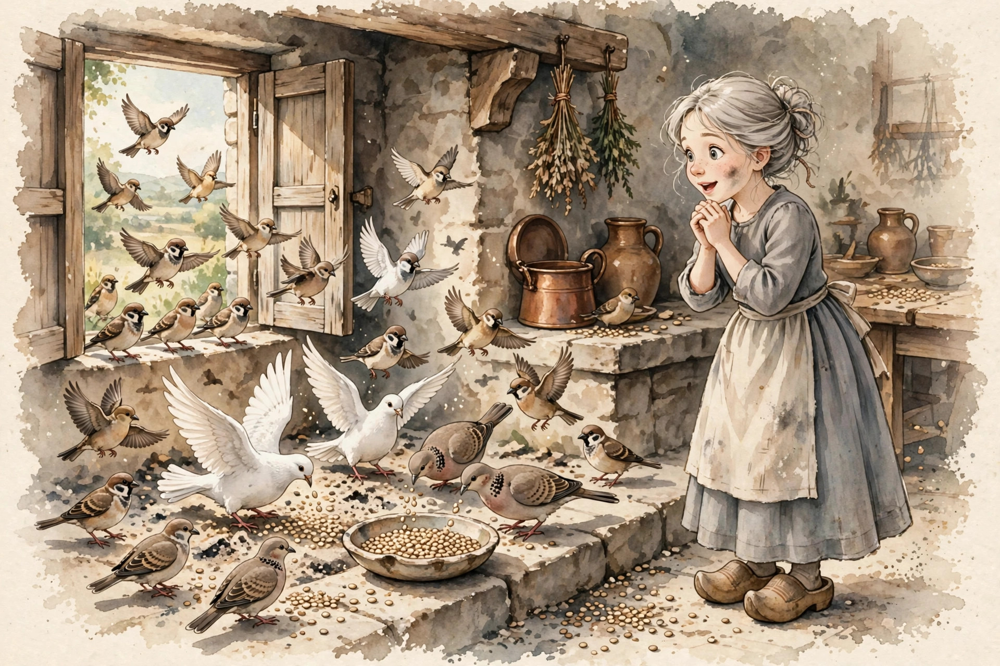

Pick, peck, pick, peck — every good grain in the dish.

## 8. Refused, and Left Behind

When she had strewed two dishes full of lentils among the ashes, Cinderella went again into the garden and called the birds, and they came as before — two white doves, the turtle-doves, and all the birds under heaven — and before half an hour was over, it was all done.

But the step-mother said, “All this is of no use to you; you cannot come with us, for you have no proper clothes and cannot dance; you would put us to shame.” Then she turned her back on poor Cinderella, and made haste to set out with her two proud daughters.

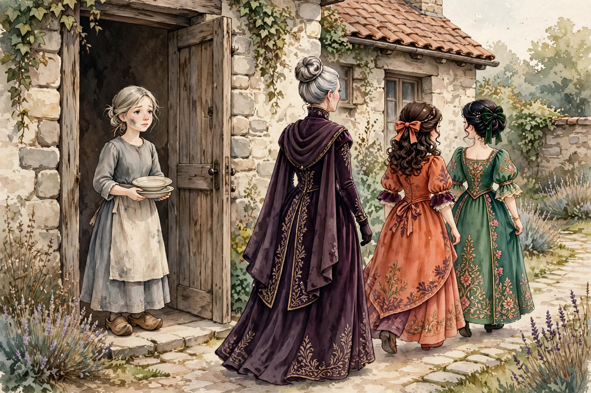

Both tasks done — and still she may not go.

## 9. Little Tree, Little Tree

Now, as there was no one left in the house, Cinderella went to her mother's grave, under the hazel tree, and cried. Then the bird threw down a dress of gold and silver, and a pair of slippers embroidered with silk and silver. In all haste Cinderella put on the dress and went to the festival.

“Little tree, little tree, shake over me, that silver and gold may come down and cover me.”

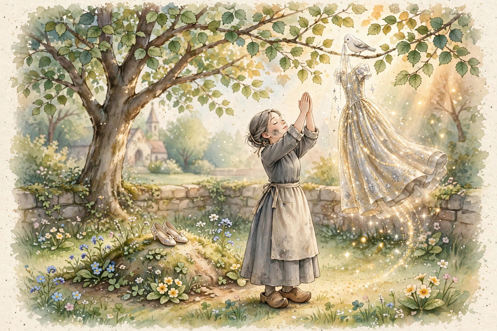

Silver and gold came down and covered her.

## 10. A Foreign Princess?

But her step-mother and sisters did not know her, and thought she must be a foreign princess, she looked so beautiful in her golden dress. Of Cinderella they never thought at all, supposing she was sitting at home picking lentils out of the ashes.

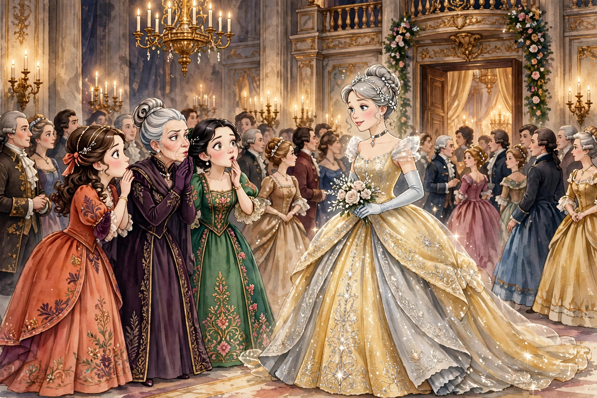

So beautiful, they never guessed who she was.

## 11. She Is My Partner

The king's son came to meet her, took her by the hand, and danced with her, and he would dance with no one else, so that he need not let go of her hand; and when anyone else came to invite her, he answered, “She is my partner.”

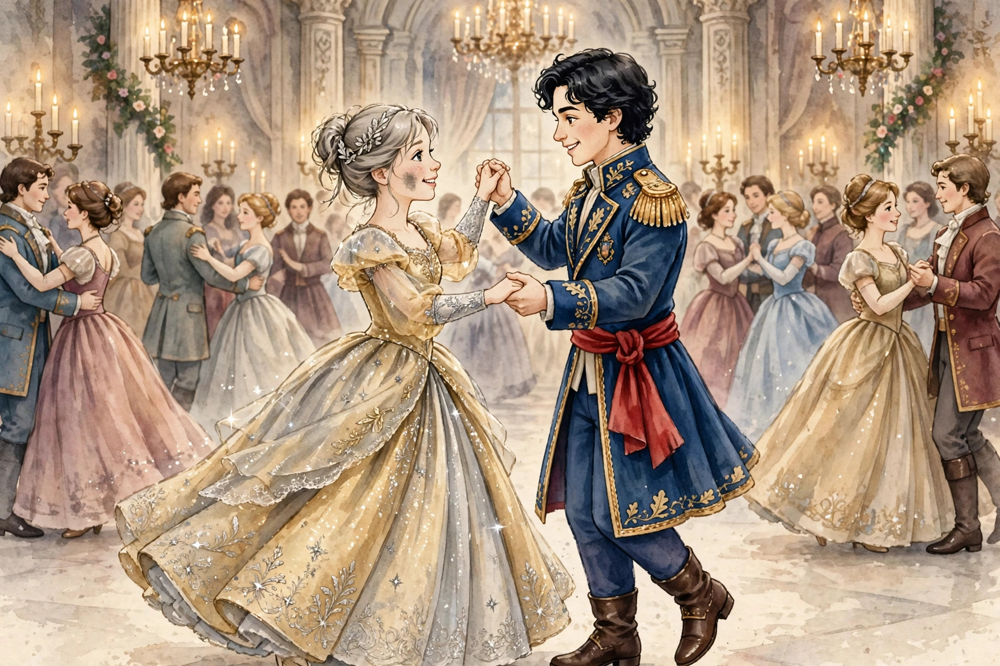

“She is my partner.”

## 12. The Pigeon-House

When evening came, she wanted to go home, and the prince said he would walk with her, for he wanted to see where the beautiful maiden lived. But she escaped from him and jumped up into the pigeon-house. The prince waited until her father came, and told him the strange maiden had jumped into the pigeon-house. The father thought, “It cannot surely be Cinderella,” and called for axes, and had the pigeon-house cut down — but there was no one in it.

And when they came into the house, there sat Cinderella in her dirty clothes among the cinders; for she had slipped out, run to the hazel tree, taken off her beautiful dress and laid it on the grave, and the bird had carried it away; then she had put on her little grey kirtle again, and sat down in the kitchen among the cinders.

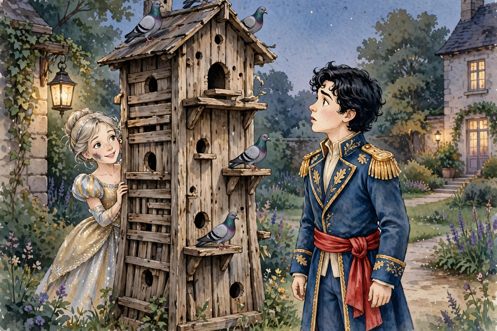

Into the pigeon-house — and home before anyone knew.

## 13. The Second Evening

The next day, when the festival began anew, and her parents and step-sisters had gone, Cinderella went to the hazel tree and cried. Then the bird cast down a dress still more splendid than the day before. When she appeared in it among the guests, everyone was astonished at her beauty. The prince had been waiting for her; he took her hand and danced with her alone, and if anyone else asked, he said, “She is my partner.”

“Little tree, little tree, shake over me, that silver and gold may come down and cover me.”

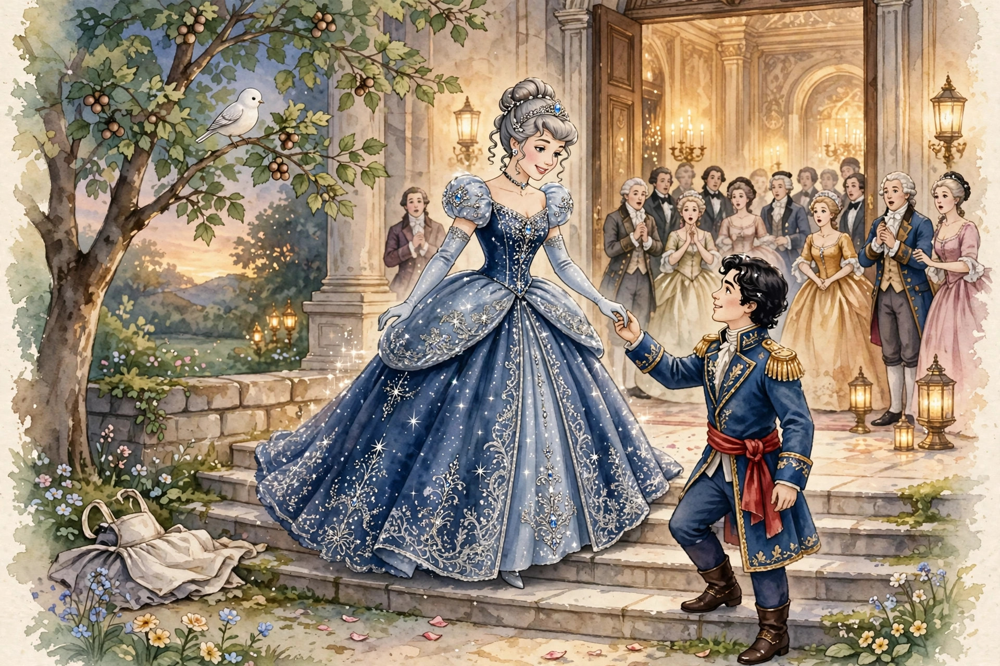

A dress still more splendid than the day before.

## 14. The Pear Tree

When evening came she wanted to go home, and the prince followed her, for he wanted to see to what house she belonged; but she broke away and ran into the garden at the back of the house. There stood a fine large tree covered with splendid pears; she leapt as lightly as a squirrel among its branches, and the prince did not know what had become of her. He waited until her father came, and told him the strange maiden had run from him and gone up into the pear-tree. The father thought, “It cannot surely be Cinderella,” and called for an axe, and felled the tree — but there was no one in it.

And when they went into the kitchen, there sat Cinderella among the cinders, as usual; for she had climbed down the other side of the tree, taken back her beautiful clothes to the bird on the hazel tree, and put on her old grey kirtle again.

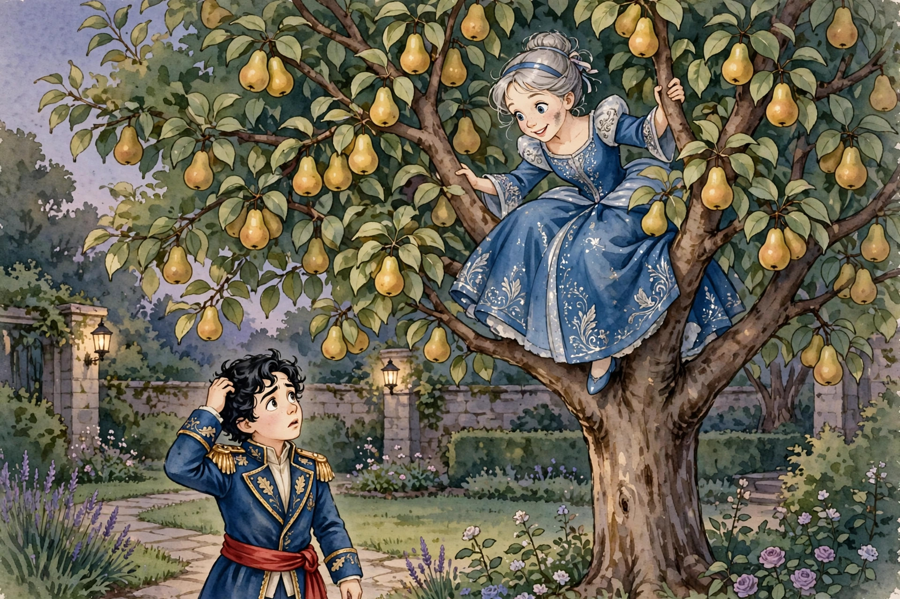

As lightly as a squirrel, up into the pear tree.

## 15. The Third Evening

On the third day, when her parents and step-sisters had set off, Cinderella went again to her mother's grave and said to the tree. Then the bird cast down a dress the like of which had never been seen for splendour and brilliancy, and slippers that were all of gold. When she appeared at the feast in this dress, nobody knew what to say for wonder. The prince danced with her alone, and if anyone else asked her, he answered, “She is my partner.”

“Little tree, little tree, shake over me, that silver and gold may come down and cover me.”

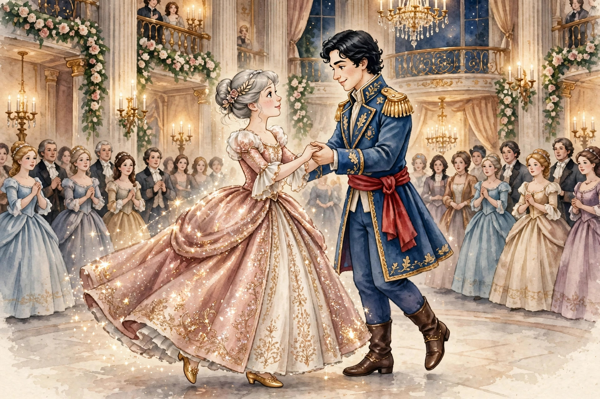

A dress the like of which had never been seen.

## 16. The Golden Shoe

When it was evening, Cinderella wanted to go home, and the prince was about to go with her, when she ran past him so quickly that he could not follow her. But he had laid a plan, and had all the steps spread with pitch, so that as she rushed down them, her left shoe remained sticking in it. The prince picked it up, and saw that it was of gold, and very small and dainty.

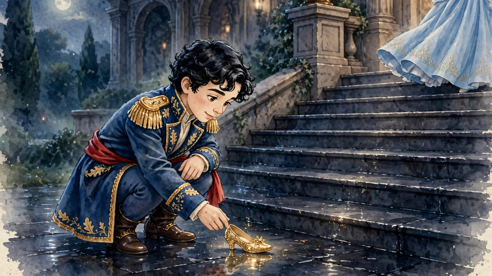

Of gold — and very small and dainty.

## 17. The Eldest Sister Tries

The next morning he went to the father and told him that no one should be his bride save the one whose foot the golden shoe fitted. Then the two sisters were very glad, for they had pretty feet. The eldest went to her room to try on the shoe, with her mother standing by. But she could not force her great toe into it, for the shoe was too small. Then her mother handed her a knife and said, “Cut the toe off; when you are queen, you will never have to go on foot.” So the girl cut off her toe, squeezed her foot into the shoe, swallowed her pain, and went down to the prince. He took her on his horse as his bride and rode off.

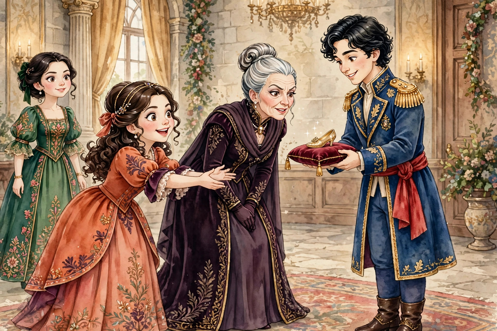

The eldest was certain the shoe would be hers.

## 18. Blood on Her Shoe

But they had to pass by the grave, and there sat the two pigeons on the hazel tree, and they cried. Then the prince looked at her foot and saw the blood. He turned his horse round and took the false bride home again, saying she was not the right one, and the other sister must try on the shoe.

“There they go, there they go! There is blood on her shoe; the shoe is too small — not the right bride at all!”

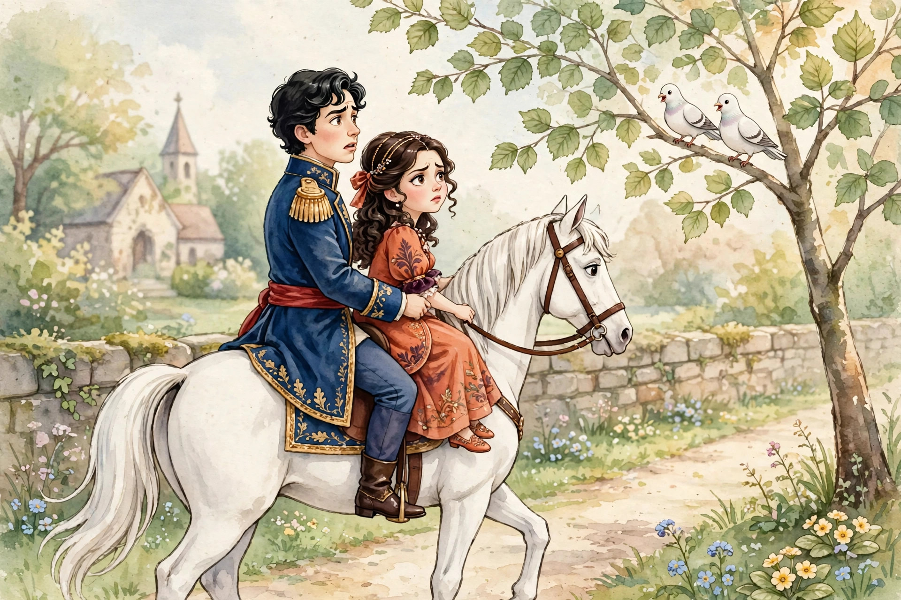

The pigeons sang out the truth.

## 19. The Second Sister Tries

So she went into her room and got her toes in, but her heel was too large. Then her mother handed her the knife, saying, “Cut a piece off your heel; when you are queen, you will never have to go on foot.” So the girl cut a piece off her heel, thrust her foot into the shoe, swallowed her pain, and went down to the prince, who took her on his horse as his bride and rode off. When they passed the hazel tree, the two pigeons sat there and cried: “There is blood on her shoe; the shoe is too small — not the right bride at all!” Then the prince looked at her foot and saw the blood flowing from the shoe and staining her white stocking. He turned his horse round and brought the false bride home again.

“This is not the right one,” said he. “Have you no other daughter?” “No,” said the man, “only my dead wife left behind her a little stunted Cinderella; it is impossible that she can be the bride.” But the king's son ordered her to be sent for. The mother said, “Oh no, she is much too dirty; she cannot be seen.” But the prince insisted, and Cinderella had to appear.

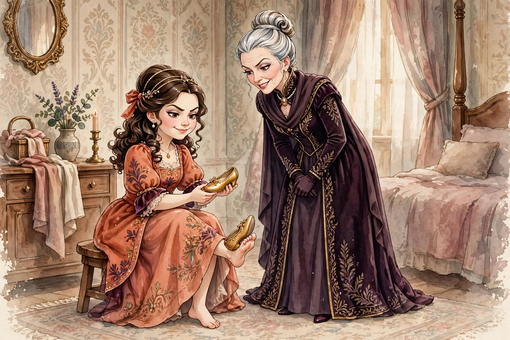

The second sister was just as sure — and just as wrong.

## 20. The Right Bride

First she washed her face and hands clean, and went in and bowed to the prince, who held out to her the golden shoe. Then she sat down on a stool, drew her foot out of the heavy wooden shoe, and slipped it into the golden one, which fitted it perfectly. And when she stood up and the prince looked into her face, he knew again the beautiful maiden who had danced with him, and he cried, “This is the right bride!”

The step-mother and the two sisters were thunderstruck, and grew pale with anger; but the prince put Cinderella before him on his horse and rode off.

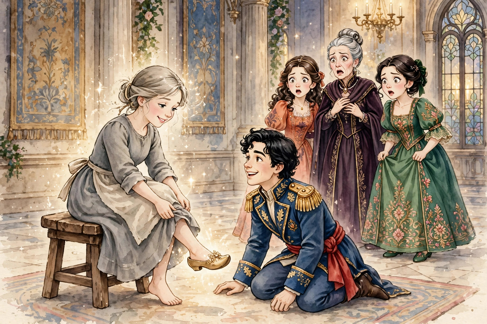

“This is the right bride!”

## 21. The Right Bride After All

And as they passed the hazel tree, the two white pigeons cried. And when they had cried this, the two pigeons came flying and perched on Cinderella's shoulders, one on the right and one on the left, and stayed there.

“There they go, there they go! No blood on her shoe; the shoe's not too small — the right bride is she after all!”

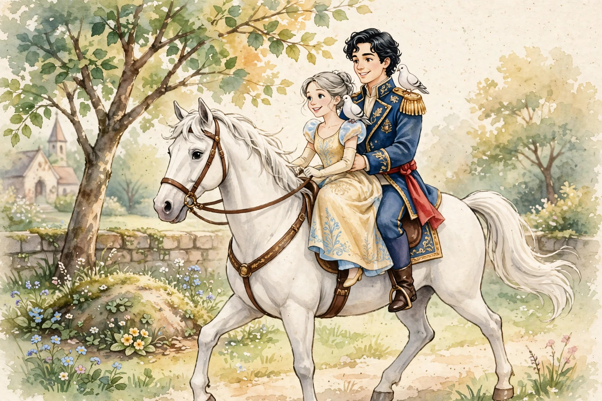

One on the right, and one on the left — and stayed there.

## 22. The Wedding

And when the wedding with the prince was to be held, the false sisters came, hoping to win favour and take part in the festivities. As the bridal procession went to church, the eldest sister walked on the right side and the youngest on the left, and the pigeons pecked out one eye of each of them. On the way back, the eldest was on the left side and the youngest on the right, and the pigeons pecked out the other eye of each of them. And so, for their wickedness and falsehood, they were punished with blindness for the rest of their days. And that is the end of the tale.

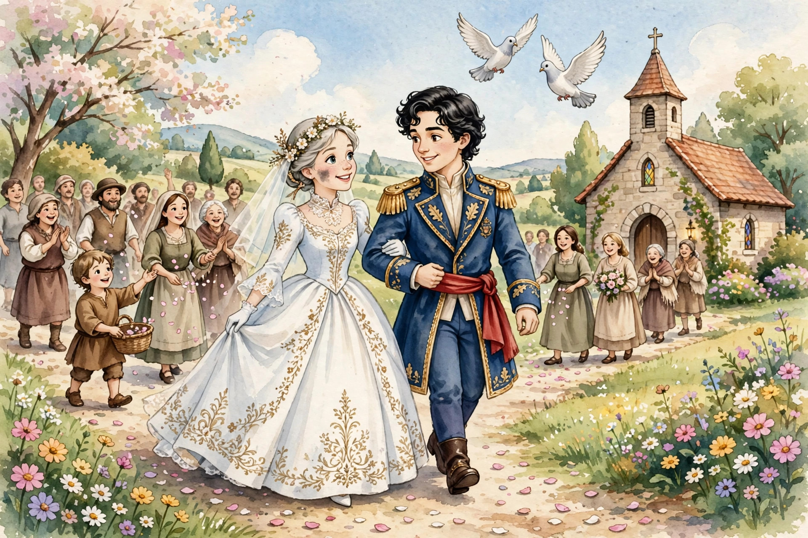

And they lived — the right bride, after all.
