# The Fisherman and His Wife

A Brothers Grimm tale • A bedtime story about a magic fish, a sea that changes with every wish, and knowing when enough is enough.

Source: https://seiyaku.com/lit/grimm/en/019.html

## 1. The Hovel by the Sea

There was once a fisherman and his wife who lived together in a hovel by the sea-shore, and the fisherman went out every day with his hook and line to catch fish, and he angled and angled.

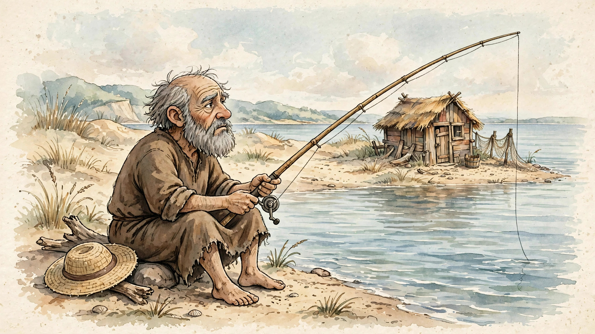

Every day the fisherman went out with his hook and line, and angled and angled.

## 2. The Great Flounder

One day he was sitting with his rod and looking into the clear water, and he sat and sat. At last down went the line to the bottom of the water, and when he drew it up he found a great flounder on the hook. And the flounder said to him, “Fisherman, listen to me; let me go, I am not a real fish but an enchanted prince. Put me back into the water again, and let me swim away.” “Well,” said the fisherman, “as you can speak I had much rather let you swim away.” Then he put him back into the clear water, and the flounder sank to the bottom.

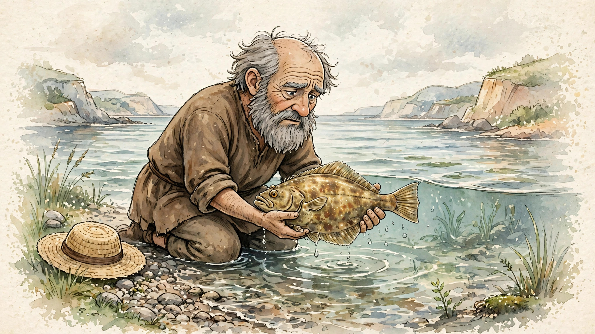

“I am not a real fish but an enchanted prince,” said the flounder. So the fisherman let him swim away.

## 3. “Did You Wish for Nothing?”

Then the fisherman got up and went home to his wife in their hovel. “Well, husband,” said the wife, “have you caught nothing to-day?” “No,” said the man, “I did catch a flounder, but as he said he was an enchanted prince, I let him go again.” “Then, did you wish for nothing?” said the wife. “No,” said the man; “what should I wish for?” “Oh dear!” said the wife; “and it is so dreadful always to live in this evil-smelling hovel. You might as well have wished for a little cottage; go again and call him; tell him we want a little cottage, I daresay he will give it us; go, and be quick.”

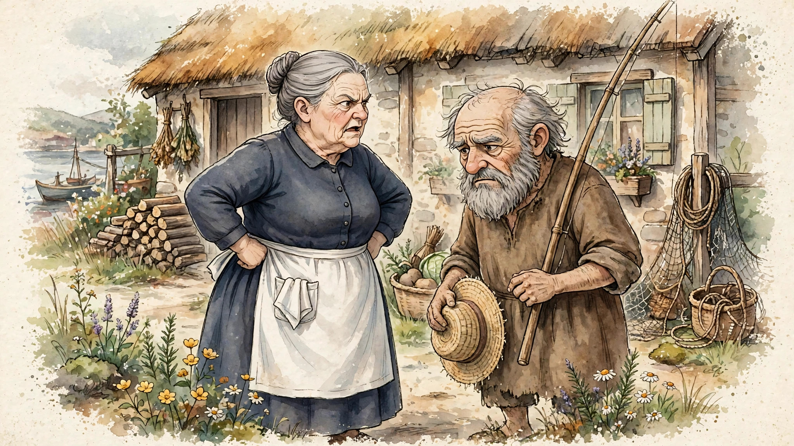

“Did you wish for nothing?” cried his wife. “Go again and call him — tell him we want a little cottage!”

## 4. The Green and Yellow Sea

And when he went back, the sea was green and yellow, and not nearly so clear. So he stood and said:

O man, O man, if man you be, or flounder, flounder, in the sea, such a tiresome wife I've got, for she wants what I do not.

Then the flounder came swimming up, and said, “Now then, what does she want?” “Oh,” said the man, “she does not want to live any longer in the hovel, and would rather have a cottage.” “Go home with you,” said the flounder, “she has it already.”

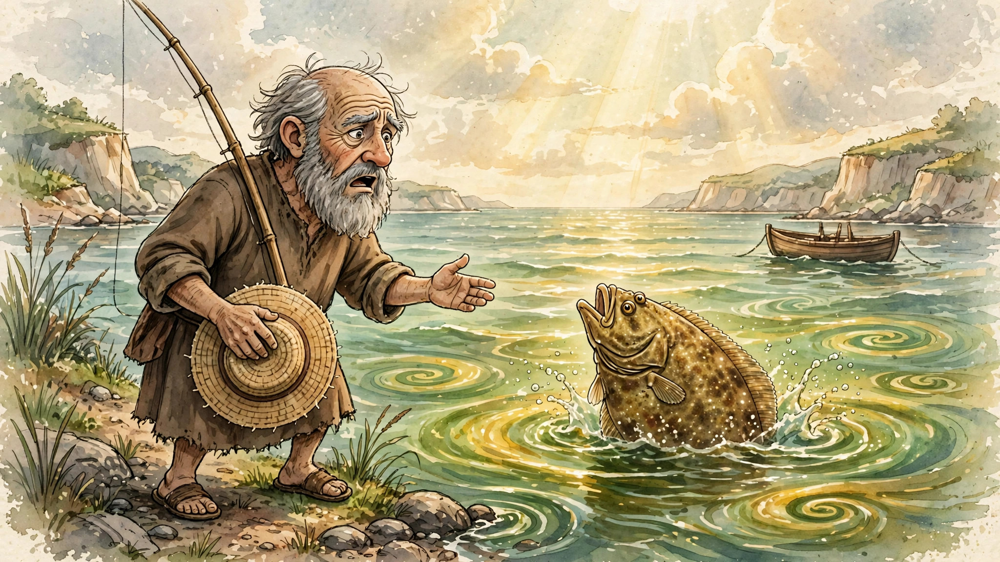

The sea had changed its colour — and the flounder came swimming up to hear the wish.

## 5. The Pretty Cottage

So the man went home, and found, instead of the hovel, a little cottage, and his wife was sitting on a bench before the door. And she took him by the hand, and said to him, “Come in and see if this is not a great improvement.” So they went in, and there was a little house-place and a beautiful little bedroom, a kitchen and larder, with all sorts of furniture of the very best. And at the back was a little yard with fowls and ducks, and a little garden full of green vegetables and fruit. “Look,” said the wife, “is not that nice?” “Yes,” said the man, “if this can only last we shall be very well contented.” “We will see about that,” said the wife.

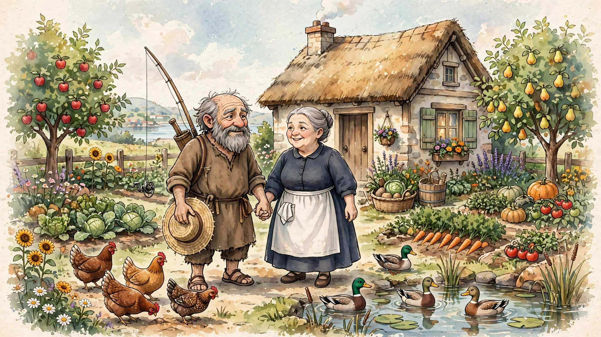

Instead of the hovel stood a pretty cottage, with a yard of fowls and ducks and a garden full of green things.

## 6. “A Large Stone Castle”

So all went well for a week or fortnight, when the wife said, “Look here, husband, the cottage is really too confined, and the yard and garden are so small; I think the flounder had better get us a larger house; I should like very much to live in a large stone castle; so go to your fish and he will send us a castle.” “O my dear wife,” said the man, “the cottage is good enough; what do we want a castle for?” “We want one,” said the wife; “go along with you; the flounder can give us one.” The man felt very reluctant and unwilling; and he said to himself, “It is not the right thing to do;” nevertheless he went.

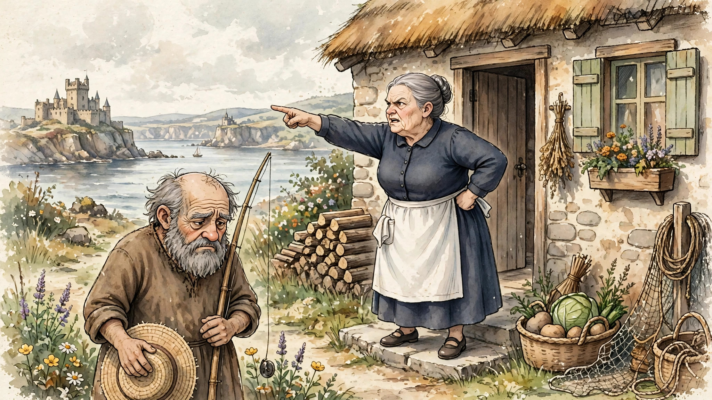

“I should like very much to live in a large stone castle,” said his wife. “Go along — the flounder can give us one!”

## 7. The Purple Sea

So when he came to the seaside, the water was purple and dark blue and grey and thick, and not green and yellow as before. And he stood and said:

O man, O man, if man you be, or flounder, flounder, in the sea, such a tiresome wife I've got, for she wants what I do not.

“Now then, what does she want?” said the flounder. “Oh,” said the man, half frightened, “she wants to live in a large stone castle.” “Go home with you, she is already standing before the door,” said the flounder.

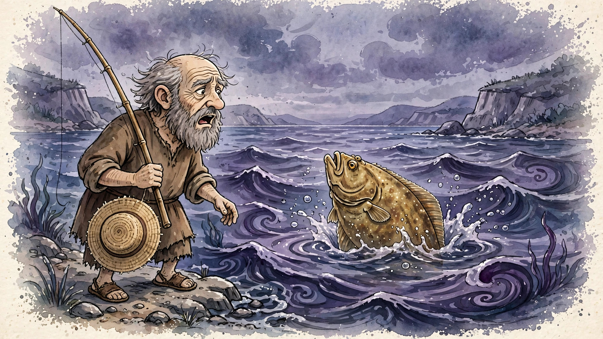

The sea was purple and dark blue and grey and thick — no longer green and yellow as before.

## 8. The Stone Castle

Then the man went home, as he supposed, but when he got there, there stood in the place of the cottage a great castle of stone, and his wife was standing on the steps, about to go in; so she took him by the hand, and said, “Let us enter.” With that he went in with her, and in the castle was a great hall with a marble pavement, and there were a great many servants, and the rooms had golden chairs and tables, and crystal chandeliers hanging from the ceiling. And the tables were covered with eatables and the best wine for any one who wanted them. And at the back of the house was a great stable-yard, besides a splendid large garden, with the most beautiful flowers and fine fruit trees, and a pleasance full half a mile long, with deer and oxen and sheep, and everything that heart could wish for. “There!” said the wife, “is not this beautiful?” “Oh yes,” said the man, “if it will only last we can live in this fine castle and be very well contented.” “We will see about that,” said the wife.

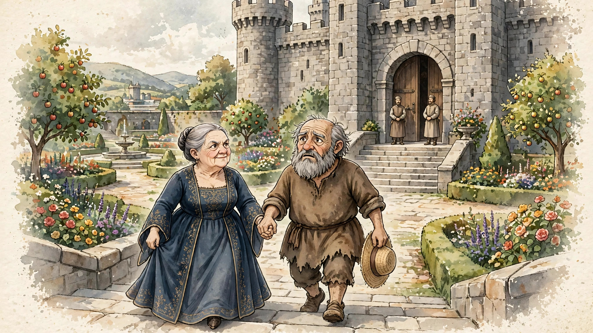

In place of the cottage stood a great castle of stone — and his wife took him by the hand. “Let us enter.”

## 9. “I Must Be King”

The next morning the wife was awake first, just at the break of day, and she looked out and saw from her bed the beautiful country lying all round. The man took no notice of it, so she poked him in the side with her elbow, and said, “Husband, get up and just look out of the window. Look, just think if we could be king over all this country. Just go to your fish and tell him we should like to be king.” “Now, wife,” said the man, “what should we be kings for? I don't want to be king.” “Well,” said the wife, “if you don't want to be king, I will be king.” “Now, wife,” said the man, “I could not ask him such a thing.” “Why not?” said the wife, “you must go directly all the same; I must be king.”

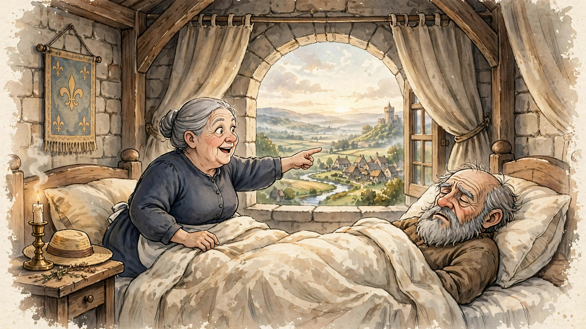

“Husband, get up and just look out of the window. Just think if we could be king over all this country!”

## 10. The Dark Grey Sea

So the man went, very much put out that his wife should want to be king. “It is not the right thing to do — not at all the right thing,” thought the man. He did not at all want to go, and yet he went all the same. And when he came to the sea the water was quite dark grey, and rushed far inland, and had an ill smell. And he stood and said:

O man, O man, if man you be, or flounder, flounder, in the sea, such a tiresome wife I've got, for she wants what I do not.

“Now then, what does she want?” said the fish. “Oh dear!” said the man, “she wants to be king.” “Go home with you, she is so already,” said the fish.

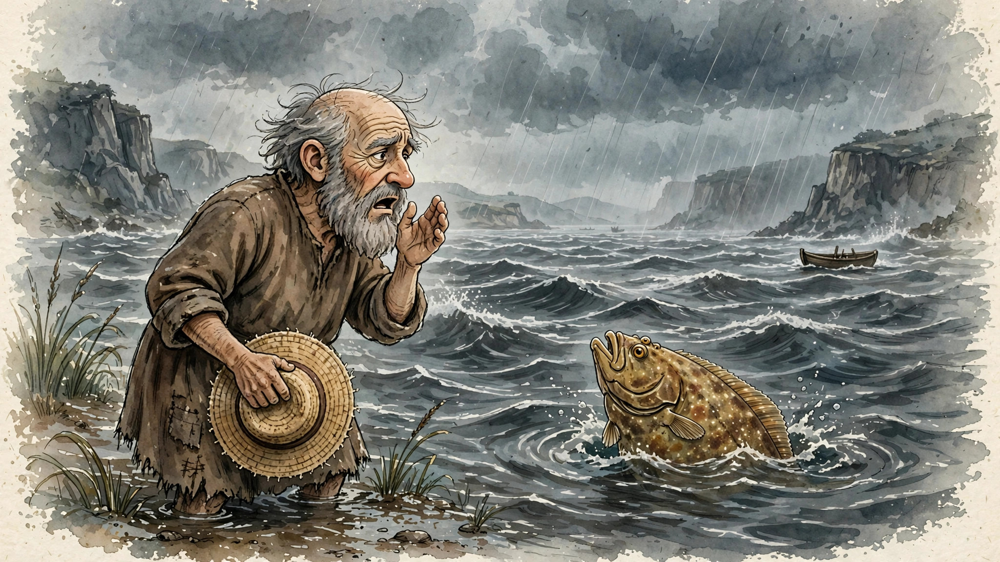

The sea was quite dark grey, and rushed far inland — but the fisherman called the flounder all the same.

## 11. The Palace Grown Greater

So the man went back, and as he came to the palace he saw it was very much larger, and had great towers and splendid gateways; the herald stood before the door, and a number of soldiers with kettle-drums and trumpets. And when he came inside everything was of marble and gold, and there were many curtains with great golden tassels. Then he went through the doors of the saloon to where the great throne-room was, and there was his wife sitting upon a throne of gold and diamonds, and she had a great golden crown on, and the sceptre in her hand was of pure gold and jewels, and on each side stood six pages in a row, each one a head shorter than the other. So the man went up to her and said, “Well, wife, so now you are king!” “Yes,” said the wife, “now I am king.” So then he stood and looked at her, and when he had gazed at her for some time he said, “Well, wife, this is fine for you to be king! now there is nothing more to wish for.” “O husband!” said the wife, seeming quite restless, “I am tired of this already. Go to your fish and tell him that now I am king I must be emperor.”

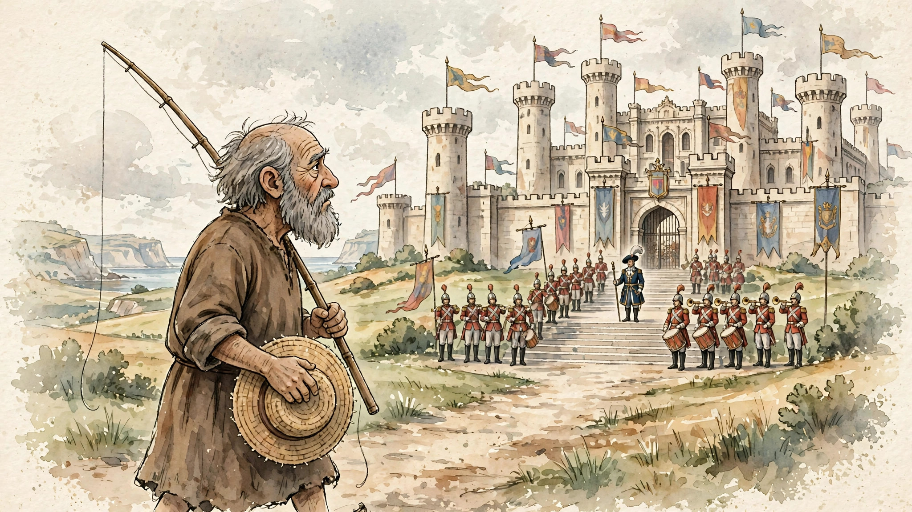

The palace was very much larger, with great towers and splendid gateways — and inside, his wife sat upon a throne of gold and diamonds.

## 12. “I Must Be Emperor”

“Now, wife,” said the man, “what do you want to be emperor for?” “Husband,” said she, “go and tell the fish I want to be emperor!” “Oh dear!” said the man, “he could not do it. I cannot ask him such a thing. There is but one emperor at a time; the fish can't possibly make any one emperor, indeed he can't.” “Now, look here,” said the wife, “I am king, and you are only my husband, so will you go at once? Go along! for if he was able to make me king he is able to make me emperor; and I will and must be emperor, so go along!”

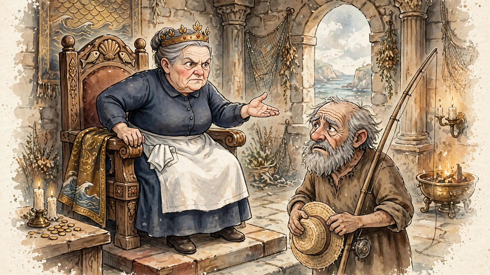

“If he was able to make me king he is able to make me emperor — and I will and must be emperor!”

## 13. The Walk Home

So he was obliged to go; and as he went he felt very uncomfortable about it, and he thought to himself, “It is not at all the right thing to do; to want to be emperor is really going too far; the flounder will soon be beginning to get tired of this.” With that he came to the sea, and the water was quite black and thick, and the foam flew, and the wind blew, and the man was terrified. But he stood and said:

O man, O man, if man you be, or flounder, flounder, in the sea, such a tiresome wife I've got, for she wants what I do not.

“What is it now?” said the fish. “Oh dear!” said the man, “my wife wants to be emperor.” “Go home with you,” said the fish, “she is emperor already.” So the man went home, uneasy beneath the dark clouds, and found the castle adorned with polished marble and alabaster figures, and golden gates.

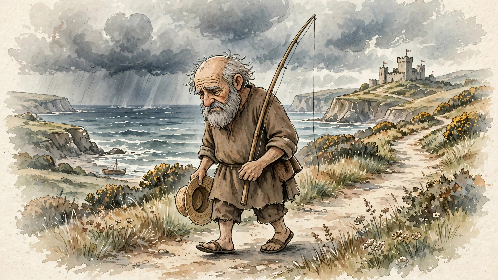

The sea was quite black and thick, and the foam flew — and the fisherman walked home uneasy beneath dark clouds.

## 14. The Emperor's Throne

The troops were being marshalled before the door, and they were blowing trumpets and beating drums and cymbals; and when he entered he saw barons and earls and dukes waiting about like servants; and the doors were of bright gold. And he saw his wife sitting upon a throne made of one entire piece of gold, and it was about two miles high; and she had a great golden crown on, which was about three yards high, set with brilliants and carbuncles; and in one hand she held the sceptre, and in the other the globe; and on both sides of her stood pages in two rows, all arranged according to their size, from the most enormous giant of two miles high to the tiniest dwarf of the size of my little finger; and before her stood earls and dukes in crowds. So the man went up to her and said, “Well, wife, so now you are emperor.” “Yes,” said she, “now I am emperor.” Then he went and sat down and had a good look at her, and then he said, “Well now, wife, there is nothing left to be, now you are emperor.” “What are you talking about, husband?” said she; “I am emperor, and next I will be pope! so go and tell the fish so.”

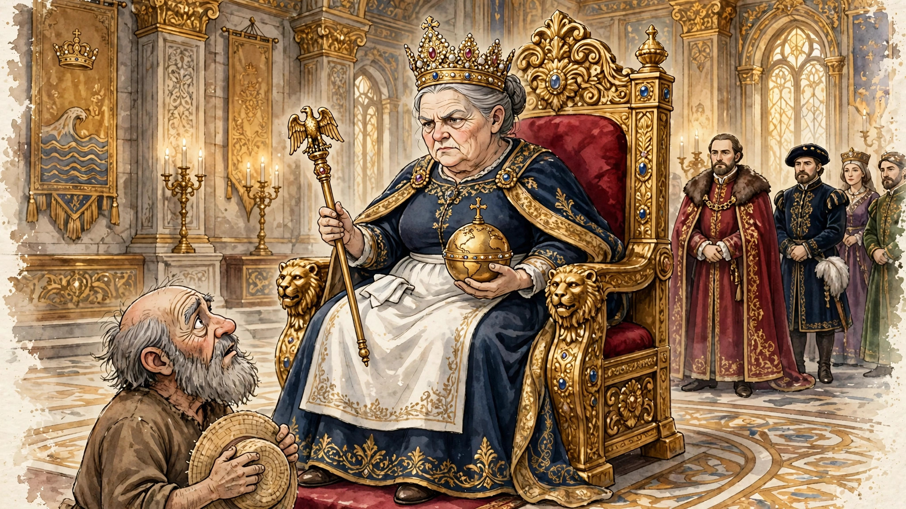

Her throne was of one entire piece of gold, her crown three yards high — and in one hand she held the sceptre, in the other the globe.

## 15. Before the Towering Throne

“Oh dear!” said the man, “what is it that you don't want? You can never become pope; there is but one pope in Christendom, and the fish can't possibly do it.” “Husband,” said she, “no more words about it; I must and will be pope; so go along to the fish.” “Now, wife,” said the man, “how can I ask him such a thing? it is too bad, it is asking a little too much; and, besides, he could not do it.” “What rubbish!” said the wife; “if he could make me emperor he can make me pope. Go along and ask him; I am emperor, and you are only my husband, so go you must.” So he went, feeling very frightened, and he shivered and shook, and his knees trembled.

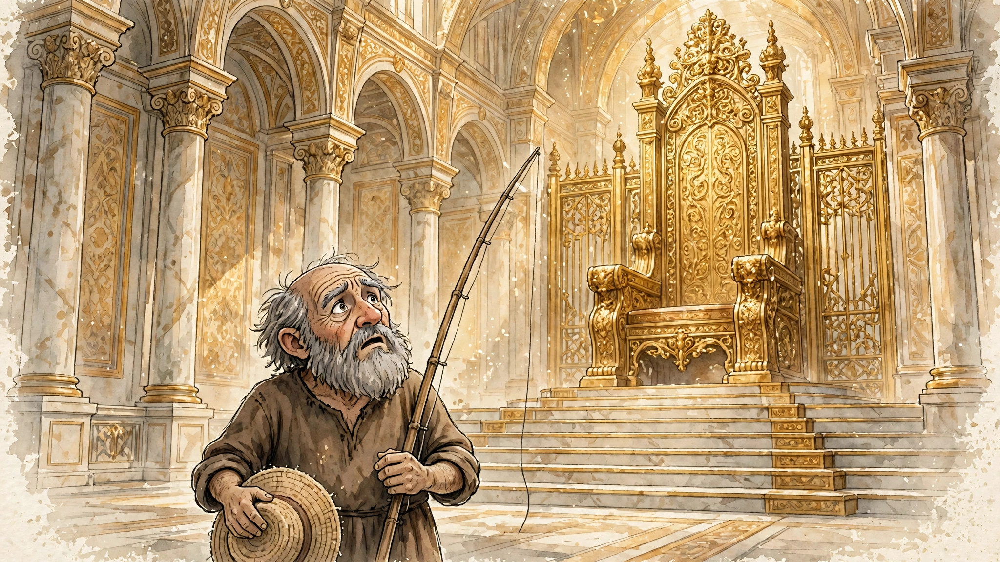

“If he could make me emperor he can make me pope.” The fisherman went, feeling very frightened.

## 16. Ships in the Storm

And there arose a great wind, and the clouds flew by, and it grew very dark, and the sea rose mountains high, and the ships were tossed about, and the sky was partly blue in the middle, but at the sides very dark and red, as in a great tempest. And he felt very desponding, and stood trembling and said:

O man, O man, if man you be, or flounder, flounder, in the sea, such a tiresome wife I've got, for she wants what I do not.

“Well, what now?” said the fish. “Oh dear!” said the man, “she wants to be pope.” “Go home with you, she is pope already,” said the fish.

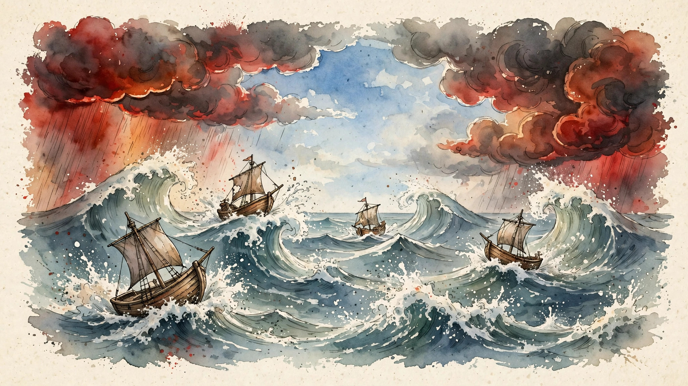

The sea rose mountains high, and the ships were tossed about, and the sky was dark and red at the sides, as in a great tempest.

## 17. The Great Church

So he went home, and he found himself before a great church, with palaces all round. He had to make his way through a crowd of people; and when he got inside he found the place lighted up with thousands and thousands of lights; and his wife was clothed in a golden garment, and sat upon a very high throne, and had three golden crowns on, all in the greatest priestly pomp; and on both sides of her there stood two rows of lights of all sizes, from the size of the longest tower to the smallest rushlight, and all the emperors and kings were kneeling before her. “Well, wife,” said the man, and sat and stared at her, “so you are pope.” “Yes,” said she, “now I am pope!” And he went on gazing at her till he felt dazzled, as if he were sitting in the sun. And after a little time he said, “Well, now, wife, what is there left to be, now you are pope?” And she sat up very stiff and straight, and said nothing. And he said again, “Well, wife, I hope you are contented at last with being pope; you can be nothing more.” “We will see about that,” said the wife.

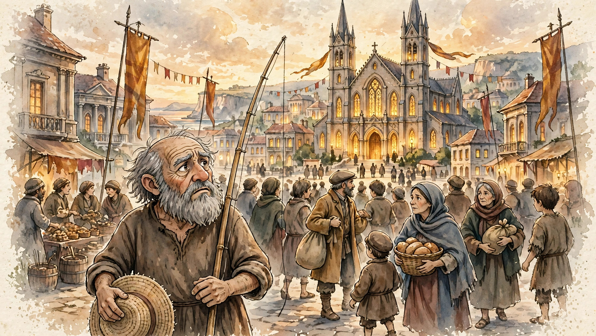

Before him stood a great church, with palaces all round — and inside, lit by thousands of lights, sat his wife in a golden garment.

## 18. The Red Dawn

With that they both went to bed; but she was as far as ever from being contented, and she could not get to sleep for thinking of what she should like to be next. The husband, however, slept as fast as a top after his busy day; but the wife tossed and turned from side to side the whole night through, thinking all the while what she could be next, but nothing would occur to her; and when she saw the red dawn she slipped off the bed, and sat before the window to see the sun rise, and as it came up she said, “Ah, I have it! what if I should make the sun and moon to rise. Husband!” she cried, and stuck her elbow in his ribs, “wake up, and go to your fish, and tell him I want power over the sun and moon.” The man was so fast asleep that when he started up he fell out of bed. Then he shook himself together, and opened his eyes and said, “Oh, wife, what did you say?” “Husband,” said she, “if I cannot get the power of making the sun and moon rise when I want them, I shall never have another quiet hour. Go to the fish and tell him so.” “O wife!” said the man, and fell on his knees to her, “the fish can really not do that for you. I grant you he could make you emperor and pope; do be contented with that, I beg of you.” And she became wild with impatience, and screamed out, “I can wait no longer, go at once!”

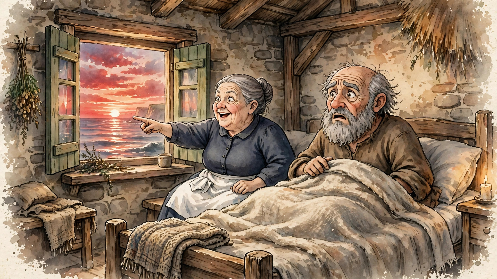

“Ah, I have it! What if I should make the sun and moon to rise?” cried his wife at the red dawn.

## 19. Back in the Old Hovel

And so off he went as well as he could for fright. And a dreadful storm arose, so that he could hardly keep his feet; and the houses and trees were blown down, and the mountains trembled, and rocks fell in the sea; the sky was quite black, and it thundered and lightened; and the waves, crowned with foam, ran mountains high. So he cried out, without being able to hear his own words:

O man, O man, if man you be, or flounder, flounder, in the sea, such a tiresome wife I've got, for she wants what I do not.

“Well, what now?” said the flounder. “Oh dear!” said the man, “she wants to order about the sun and moon.” “Go home with you!” said the flounder, “you will find her in the old hovel.” And there they are sitting to this very day.

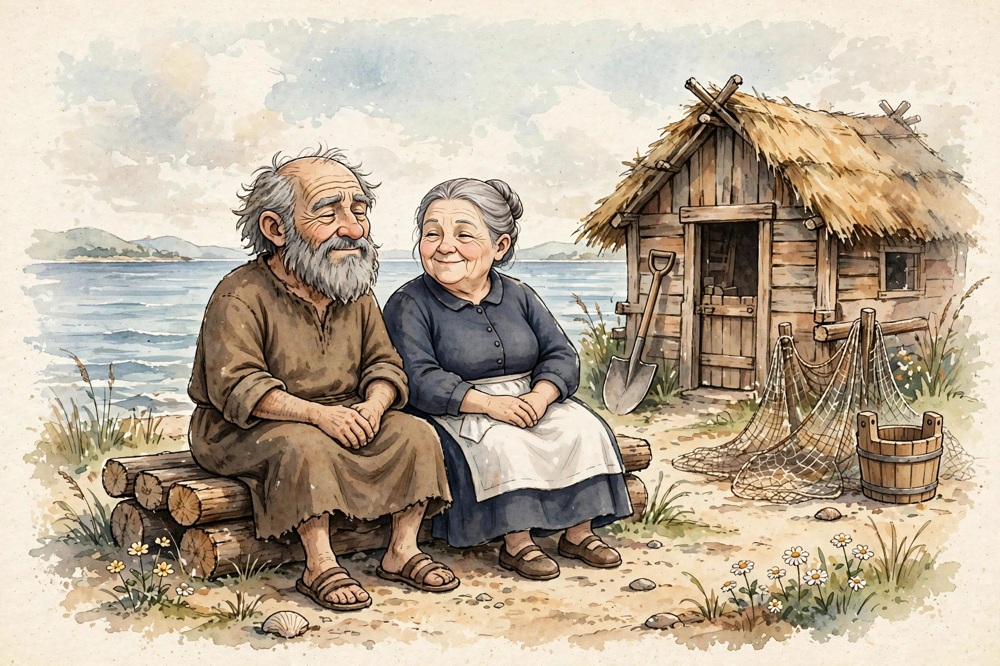

The flounder sent them back to the old hovel — and there they are sitting to this very day.
