# Pippin Paddlepaw and the Seven Golden Acorns

*A 20-minute bedtime fable weaving together The Little Red Hen, The Three Little Pigs, The Crow and the Pitcher, The Lion and the Mouse, The Boy Who Cried Wolf, The Ants and the Grasshopper, The Tortoise and the Hare, and The North Wind and the Sun.*

Source: https://read.gov/aesop/001.html

---

## Chapter 1: Willing Paws & Warm Muffins
*Inspired by The Little Red Hen & The Three Little Pigs — When friends pitch in and build with care, everyone shares the warmest treat.*

### 1. The Morning of the Seven Golden Acorns

Once upon a cozy autumn morning, deep in Whispering Willows Valley, the leaves were turning the color of golden honey, warm cinnamon, and toasted marshmallows.

Right in the middle of the green meadow stood the Grand Willow Tree. Its long, feathery branches dipped down like gentle green curtains, and carved into its mossy roots was a round oak door with a shiny brass knocker. Every year on the evening of the Harvest Moon, all the woodland neighbors gathered beneath the Grand Willow Tree for the Great Lantern Festival.

High among the willow boughs hung seven glass lantern globes shaped like acorns. To make the seven lanterns shine on Festival Night, a helper had to gather the Seven Golden Acorns of Kindness before sunset. Each Golden Acorn was kept by a different neighbor, and each one only began to glow when a young friend practiced a true lesson of kindness, patience, and honesty.

Out onto the arched pine footbridge stepped Pippin Paddlepaw. Pippin was a five-year-old river-otter cub with soft cinnamon-brown fur, creamy-white cheeks, and a sky-blue knitted waistcoat with two brass buttons. Slung across his shoulder was his woven willow satchel, ready to carry the seven treasures safely up the hill.

“Good morning, sparkling brook! Good morning, Grand Willow Tree! Today my paws are washed and ready, my ears are open for listening, and my satchel has room for all seven Golden Acorns!”

Pippin patted his satchel and sang his helper song. Can you tap your knees gently and say it with him?

> **🦦 Pippin’s Helper Refrain**
> “Step by step and paw by paw, the kindest things you ever saw! Little hands and gentle heart, that is how good helpers start!”

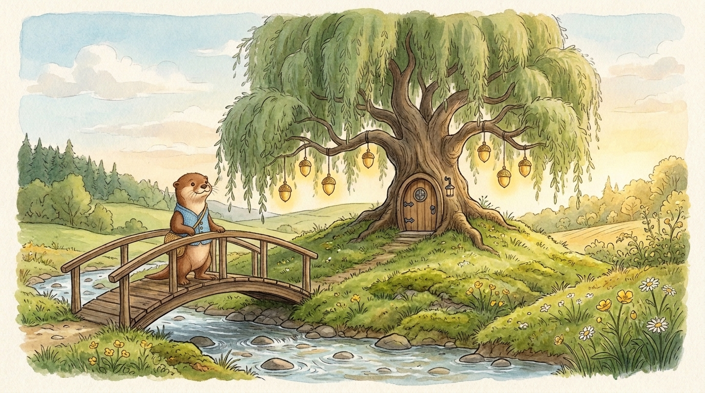

Pippin Paddlepaw stood on the pine footbridge with his woven willow satchel, ready to gather the Seven Golden Acorns of Kindness before sunset.

### 2. Rosie Red-Hen's Flour Mill

Pippin followed the cobblestone lane until his pink nose gave a happy twitch—sniff, sniff! Something smelled like toasted oats, clover honey, and wild blueberries.

Outside a thatched cottage with yellow shutters stood Rosie Red-Hen in a crisp white baker's apron and a braided straw sun-bonnet. On her table sat a heavy sack of golden oat flour, a pitcher of meadow milk, a jar of honey, and a basket of blue huckleberries.

“Cluck, cluck, oh dear me! The Lantern Festival begins at twilight, and I have twenty-four honey-oat berry muffins to bake for our neighbors! Plus, I need to stack three neat bundles of dry birchwood beside the brick oven so the fire stays steady! Who will help me stack the wood and sift this oat flour?”

Up in an old apple tree, a sleepy dormouse yawned and pulled his leaf-cap over his whiskers. “Not I,” mumbled the dormouse, “my moss pillow is much too cozy!”

By the garden fence, a green bullfrog was practicing puddle-hops over a watering can. “Not I,” ribbited the bullfrog, “hopping is much more fun than sifting oats!”

But Pippin didn't wait to be asked twice. Remembering how the wisest builder in the tale of the Three Little Pigs always built things sturdy and right, Pippin trotted up to Rosie's table and rolled up his sky-blue waistcoat sleeves.

“I will help you, Miss Rosie! First I can stack the dry birchwood neatly beside your brick oven, and then my paws can sift every scoop of oat flour!”

“Bless your cheerful whiskers, Pippin! Two pairs of willing paws make every big job twice as merry!”

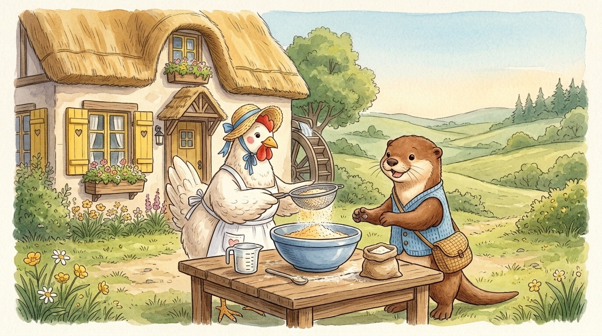

While the sleepy dormouse and hopping bullfrog said “Not I,” Pippin rolled up his sky-blue waistcoat sleeves to help Rosie Red-Hen right away.

### 3. Stirring the Sweet Berry Batter

Inside Rosie Red-Hen's sunlit kitchen, the brick oven glowed like a cozy orange campfire after Pippin stacked the birchwood neatly in its box.

First, Rosie showed Pippin how to shake the round wire sifter. Shika-shika-shake! Down drifted the fine oat flour like soft snow into the big blue ceramic bowl. Next, Rosie poured in the sweet milk and a ribbon of golden honey.

“Now comes the best part! Who will help me rinse the wild blueberries and fold them gently into the batter so they do not burst?”

Bramble Red-Squirrel popped his copper head through the open Dutch window, twitching his fluffy plume tail.

“Oh, Miss Rosie, I am the champion of eating warm muffins once they come out of the oven, but stirring batter makes my elbows tired! Save a big muffin for me, and I will be back when the timer rings!”

Pippin chuckled and picked up the carved wooden mixing spoon with both paws.

“I will stay right here until the last muffin is baked, Miss Rosie! Watch how gently I can fold the blueberries in!”

Together, Pippin and Rosie counted five slow circles with the wooden spoon: One, two, three, four, five! Swirl, fold, and scoop! They spooned the batter into twenty-four muffin cups and slid the pans into the warm oven.

> **🦦 Pippin’s Helper Refrain**
> “Step by step and paw by paw, the kindest things you ever saw! Pitching in makes work so sweet, soon we all will share a treat!”

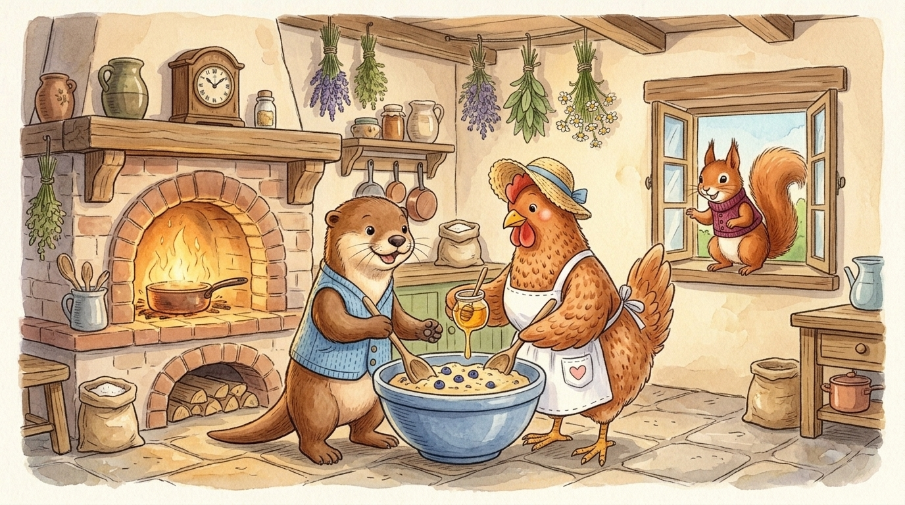

Together, Pippin and Rosie counted five slow circles with the wooden spoon—folding the sweet wild blueberries gently into the batter.

### 4. The First Golden Acorn Shines

Soon a delicious cloud of warm cinnamon and baked blueberries floated out the kitchen window. Ding-ling-ling went the brass oven timer!

Rosie lifted out twenty-four golden honey-oat muffins. Right away, the dormouse, the bullfrog, and Bramble Squirrel tiptoed back to the gate, looking down at their toes because they hadn't helped with a single scoop of flour.

“Pippin, because you stacked the wood, sifted the flour, and stirred the batter from start to finish, these muffins are yours to share however you think is best!”

“In the old storybooks, the Little Red Hen ate the bread by herself because nobody helped. But tonight is the Lantern Festival! Let's invite our friends to wash the mixing bowls, sweep the floor, and carry the baskets right now—and then everyone can earn a warm muffin together!”

How quickly the dormouse, the bullfrog, and Bramble cheered! They hurried inside to wash the bowl, dry the spoons, and sweep the floor clean before sharing a warm muffin.

As Pippin wiped the table, Rosie reached into her apron pocket and placed a polished brass acorn into Pippin's paw. Instantly, it lit up with a warm golden-amber glow!

> **🐔 Rosie Red-Hen’s Blessing**
> “Here is the First Golden Acorn, dear Pippin. Pitching in with willing hands turns everyday work into friendship.”

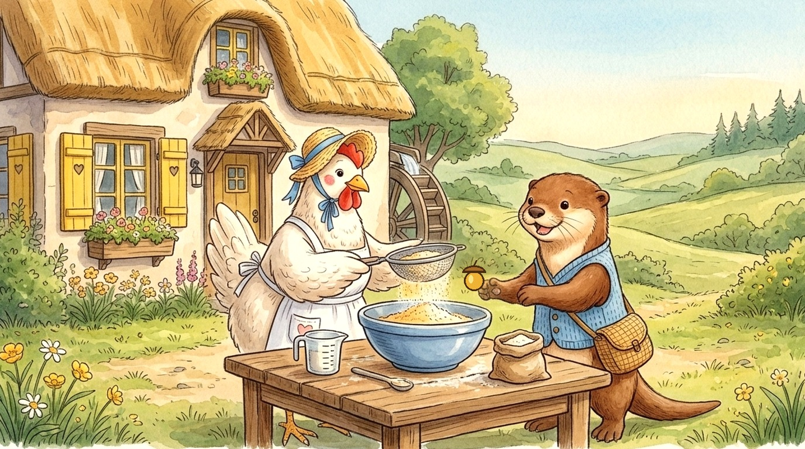

As Pippin wiped the table clean, Rosie placed the First Golden Acorn into his paw, where it shone with warm amber light.

---

## Chapter 2: Pebble by Pebble, Up Comes the Water
*Inspired by Aesop’s The Crow and the Pitcher — Patience and clever thinking solve big puzzles, one small pebble at a time.*

### 5. Clara Rook and the Tall Stone Pitcher

Tucking the first glowing acorn into his satchel, Pippin skipped down the flagstone path to the Whispering Stone Courtyard.

In the center of the courtyard grew a pot of golden star-lilies for the festival. Beside them stood Clara Rook, a sleek indigo bird wearing tiny half-moon brass spectacles and a yellow silk scarf.

Next to Clara stood a tall, narrow-necked terracotta pitcher. Clara was stretching her neck—tip-toe, stretch, peek!—trying to dip her watering cup inside, but her beak kept bumping the narrow clay rim.

“Caw, caw, oh fiddlesticks! Look at our golden star-lilies, Pippin—the sun has made their leaves droop, and they need a drink of spring water! There is cool water at the bottom of this tall pitcher, but the neck is too narrow for my wings, and my beak is three inches too short!”

“Let me try reaching in with my otter paw, Miss Clara!”

Pippin stood on tiptoe and reached his brown arm down into the pitcher. Wiggle, stretch, reach! His fingertips brushed the clay wall just above the water, still two inches short.

“Oh whiskers! My arm isn't long enough either! And if we tip this heavy clay pitcher over, it will crack on the flagstones and spill every drop! What can we do?”

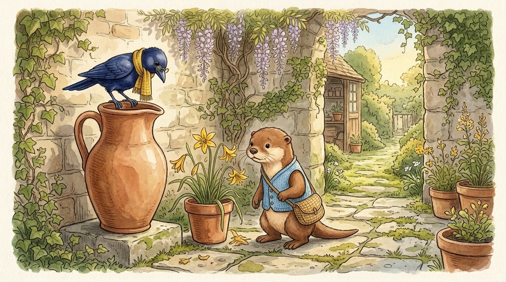

Cool spring water sparkled near the bottom of the tall terracotta pitcher, just out of reach of Clara’s beak and Pippin’s paw.

### 6. Pebble by Pebble, Up Comes the Water

Clara Rook adjusted her brass spectacles and tapped her wing thoughtfully.

“Wait a moment, Pippin! My grandmother told me the ancient fable of a clever crow who faced this exact puzzle! When a problem cannot be solved by pushing hard, we solve it with patience and our thinking caps! Look down beside the garden path. What do you see?”

All along the flowerbed lay dozens of smooth, clean grey and white river pebbles washed bright by the brook.

“Tell me, Pippin, when you step into your wooden bathtub at home, what happens to the water level?”

“It rises higher because I take up space at the bottom! Oh, Miss Clara, how clever! If we drop these smooth river pebbles gently into the pitcher one by one, they will sink to the bottom and push the cool water right up to the top!”

Let's count with Pippin and Clara as they drop the pebbles in!

> **🐦 The Pebble-Counting Song**
> “Plink! Plonk! Pebble number one, pebble number two! Up, up, up comes the water for me and you!”

Plink! went a white pebble from Clara's beak. Plonk! went a grey pebble from Pippin's paw. After six pebbles, Pippin peeked inside. The water had barely risen the width of a clover leaf.

“Miss Clara, we dropped six pebbles in, and the water is still way down low!”

“Never lose heart when a good plan starts slowly, Pippin! Great things happen by adding one small effort to another without giving up!”

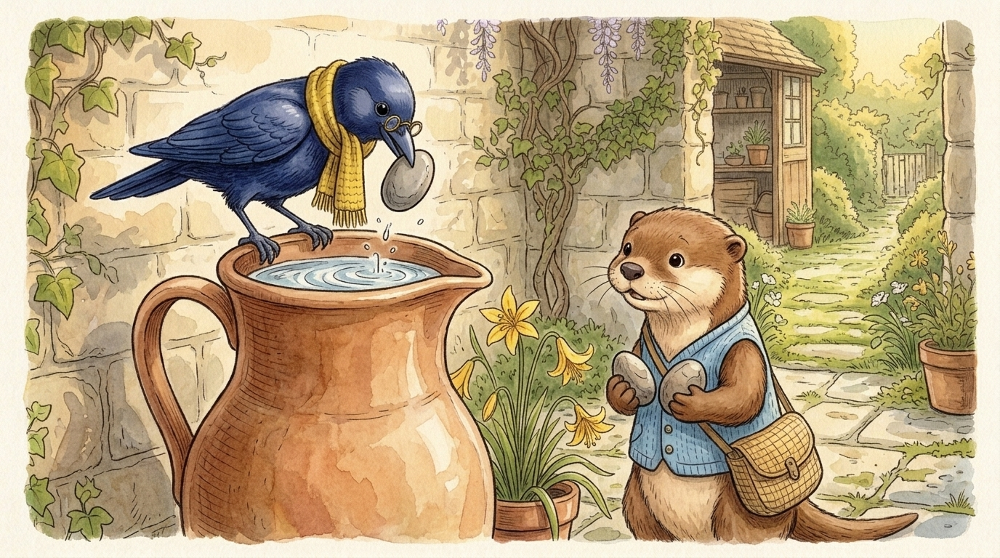

Plink! Plonk! One smooth river pebble at a time, Clara and Pippin dropped stones into the pitcher without giving up.

### 7. The Star-Lilies Bloom Again

Encouraged by Clara's words, Pippin filled his basket with smooth pebbles. Plink, plonk, ker-plink, ker-plonk! Six pebbles became fifteen. Fifteen became thirty!

With every smooth stone that settled at the bottom, the sparkling spring water climbed higher up the terracotta neck—halfway up, three-quarters up, until with the thirtieth smooth pebble—glug, shimmer, sparkle!—the cool water rose right to the very top rim!

“Hooray! Look, Miss Clara! The water climbed all the way to the top without spilling a drop!”

Clara dipped her brass watering cup and Pippin scooped with a gourd ladle, pouring the cool water around the roots of the golden star-lilies. Right away, the stems stood tall and opened their velvety yellow petals, filling the courtyard with a sweet lemon-blossom scent.

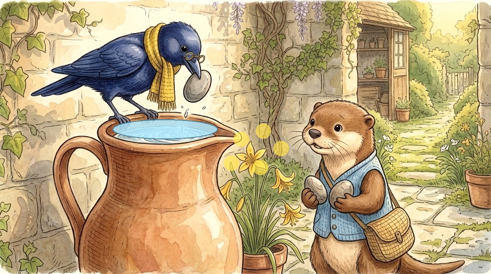

With the thirtieth smooth pebble, the cool spring water brimmed at the top rim and the golden star-lilies bloomed bright again!

### 8. The Second Golden Acorn

Clara Rook perched on the flower pot, her eyes twinkling behind her spectacles.

“You learned a wonderful secret today, Pippin. When a task looks too deep at first, patience and clever thinking lift you to the top, one small pebble at a time.”

From beneath her yellow scarf, Clara untied a second brass acorn and placed it into Pippin's paw, where it glowed with soft honey light!

> **🦦 Pippin’s Helper Refrain**
> “Step by step and paw by paw, the kindest things you ever saw! Pebble by pebble, slow and smart, patience fills a peaceful heart!”

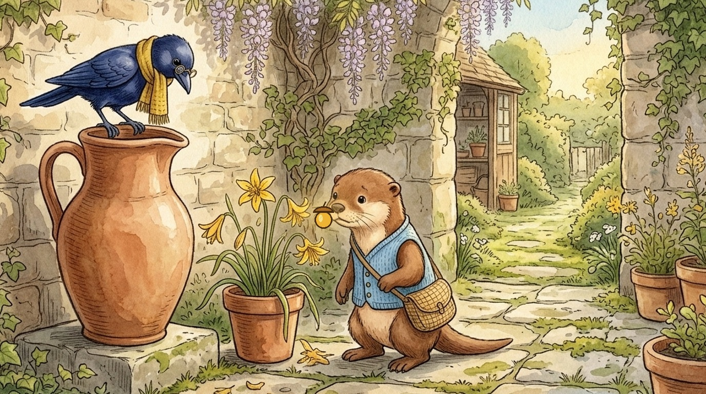

Clara Rook placed the Second Golden Acorn into Pippin’s satchel for solving the pitcher puzzle with patience and care.

---

## Chapter 3: Little Paws & Big Friends
*Inspired by Aesop’s The Lion and the Mouse — No friend is ever too small to help a big friend in need.*

### 9. Barnaby Badger and the Tangled Wheelbarrow

Around the bend of the fern lane, Pippin heard a deep sigh: Hoooo-humph, oh dear!

Standing beside a wooden wheelbarrow loaded with orange pumpkins and blackberry jam was Barnaby Badger in his green corduroy overalls and felt gardener's hat.

An hour earlier, while Barnaby was resting under a walnut tree, tiny Penny Harvest-Mouse had accidentally scurried across his boot. Like the generous lion in the fable of the Lion and the Mouse, kind Barnaby had tipped his hat and let little Penny pass safely by.

Now strong Barnaby was stuck! His wheelbarrow wheel had rolled into a tangle of tough green morning-glory ribbons that wrapped tightly around the narrow center axle between the wooden spokes!

“Oh, my stars, Pippin! My arms are strong enough to lift giant pumpkins and oak logs, but my big badger paws are much too wide to squeeze between these narrow wooden spokes! If I pull by brute strength, I will snap the spokes and spill all the festival jam!”

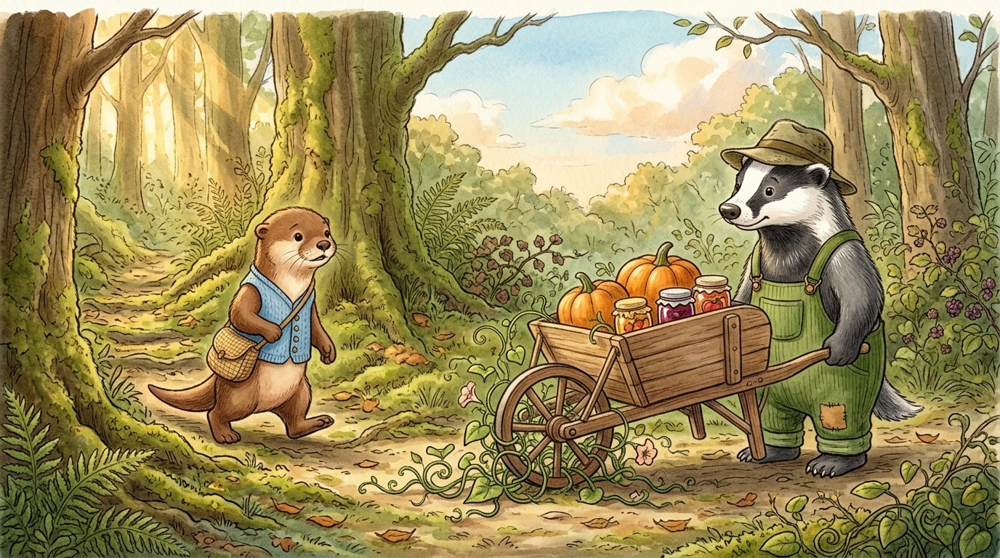

Strong Barnaby Badger could lift giant pumpkins, yet his big paws were too wide to reach between the narrow wooden wheel spokes.

### 10. Little Paws Do What Big Paws Cannot

Just then—rustle, squeak! Out from beneath a fern frond hopped tiny Penny Harvest-Mouse in her patchwork gingham pinafore!

“Look, Mr. Barnaby! Little Penny is here! Her tiny mouse fingers and my slender otter paws can slip right between the narrow wheel spokes where your big paws cannot fit!”

“Bless my brass buckles, little Penny! Can such tiny paws truly free a heavy wheelbarrow like mine?”

Penny nodded happily and hopped right through the spokes onto the center hub! Like a tiny sailor untying silk ribbons, Penny loosened the tightest inner honeysuckle loops—slip, unloop, untuck!—while Pippin unwound the outer tendrils and draped them back onto the garden trellis. In two minutes, the wheel spun free!

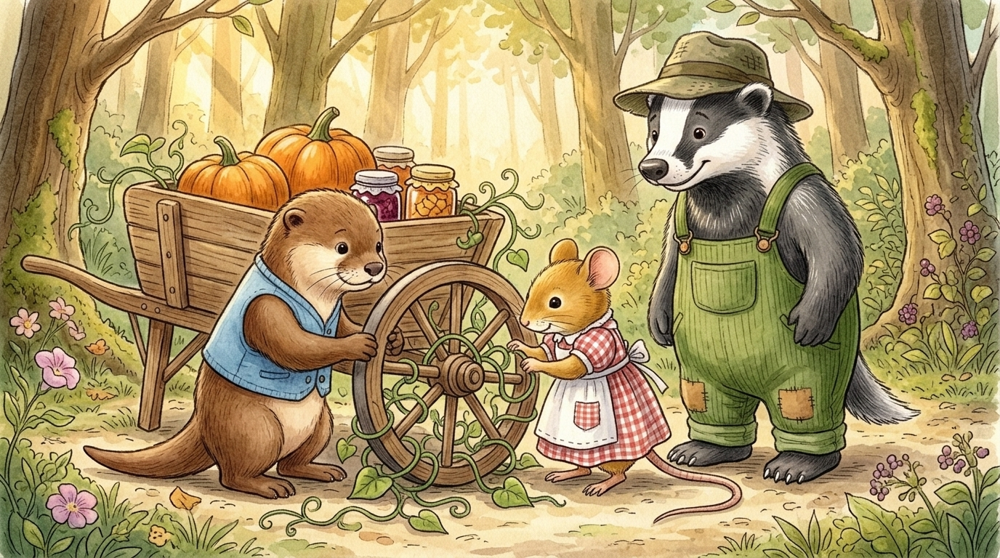

Slip, unloop, untuck! Tiny Penny Harvest-Mouse and Pippin untied the inner vine knots where big paws could not fit.

### 11. Big Paws Return the Favor at the Brook

Barnaby Badger clapped his striped paws with a joyful boom!

“Well, I never! The smallest mouse in the valley just rescued the strongest badger! Hop onto my wheelbarrow, Penny, and walk beside me, Pippin!”

When they reached the pebble brook crossing, a heavy mossy birch branch had tumbled across the narrow footpath. Little Penny and five-year-old Pippin pushed with all their might, but the heavy branch wouldn't budge!

“Aha!” smiled Barnaby, rolling up his corduroy sleeves. “Little paws did what big paws could not—now it is big paws' turn to help little paws!”

With one calm lift—heave-ho!—strong Barnaby lifted the heavy birch branch clean off the path and set it beside the bank as a mossy bench for the frogs!

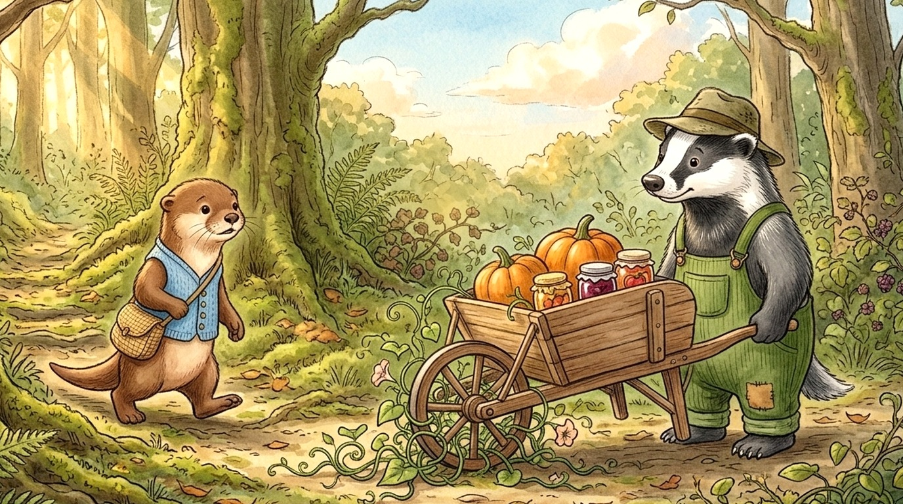

With one calm heave-ho, Barnaby Badger lifted the heavy mossy branch aside and turned it into a cozy bench by the brook.

### 12. The Third Golden Acorn

Across the bridge, Barnaby gave Penny a honey-clover tea cake and placed the Third Golden Acorn into Pippin's paws!

“Guard this third acorn well, Pippin. Today you and Penny proved that no friend is ever too small to offer a giant help, and no friend is ever too big to need a gentle hand.”

> **🦦 Pippin’s Helper Refrain**
> “Step by step and paw by paw, the kindest things you ever saw! Big or tiny, tall or small, kindness has a job for all!”

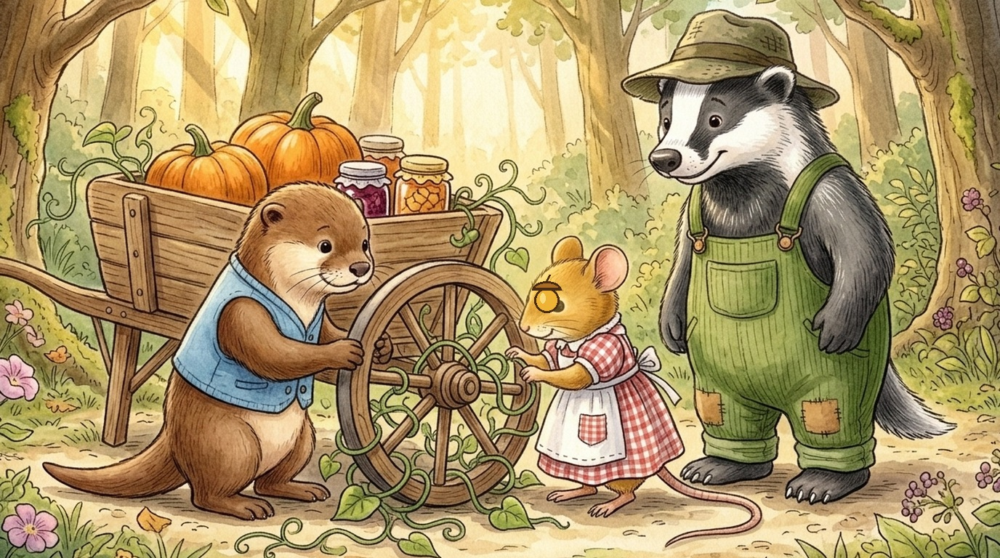

Barnaby Badger tipped his gardener’s hat and placed the Third Golden Acorn into Pippin’s paws.

---

## Chapter 4: Bramble Squirrel and the Honest Bell
*Inspired by Aesop’s The Shepherd Boy and the Wolf — Speaking the truth keeps our friends’ trust safe and bright.*

### 13. Bramble Squirrel's Silly Acorn Alarm

With three Golden Acorns glowing in his satchel, Pippin climbed up to the Sunny Oak Grove. High on an oak limb sat Bramble Red-Squirrel beside a huge wicker basket of shiny brown roasting-acorns.

The elders had given Bramble a shiny brass helper bell to ring ONLY if his heavy basket started to slip. But sitting in the quiet tree, Bramble felt fidgety and thought of a silly trick—just like the shepherd boy in the old fable.

“Ding-a-ling-a-ling! Help, everybody! My giant acorn basket is slipping off the branch! Hurry, hurry!”

Pippin, Barnaby Badger, and Rosie Red-Hen dropped their work and ran puffing up the steep hill!

“Hold on, Bramble! Our arms are ready to catch the basket! Where is it slipping?”

Up on the limb, the basket sat completely still, and Bramble giggled until his ears wobbled!

“Tee-hee-hee! Fooled you! My basket wasn't slipping at all! I just wanted to see how fast you could run!”

“Oh, Bramble,” said Rosie gently. “We ran up the hill because we trusted your bell. Never use a helper bell for a trick.”

Fifteen minutes later, Bramble got bored again and rang his bell a second time: “Ding-a-ling! A whirlwind is tipping my basket!” Kind Pippin and Barnaby ran back up—only to find Bramble giggling behind his tail again!

“Bramble, when you call false alarms twice in a row, your friends cannot tell when your words are real anymore.”

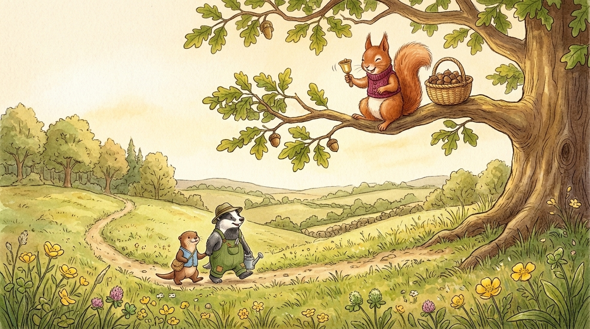

Twice in a row, Bramble rang his brass helper bell just for a silly trick, and his neighbors warned him how precious trust is.

### 14. When the Basket Really Tips Over

Twenty minutes later, Bramble stretched up on tiptoe to pluck one high acorn—and his heel accidentally bumped the heavy wicker basket!

Wobble, tilt, ker-plop! Down tumbled the basket onto the mossy bank below! Its lid popped open, and out poured two hundred brown acorns—roly-poly-zip!—hiding deep in the green clover and under the fern leaves!

> **🐿️ Bramble’s Real Call for Help**
> “Ding-a-ling-a-ling! Please help me! This time it is not a joke! The basket really tipped over, and all two hundred festival acorns are lost in the deep clover!”

Down in the valley, the neighbors heard the bell a third time. “That is just Bramble playing his trick again,” sighed the bullfrog, and nobody came up the hill. Poor Bramble sat beside his empty basket with his tail drooping and two warm teardrops on his whiskers.

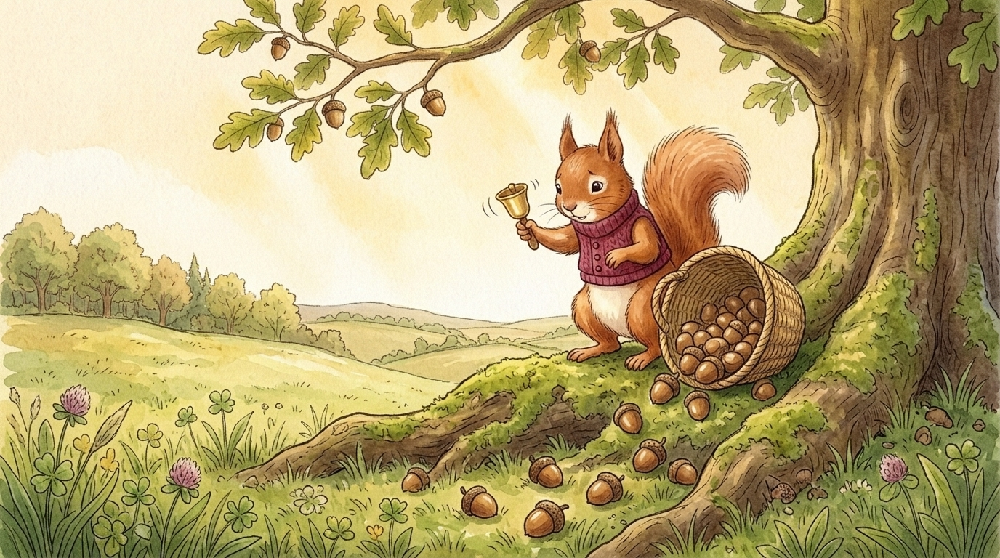

When the heavy wicker basket really tipped over and spilled two hundred acorns into the clover, nobody in the valley believed the third alarm.

### 15. Pippin Checks and Bramble Promises

Halfway down the trail, Pippin paused and listened carefully.

“Wait a second. The first two times Bramble called, I heard giggles in his voice. This time he sounds truly sorry. A good helper checks to make sure a friend is okay!”

Pippin trotted back up to the oak tree and saw the spilled acorns hiding in the clover.

“Oh, Pippin, you came! My basket really tipped over, and nobody believed my bell because I told two silly fibs! I broke my friends' trust! I put my paw right over my heart: from this day on, my word and my bell will always tell the one-hundred-percent truth!”

“Trust is like a warm lantern glass, Bramble—we keep it bright by always speaking the truth! Come on, let's find every acorn together!”

On their knees in the clover, Pippin and Bramble searched under every buttercup and fern, counting all two hundred shiny brown acorns back into the basket!

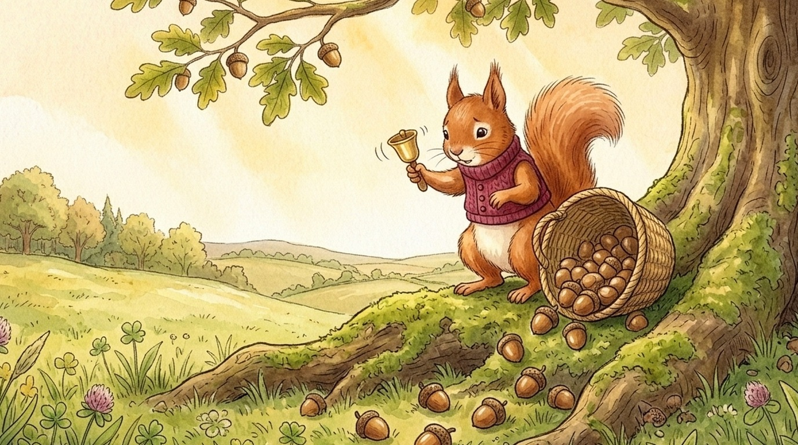

With his paw over his heart, Bramble promised to always speak the truth as he and Pippin gathered every last acorn from the clover.

### 16. The Fourth Golden Acorn

As Bramble fastened the basket latch, a fourth brass acorn resting at the center of the basket lit up with a clear, steady golden glow!

“Look, Pippin! The Fourth Golden Acorn woke up for your satchel! And I will carry this heavy basket down the hill myself to apologize to Miss Rosie and Mr. Barnaby!”

When Bramble apologized honestly down in the meadow, Rosie and Barnaby welcomed him right back with warm smiles!

> **🦦 Pippin’s Helper Refrain**
> “Step by step and paw by paw, the kindest things you ever saw! Honest words that ring so true make our friendships good as new!”

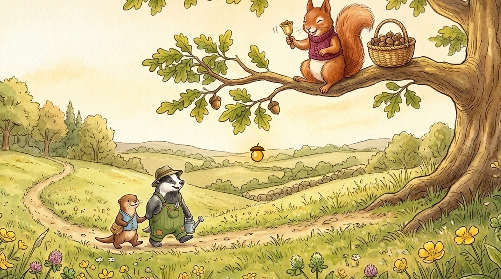

From the center of the refilled basket shone the Fourth Golden Acorn, celebrating an honest apology and a promise kept.

---

## Chapter 5: The Fiddle, the Pine-Cones & the Cozy Hearth
*Inspired by Aesop’s The Ants and the Grasshopper — Preparing a little bit early lets us share generously with friends when the cool breeze blows.*

### 17. Hopper Cricket's Merry Autumn Tune

Now the afternoon sun was dipping toward the western hills. Down in Maple Meadow, little Penny Harvest-Mouse was stacking dry pine-cones beside her hearth and filling jugs with warm spiced cider.

Perched on a polka-dotted toadstool nearby was Hopper Cricket in his emerald-green tailcoat, playing a merry jig on his tiny wooden fiddle: Zippity-zing, fiddle-dee-dee!

“What a lively tune, Hopper! The sun is sinking and the evening breeze will be chilly soon. Will you help Penny and me stack just one basket of dry pine-cones before the dew falls?”

“Oh, pshaw, Pippin!” laughed Hopper Cricket. “The sun is still warm on my wings! Stacking pine-cones is for later—right now my fiddle wants to dance!”

“In the fable of the Ants and the Grasshopper, the grasshopper forgot to prepare while the sun was shining! Ten minutes of helping now will keep us warm tonight!”

But Hopper kept leaping from toadstool to daisy while Pippin and Penny gathered two extra baskets of dry pine-cones and sweet chestnuts.

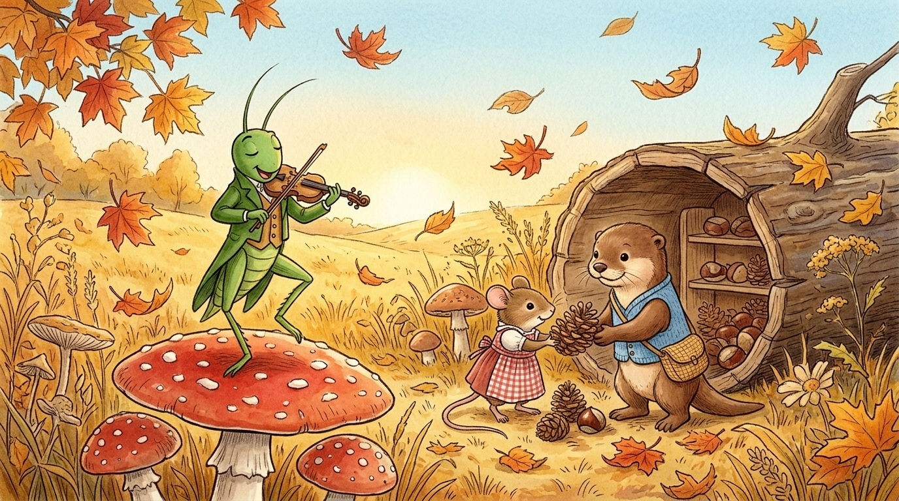

While Hopper Cricket danced and fiddled in the afternoon sunshine, Penny Harvest-Mouse and Pippin gathered extra dry pine-cones and sweet chestnuts.

### 18. The Cool Evening Breeze Arrives

Soon the sun slipped behind Clover Ridge. Whooooosh-shiver! A crisp twilight breeze swept across Maple Meadow, and silver dew dampened all the remaining pine-cones in the field.

Hopper Cricket stopped playing. His wings shivered—brrrr!—and his tummy rumbled. Every pine-cone left outside was wet with dew, and he hadn't packed a sweater or supper! Across the lane, warm amber light glowed from Penny's hollow-log cottage. Tucking his fiddle under his arm, Hopper gave a polite tap-tap-tap on the oak door.

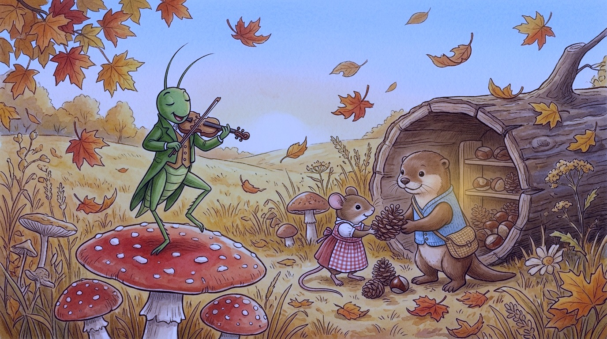

When the cool twilight breeze arrived and dampened the meadow with dew, chilly Hopper Cricket knocked politely at Penny’s warm hollow-log cottage.

### 19. Warm Cider, Preparation, and Sharing

Penny and Pippin opened the door wide.

“Oh, Penny and Pippin,” whispered Hopper softly. “You prepared while the sun shone, and I only danced. Now the chill is here and my basket is empty.”

“Come right inside by the hearth, Hopper! Because Penny and I gathered extra pine-cones and brewed extra spiced cider while the sun was shining, we have plenty to share with a friend who has learned his lesson!”

Wrapped in a warm wool shawl with a mug of cinnamon cider, Hopper beamed with gratitude.

“Thank you both! Tomorrow morning, before I play a single note, I will gather three full baskets of dry kindling! And right now, let me help load the cider jugs onto the festival cart and play a cheerful marching song as we pull it up the hill!”

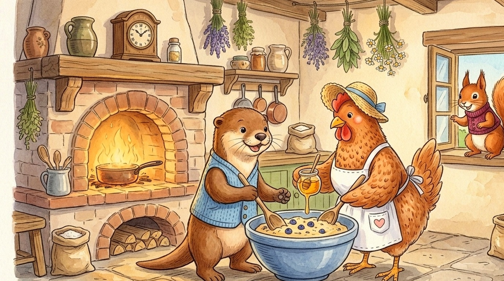

Wrapped in a cozy wool blanket with warm spiced cider, Hopper promised to gather kindling first thing every morning before playing his fiddle.

### 20. The Fifth Golden Acorn

As Hopper helped load the cart, the fifth brass acorn on Penny's mantelpiece blossomed with rich golden radiance! Penny and Hopper placed it into Pippin's satchel.

> **🦦 Pippin’s Helper Refrain**
> “Step by step and paw by paw, the kindest things you ever saw! First prepare and do your part, then share with a joyful heart!”

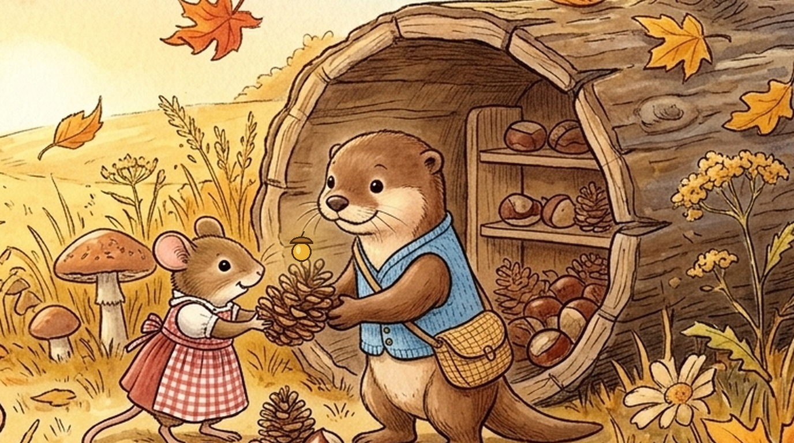

Beside the glowing hearth, Penny Harvest-Mouse and Hopper Cricket placed the Fifth Golden Acorn into Pippin’s paws.

---

## Chapter 6: Steady Steps & Gentle Sunbeams
*Inspired by Aesop’s The Hare and the Tortoise and The North Wind and the Sun — Steady steps and gentle warmth succeed where rushing and bluster fail.*

### 21. Tilly Terrapin, Dash Jackrabbit, and the Hilltop Trail

At the bottom of Willow Hill stood Dash Jackrabbit in his striped runner's sash and wise Tilly Terrapin in her lavender shawl, holding the final two unlit brass acorns inside glass lanterns.

“Look how tiny your steps are, Miss Tilly!” laughed Dash Jackrabbit, bouncing like a rubber ball. “With my speedy jackrabbit bounds, I will reach the Grand Willow Tree in two shakes of a cottontail! Watch me zoom—one, two, three, go!”

Boing-whoosh! Off bounded Dash up the hill!

“Let him bounce, dear Pippin,” smiled Tilly calmly. “When carrying a precious lantern, rushing makes us stumble, but calm, steady steps always reach the top safely. Will you walk steadily beside me?”

“Yes please, Miss Tilly! Left paw, right paw, breathing slow and deep!”

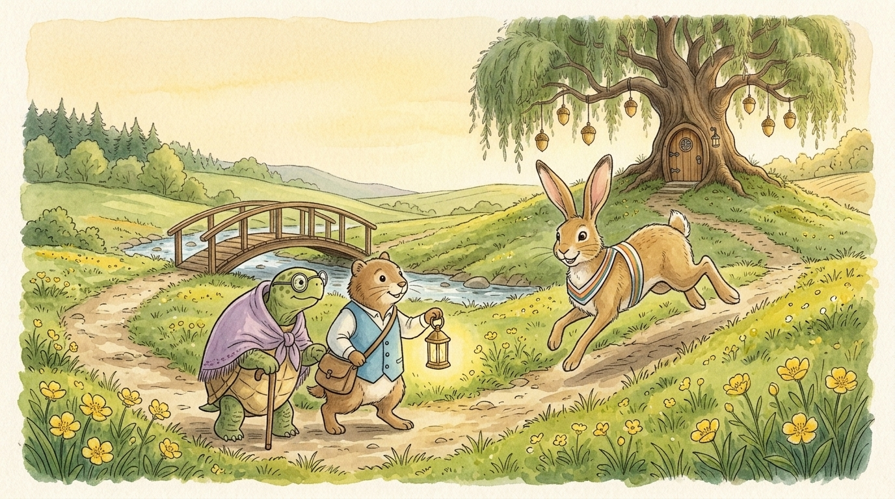

While Dash Jackrabbit zoomed ahead in giant bounds, Tilly Terrapin and Pippin walked calmly step by step carrying the precious lantern.

### 22. Slow and Steady Passes the Snoozing Hare

Halfway up the trail, Dash Jackrabbit looked back and yawned. “I am so far ahead of slow little Tilly that I can take a cozy nap in this warm clover patch and still win!” Within seconds, Dash was fast asleep—zzzzzz-whiffle-zzzzzz!

Up the winding trail came Tilly and Pippin: Step, breathe, smile! When they reached the sleeping jackrabbit, kind Pippin spread a warm maple-leaf quilt over Dash's shoulders so he wouldn't get chilled, and whispered:

“When we reach the top, we will ring the welcome chime so Dash wakes up in time to celebrate with us!”

“That is a true winner's heart, Pippin. Slow and steady reaches the goal, and kindness brings every friend along!”

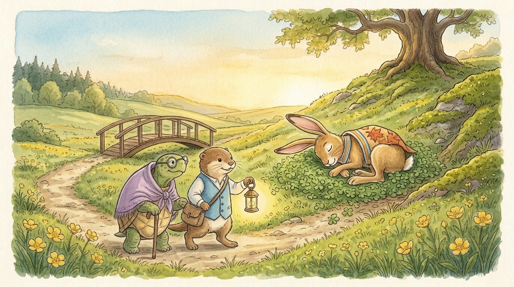

Slow and steady, Tilly and Pippin walked past the snoozing jackrabbit—tucking a maple-leaf quilt over his shoulders so he stayed warm.

### 23. The Breeze and the Golden Sunbeam

Step by steady step, Tilly and Pippin reached the summit beneath the Grand Willow Tree, and the sixth brass acorn lit up with a serene golden glow! Dash Jackrabbit woke up at the chime and bounded up the last steps, blushing and thanking them for the leaf blanket.

Above the tree, Little North Breeze—a puffy silver cloud—wanted to open the wooden lantern shutters by force, just like in the fable of the North Wind and the Sun! He blew a noisy gust—whooooosh!—but the willow shutters only latched tighter against the cold wind!

Then the Golden Setting Sun smiled from the horizon and poured a soft, loving golden sunbeam over the hilltop. Feeling that gentle warmth, Little North Breeze relaxed, the wooden lantern shutters opened like blooming flowers, and the seventh brass acorn burst into radiant starlight!

> **🐢 Tilly Terrapin’s Wisdom**
> “Look at that wonder, Pippin. Loud bluster makes the world close up tight, but gentle warmth and kindness open every heart.”

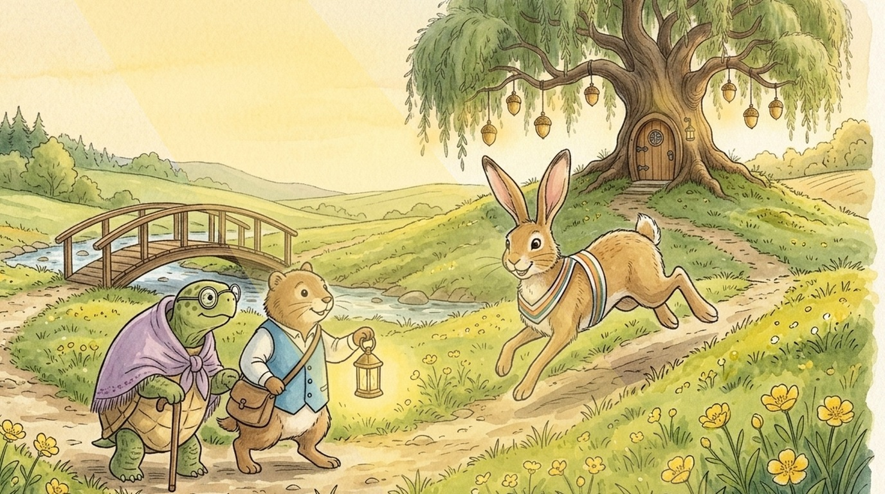

Where the noisy wind could not force the shutters open, a gentle golden sunbeam warmed the willow boughs and lit the Seventh Golden Acorn!

### 24. The Grand Willow Lantern Festival Under the Stars

Up the hillside arrived Rosie Red-Hen, Clara Rook, Barnaby Badger, Bramble Squirrel, Penny Harvest-Mouse, and Hopper Cricket! Together with Pippin, they hung all Seven Golden Acorns inside the glass lanterns on the Grand Willow Tree. Let's count them from one to seven!

> **🌟 Counting the Seven Golden Lanterns**
> “Lantern One for pitching in with Rosie Red-Hen! Lantern Two for patient pebble-thinking with Clara Rook! Lantern Three because no friend is too small to help with Barnaby and Penny! Lantern Four for speaking the honest truth with Bramble! Lantern Five for preparing ahead and sharing with Hopper! Lantern Six for walking slow and steady with Tilly! And Lantern Seven for choosing gentle warmth like the Golden Sun!”

Shimmer... glow... twinkle! All seven lanterns lit the twilight sky! Beneath the glowing willow boughs, the friends sat on soft patchwork quilts, sharing warm blueberry muffins and spiced cider while Hopper played a dreamy lullaby on his fiddle.

Five-year-old Pippin Paddlepaw curled up between Barnaby Badger and Tilly Terrapin. He took a slow, cozy breath, let his eyelids grow heavy, and whispered his bedtime rhyme:

> **🌙 Pippin’s Bedtime Goodnight**
> “Step by step and paw by paw, the kindest day you ever saw. Seven lanterns, warm and bright, whisper to the woods... goodnight.”

And as the golden lanterns swayed in the starry night, all of Whispering Willows Valley smiled, closed their eyes, and drifted off into the sweetest sleep. Goodnight, little helper. The End.

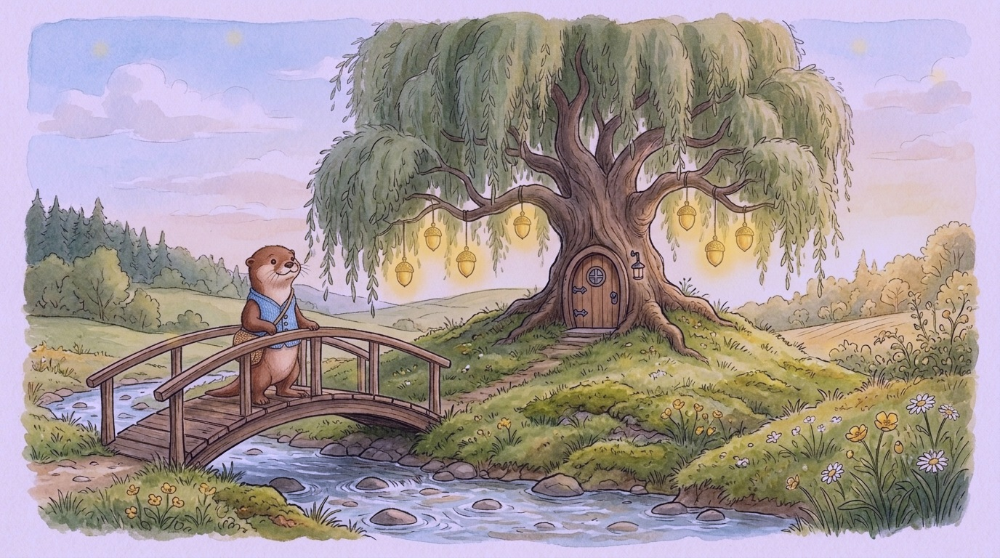

Beneath the seven glowing Golden Acorn lanterns, Pippin Paddlepaw and all his woodland friends shared warm muffins and drifted off to sleep under the stars.
