# Sleeping Beauty

A Brothers Grimm tale • A bedtime story about a wished-for princess, thirteen wise women, a hedge of thorns, and a hundred years’ sleep.

Source: https://seiyaku.com/lit/grimm/en/050.html

## 1. The Wish

In times past there lived a king and queen who said to each other every day of their lives, “Would that we had a child!” and yet they had none. But it happened once that when the queen was bathing, a frog came out of the water, squatted on the ground, and said to her, “Thy wish shall be fulfilled; before a year has gone by, thou shalt bring a daughter into the world.”

Thy wish shall be fulfilled; before a year has gone by, thou shalt bring a daughter into the world.

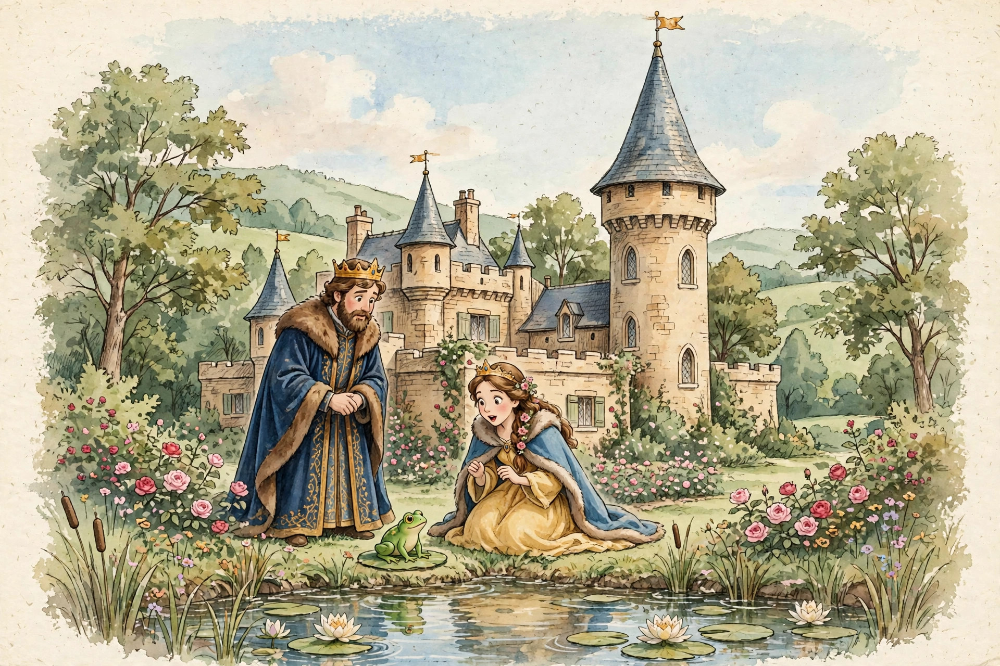

A wish at last: the frog promises the king and queen a daughter within the year.

## 2. A Daughter Is Born

And as the frog foretold, so it happened, and the queen bore a daughter so beautiful that the king could not contain himself for joy, and he ordained a great feast. Not only did he bid to it his relations, friends, and acquaintances, but also the wise women, that they might be kind and favourable to the child.

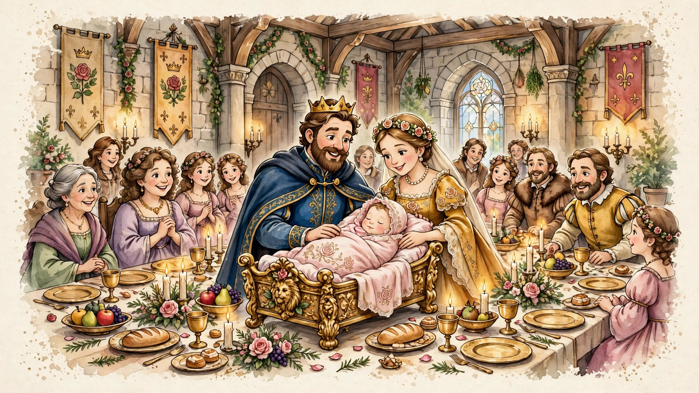

Rosamond is born, and the king ordains a great feast.

## 3. The Wise Women’s Gifts

The feast was celebrated with all splendour, and as it drew to an end, the wise women stood forward to present to the child their wonderful gifts: one bestowed virtue, one beauty, a third riches, and so on, whatever there is in the world to wish for.

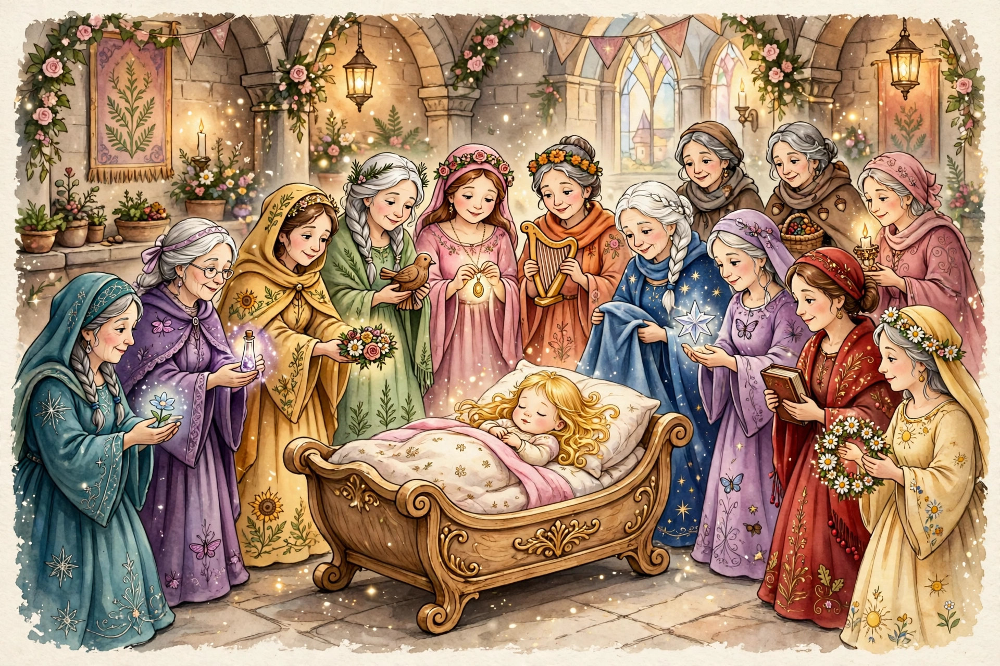

Virtue, beauty, riches: the wise women bless the baby.

## 4. Twelve Golden Plates

There were thirteen wise women in his kingdom, but as the king had only provided twelve golden plates for them to eat from, one of them had to be left out. And when eleven of them had said their say, the feast hall fell quiet, for everyone felt that something was missing.

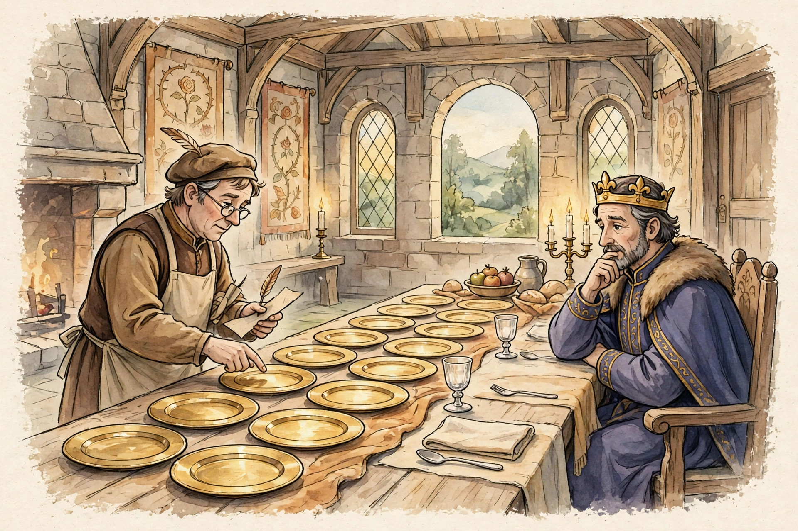

Thirteen wise women, but only twelve golden plates.

## 5. The Twelfth Gift

Then in came the uninvited thirteenth, burning to revenge herself, and without greeting or respect she cried with a loud voice, “In the fifteenth year of her age the princess shall prick herself with a spindle and shall fall down dead.” Everyone was terrified, when the twelfth came forward, for she had not yet bestowed her gift, and though she could not do away with the evil prophecy, yet she could soften it, so she said, “The princess shall not die, but fall into a deep sleep for a hundred years.”

The princess shall not die, but fall into a deep sleep for a hundred years.

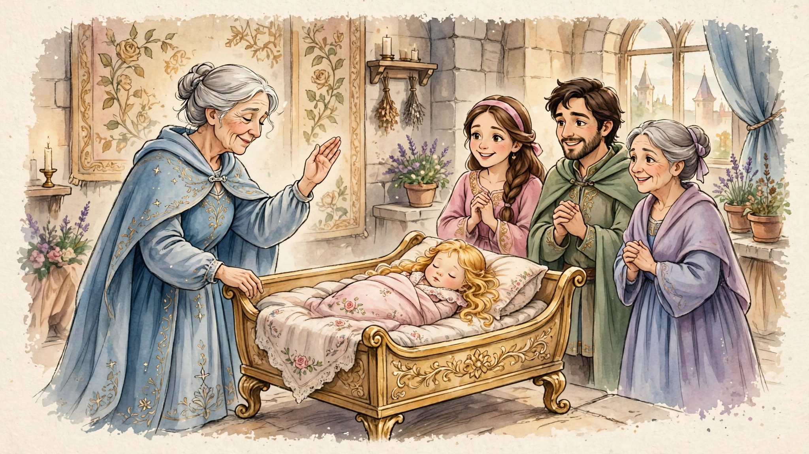

The curse is spoken, and the twelfth gift softens it to a hundred years’ sleep.

## 6. The Spindles Burn

Now the king, being desirous of saving his child even from this misfortune, gave commandment that all the spindles in his kingdom should be burnt up.

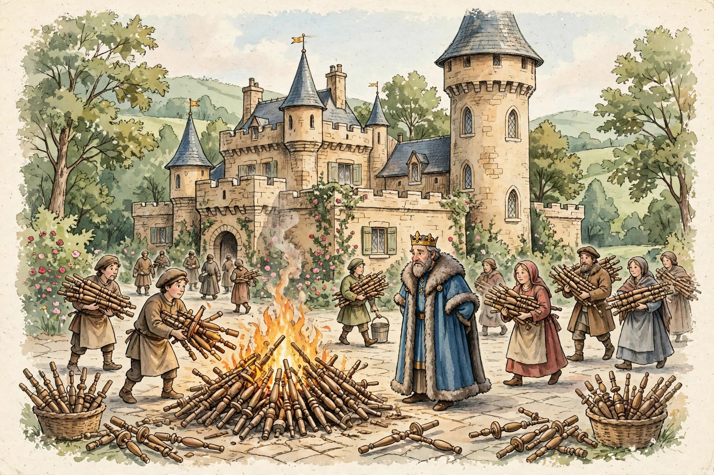

Every spindle in the kingdom is burnt.

## 7. Rosamond Grows Up

As the years passed, the maiden grew up, adorned with all the gifts of the wise women, and she was so lovely, modest, sweet, and kind and clever, that no one who saw her could help loving her.

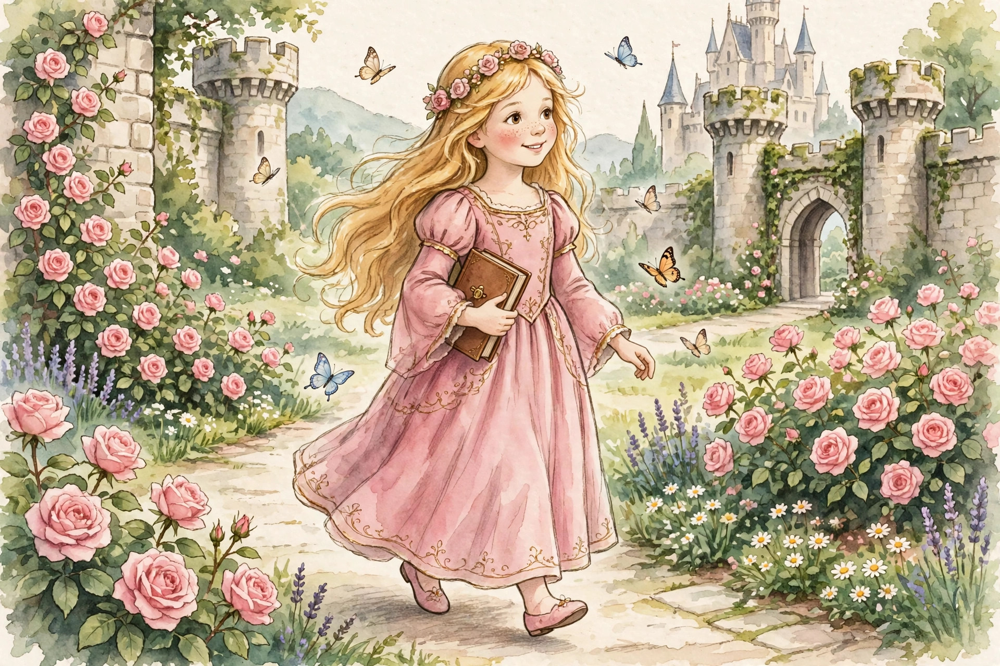

Lovely, modest, sweet, kind, and clever: Rosamond grows up.

## 8. The Old Tower

It happened one day, she being already fifteen years old, that the king and queen rode abroad, and the maiden was left behind alone in the castle. She wandered about into all the nooks and corners, and into all the chambers and parlours, as the fancy took her, till at last she came to an old tower. She climbed the narrow winding stair which led to a little door, with a rusty key sticking out of the lock; she turned the key, and the door opened, and there in the little room sat an old woman with a spindle, diligently spinning her flax.

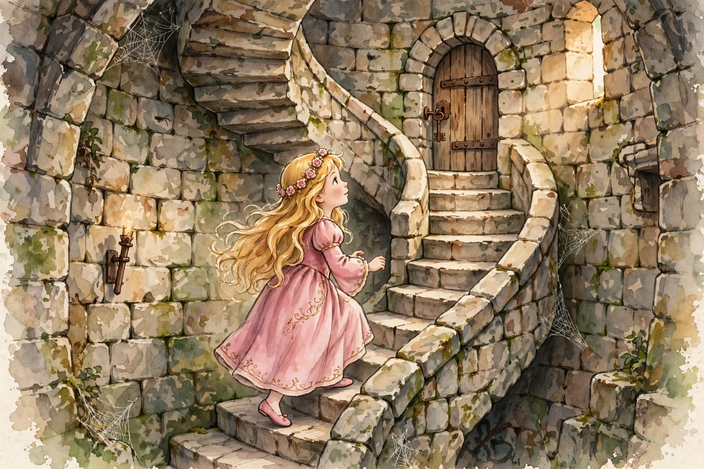

Alone in the castle, Rosamond finds the old tower.

## 9. The Deep Sleep

“Good day, mother,” said the princess, “what are you doing?” “I am spinning,” answered the old woman, nodding her head. “What thing is that that twists round so briskly?” asked the maiden, and taking the spindle into her hand she began to spin; but no sooner had she touched it than the evil prophecy was fulfilled, and she pricked her finger with it. In that very moment she fell back upon the bed that stood there, and lay in a deep sleep.

Good day, mother, what are you doing?

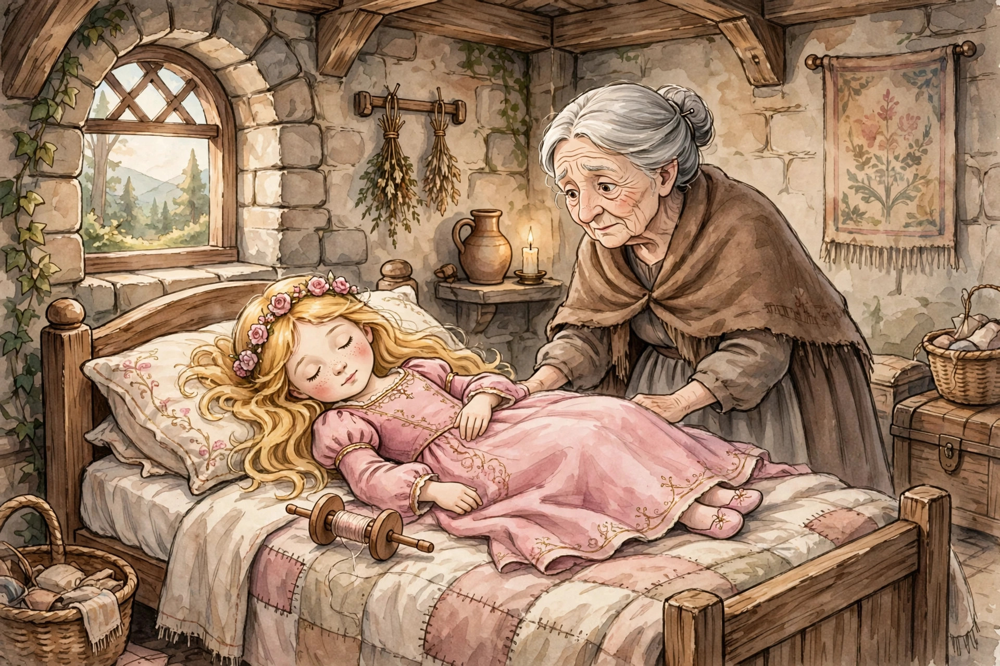

One touch of the spindle, and Rosamond falls into her deep sleep.

## 10. The Animals Sleep

And this sleep fell upon the whole castle. The horses in their stalls, the dogs in the yard, the pigeons on the roof, the flies on the wall, the very fire that flickered on the hearth, became still, and slept like the rest; and the meat on the spit ceased roasting. And the wind ceased, and not a leaf fell from the trees about the castle.

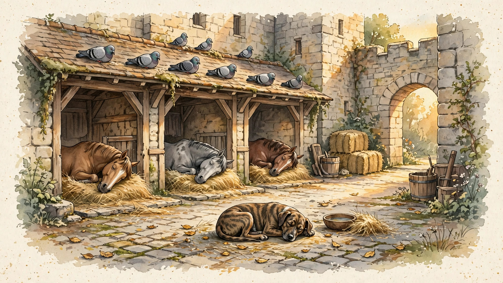

The sleep falls on the whole castle, even the animals.

## 11. The Thorn Hedge

Then round about that place there grew a hedge of thorns thicker every year, until at last the whole castle was hidden from view, and nothing of it could be seen but the vane on the roof.

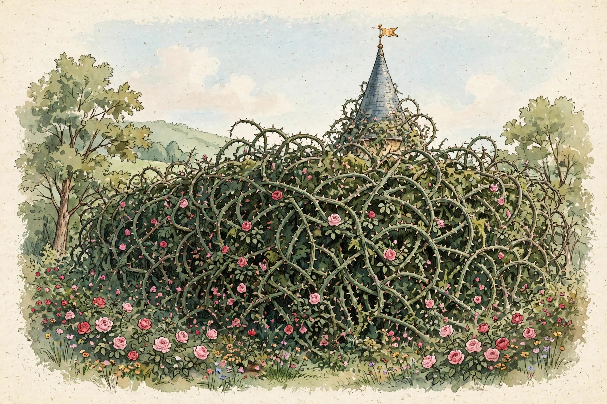

Year by year, the thorn hedge grows until it hides the castle.

## 12. The Rumour

And a rumour went abroad in all that country of the beautiful sleeping Rosamond, for so was the princess called; and from time to time many kings’ sons came and tried to force their way through the hedge; but it was impossible for them to do so, for the thorns held fast together like strong hands, and the young men could not get free.

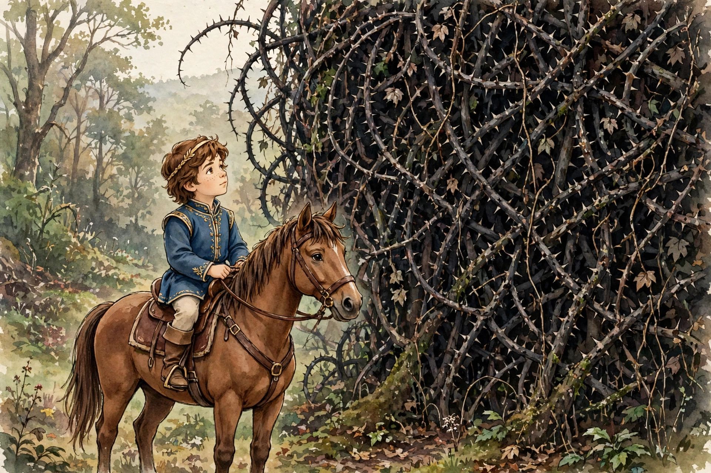

Princes come to try the hedge, but the thorns hold fast.

## 13. The Old Man’s Tale

Many a long year afterwards there came a king’s son into that country, and heard an old man tell how there should be a castle standing behind the hedge of thorns, and that there a beautiful enchanted princess named Rosamond had slept for a hundred years, and with her the king and queen, and the whole court. The old man had been told by his grandfather that many king’s sons had sought to pass the thorn-hedge, but had been caught and pierced by the thorns. Then said the young man, “Nevertheless, I do not fear to try; I shall win through and see the lovely Rosamond.”

Nevertheless, I do not fear to try; I shall win through and see the lovely Rosamond.

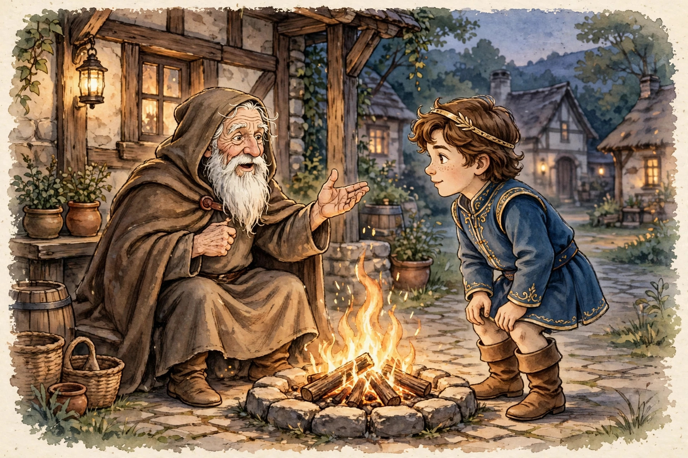

An old man tells the prince of the sleeping princess.

## 14. The Flowers Part

The good old man tried to dissuade him, but he would not listen to his words. For now the hundred years were at an end, and the day had come when Rosamond should be awakened. When the prince drew near the hedge of thorns, it was changed into a hedge of beautiful large flowers, which parted and bent aside to let him pass, and then closed behind him in a thick hedge.

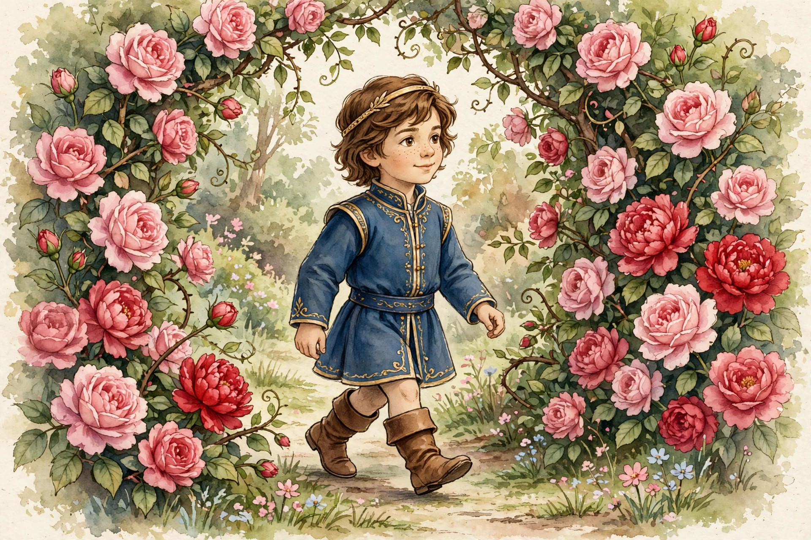

The hundred years are at an end, and the thorns turn to flowers.

## 15. The Sleeping Courtyard

When he reached the castle-yard, he saw the horses and brindled hunting-dogs lying asleep, and on the roof the pigeons were sitting with their heads under their wings.

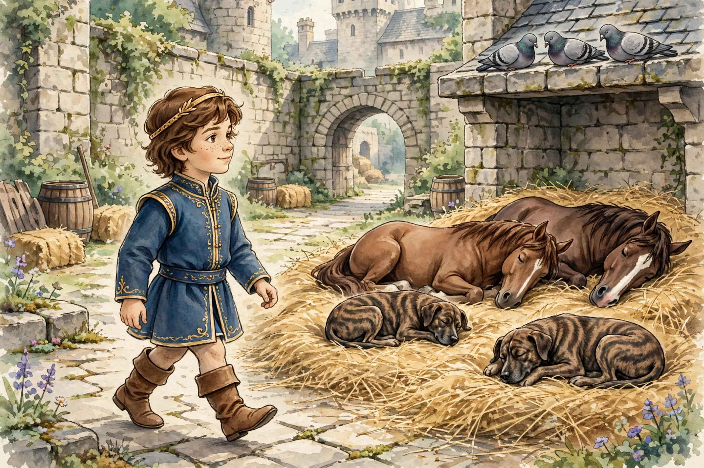

Inside at last: the courtyard lies asleep.

## 16. The Kitchen Asleep

And when he came indoors, the flies on the wall were asleep, the cook in the kitchen had his hand uplifted to strike the scullion, and the kitchen-maid had the black fowl on her lap ready to pluck. Then he mounted higher, and saw in the hall the whole court lying asleep, and above them, on their thrones, slept the king and the queen.

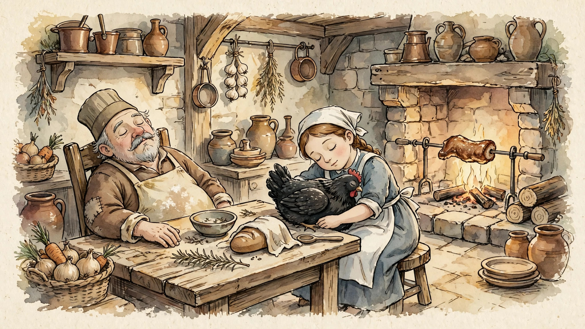

The kitchen sleeps, and above it the whole court on their thrones.

## 17. The Tower Room

And still he went farther, and all was so quiet that he could hear his own breathing; and at last he came to the tower, and went up the winding stair, and opened the door of the little room where Rosamond lay. And when he saw her looking so lovely in her sleep, he could not turn away his eyes; and presently he stooped and kissed her.

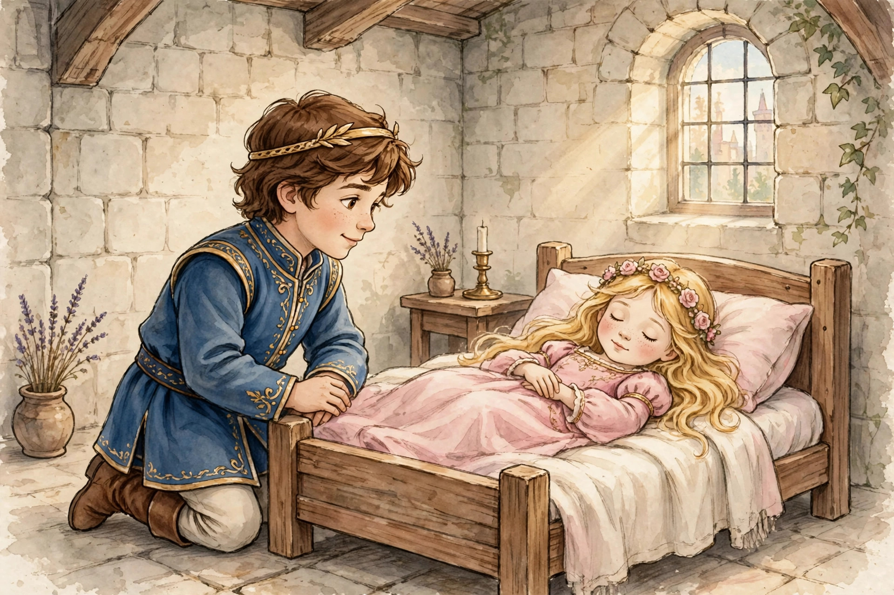

Up the winding stair, at last, to where Rosamond lies.

## 18. The Waking and the Wedding

And she awaked, and opened her eyes, and looked very kindly on him. And she rose, and they went forth together, and the king and the queen and whole court waked up, and gazed on each other with great eyes of wonderment. And the horses in the yard got up and shook themselves, the hounds sprang up and wagged their tails, the pigeons on the roof drew their heads from under their wings, looked round, and flew into the field, the flies on the wall crept on a little farther, the kitchen fire leapt up and blazed, and cooked the meat, the joint on the spit began to roast, the cook gave the scullion such a box on the ear that he roared out, and the maid went on plucking the fowl. Then the wedding of the Prince and Rosamond was held with all splendour, and they lived very happily together until their lives’ end.

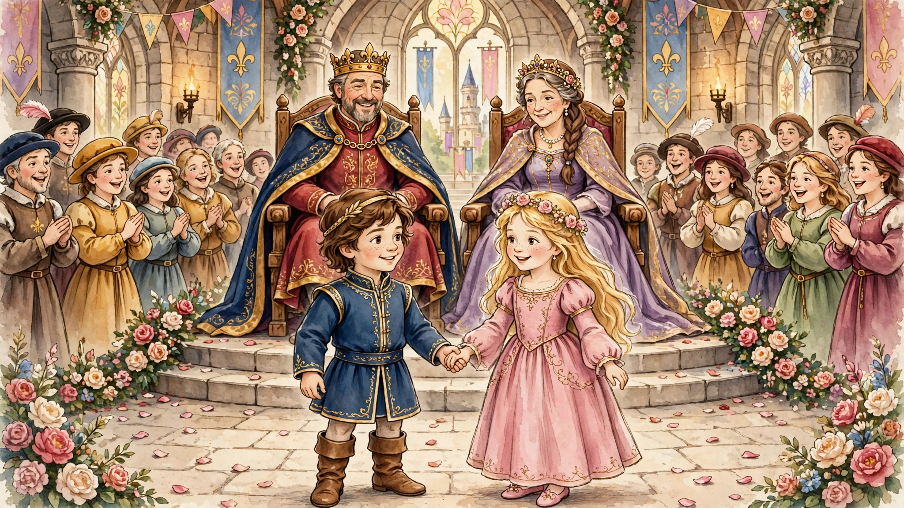

She wakes, the whole castle wakes, and the wedding is held with all splendour.
