# The Gift of the Magi

Adapted from O. Henry’s 1905 Christmas tale • A gentle family bedtime story about one dollar and eighty-seven cents, two treasured possessions, and the wisest gifts ever given.

Source: https://americanliterature.com/author/o-henry/short-story/the-gift-of-the-magi

## 1. One Dollar and Eighty-Seven Cents

One dollar and eighty-seven cents. That was all. And sixty cents of it was in copper pennies, saved one and two at a time whenever Della went to the grocer and the market. Three times Della counted the little stack of coins on the parlor table, and it was still one dollar and eighty-seven cents.

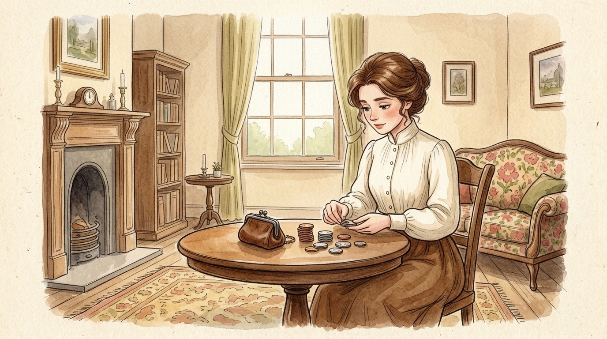

One dollar and eighty-seven cents — and sixty cents of it was in pennies, saved one and two at a time.

## 2. A Wistful Christmas Eve

The very next day would be Christmas. Della sat quietly on the little floral settee in their upstairs parlor and sighed a soft, wistful sigh. She loved her husband Jim with all her heart, and she wanted so much to buy him a wonderful Christmas present.

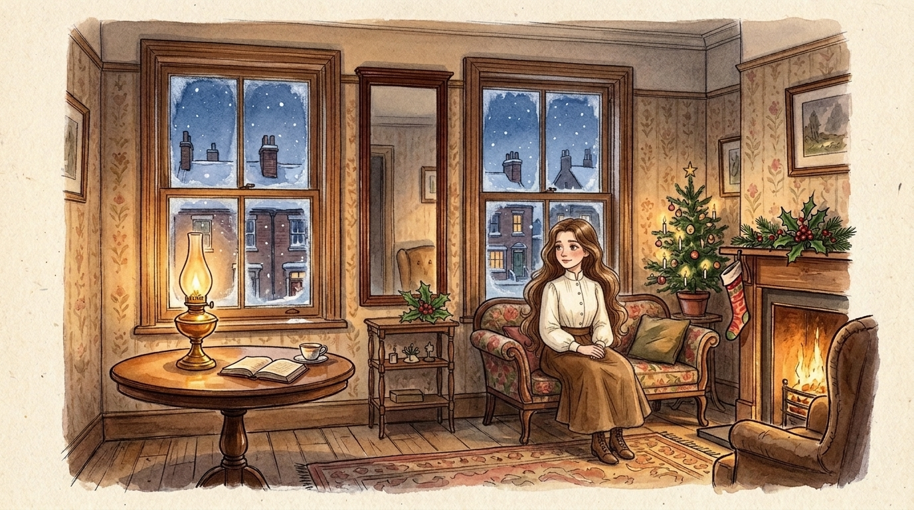

Tomorrow would be Christmas Day, and she had only one dollar and eighty-seven cents to buy Jim a present.

## 3. Home in the Little Flat

Della and Jim lived in a cozy, humble flat high up in an old brick house. Downstairs by the front door stood a tiny brass letter-box and a polished nameplate for James Dillingham Young. They did not have much money anymore, for Jim’s wages had grown smaller that winter. Yet every evening when Jim came up the stairs, Della met him at the door with the biggest, warmest hug in the world.

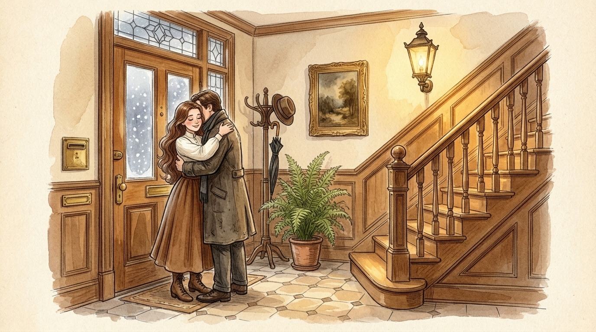

Whenever Jim came home and reached the stairs, he was called “Jim” and warmly hugged by Della.

## 4. By the Frosty Window

Della stood by the frosty parlor window and watched a fluffy grey cat walk along a snowy wooden fence in the yard below. For weeks she had dreamed of finding a gift for Jim that was fine, rare, and sterling — something truly worthy of her kind and hardworking husband. How could she ever find it for only one dollar and eighty-seven cents?

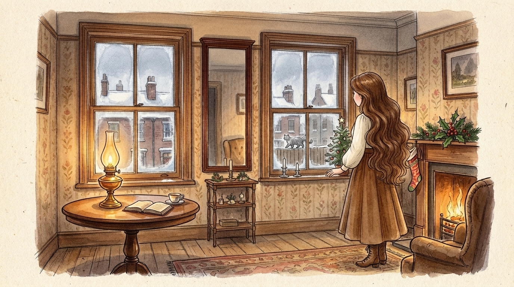

She stood by the window watching a grey cat on a snowy fence — dreaming of something fine and sterling for Jim.

## 5. The Two Great Treasures

Now, in Della and Jim’s house there were two treasures in which they both took a mighty pride. One was Jim’s shining gold pocket watch, which had belonged to his father and to his grandfather before him. The other was Della’s own glorious chestnut hair, which rippled and shone like a cascade of brown waters all the way past her waist.

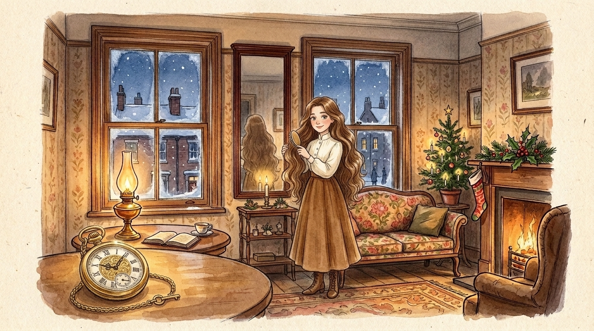

There were two treasures in which they both took a mighty pride: Jim’s gold pocket watch, and Della’s glorious brown hair.

## 6. A Sudden Bright Idea

All at once Della turned from the window and stood before the tall, narrow looking-glass between the windows. Her eyes shone with a sudden, bright idea! For one quiet moment she looked at her long, shimmering hair, and then she coiled it neatly back up. She buttoned on her warm old brown winter coat, tied on her little brown hat, and hurried down the stairs into the snowy street.

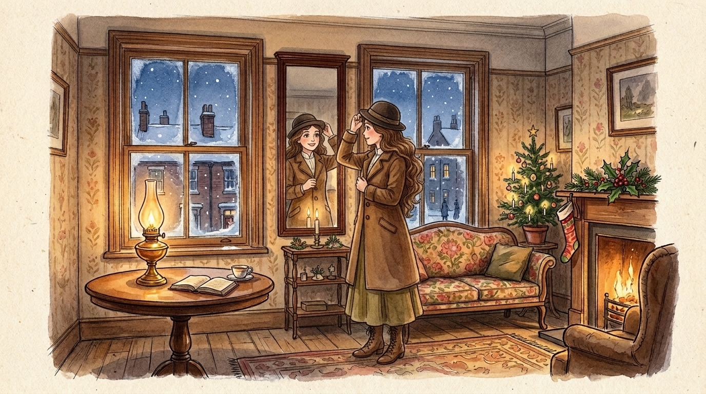

On went her old brown coat; on went her old brown hat. With a bright sparkle in her eyes, she hurried out the door.

## 7. Madame Sofronie’s Shop

Down the street Della hurried until she reached the neat shop of Madame Sofronie, who bought and sold fine hair goods of all kinds. Della stepped up to the wooden counter, took off her hat, and asked if Madame Sofronie would buy her long brown hair.

“Twenty dollars,” said Madame Sofronie kindly, admiring the rich brown tresses. — “Give it to me quick!” said Della with a brave smile.

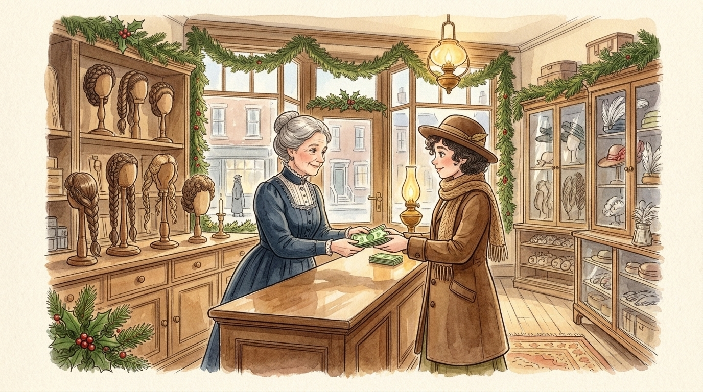

“Twenty dollars,” said Madame Sofronie kindly. “Give it to me quick!” said Della.

## 8. Searching the Christmas Shops

Now Della had twenty-one dollars and eighty-seven cents in her purse, and her hair was cropped short in soft little curls beneath her hat. The next two hours flew by as if on rosy wings! She went from shop to shop along the snowy avenues, peering into glowing Christmas windows to find the very best gift in the city for Jim.

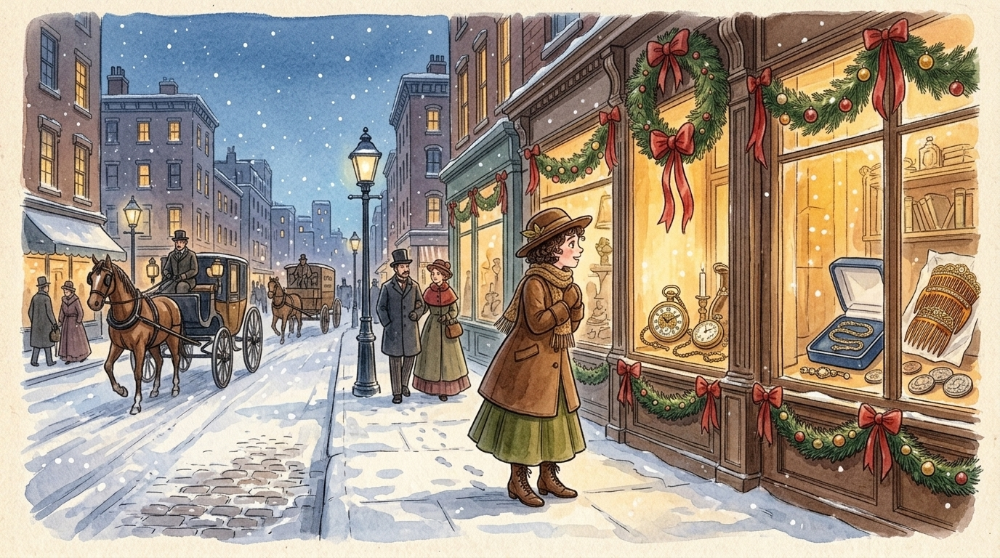

The next two hours flew by on rosy wings as Della searched the Christmas shops for Jim’s present.

## 9. The Platinum Watch Chain

At last she found it in a quiet jeweler’s shop. It was a braided platinum fob chain for a pocket watch — simple, strong, and shining, with no gaudy ornaments at all. It was quiet and genuine, just like Jim. As soon as Della saw it, she knew it belonged on Jim’s grand gold watch. She paid twenty-one dollars for the chain and hurried home with eighty-seven cents left in her pocket.

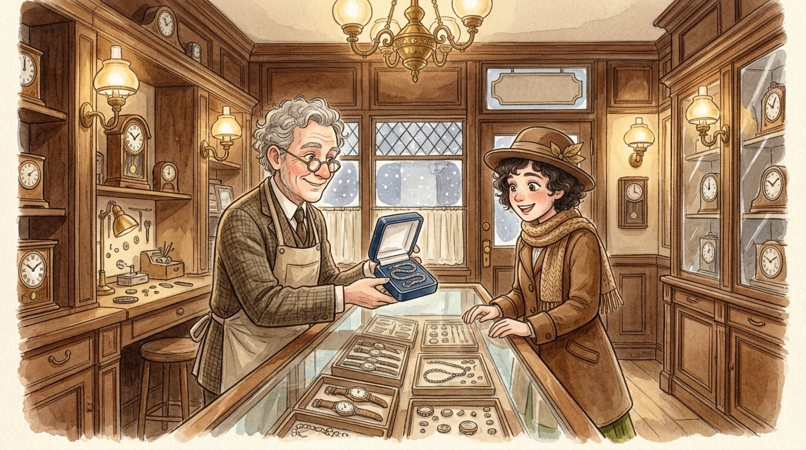

It was a braided platinum watch chain, simple and shining — as soon as she saw it, she knew it must be Jim’s.

## 10. Soft Little Curls in the Mirror

When Della reached home, she brushed and arranged her short hair before the looking-glass until her whole head was covered with tiny, soft ringlet curls. She looked into the mirror and smiled shyly. With her short curls, she looked almost like a cheerful little schoolboy! She wondered what Jim would say when he saw her.

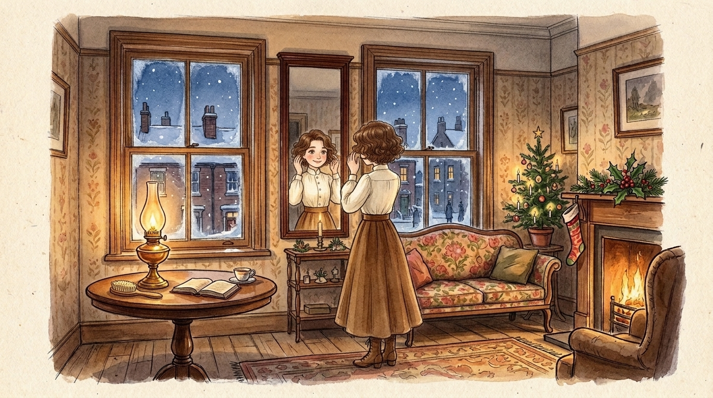

Soon her head was covered with soft, close-lying curls that made her smile shyly into the looking-glass.

## 11. Waiting for Jim’s Step

At seven o’clock the coffee was steaming on the stove, and supper was ready to cook. Jim was never late. Della folded the shining platinum watch chain in her hand and sat near the parlor door, listening to the sound of his boots coming up the stairs.

“Please, dear Lord,” she whispered softly, “make him think I am still pretty.”

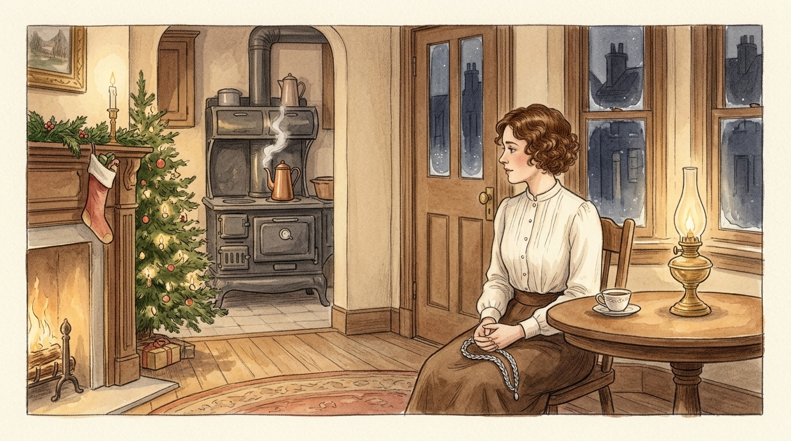

At seven o’clock the coffee was made, and Della sat near the door with the watch chain folded in her hand.

## 12. Jim Steps Inside

The door opened, and Jim stepped in out of the cold. He looked thin and tired in his worn brown overcoat, holding his hat in his ungloved hands and carrying a small paper-wrapped package under his arm. Then Jim stopped still by the door, his eyes wide with quiet wonder as he looked at Della’s short curls.

“You have cut off your hair?” asked Jim softly, as if he could hardly believe his eyes.

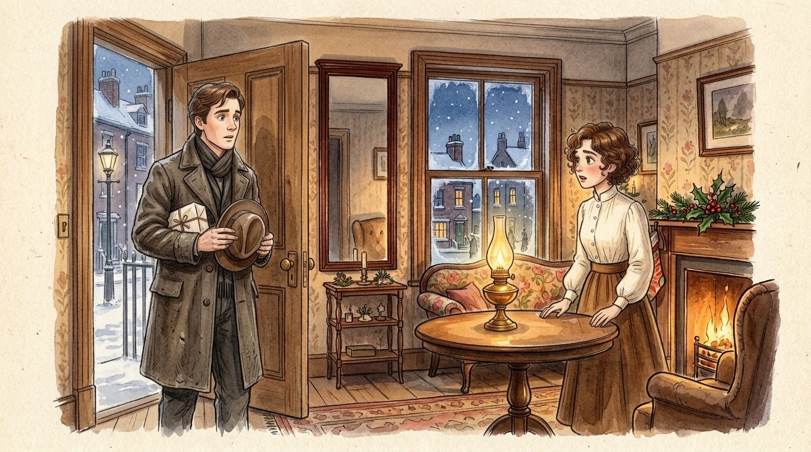

The door opened and Jim stepped in — stopping still as his eyes fixed in quiet wonder upon Della’s short curls.

## 13. “My Hair Is Sold and Gone”

Della ran across the room and took Jim’s hands.

“Jim, darling, don’t look at me that way! I had my hair cut off and sold it because I couldn’t have lived through Christmas without giving you a present. It’ll grow out again — and oh, Jim, wait till you see what I got for you!”

At that, a warm, gentle smile spread across Jim’s face. He wrapped his arms around his Della and hugged her close, telling her that no haircut in the world could ever make him love his girl any less. Then he took the little paper-wrapped package from his coat and laid it on the table.

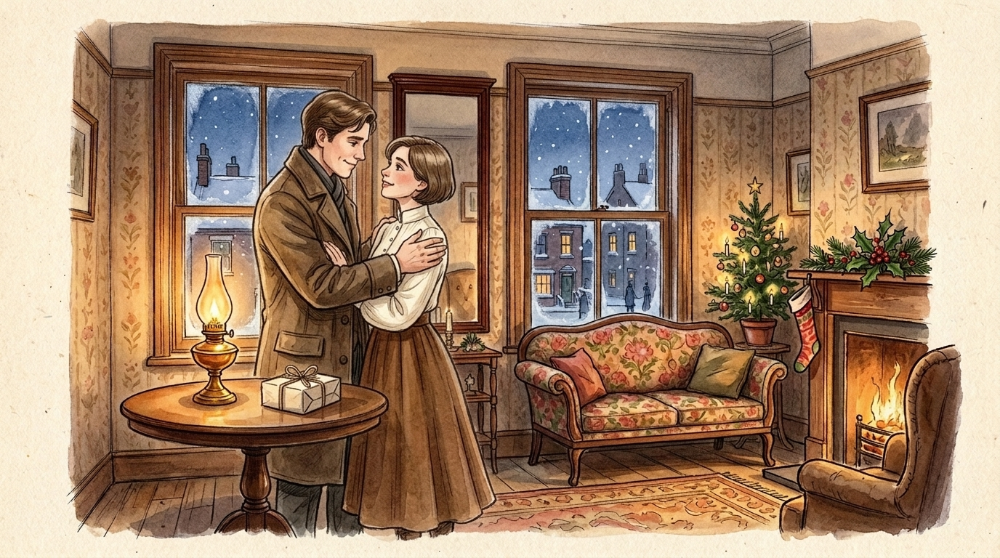

Jim woke from his surprise, wrapped his Della in a warm embrace, and laid a small package upon the table.

## 14. The Tortoiseshell Combs

Della untied the string and unfolded the white paper — and then she gave a little gasp of pure joy! Resting inside were The Combs: the set of three tortoise-shell hair combs with sparkling jeweled rims that she had admired for months in a shop window on Broadway. They were the exact warm shade to wear in her vanished chestnut hair. Della hugged them to her heart and looked up at Jim with shining eyes.

“Oh, they are so beautiful! And my hair grows awfully fast, Jim!”

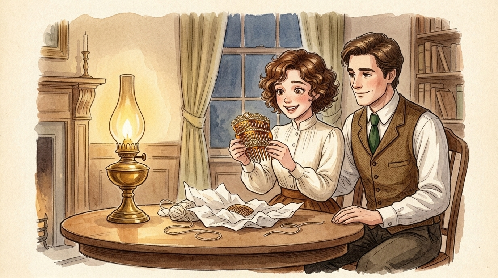

There lay The Combs — pure tortoiseshell with jeweled rims! “My hair grows awfully fast, Jim!”

## 15. Jim’s Secret Surprise

Then Della jumped up and held out her own gift in her open palm, where the braided platinum chain flashed like pale silver in the lamplight. She asked Jim for his gold watch so they could see how handsome it looked together. Instead of reaching into his pocket, Jim sat down on the floral settee, leaned back, and smiled the warmest smile of all.

“Dell, let’s put our Christmas presents away and keep them awhile. They’re too nice to use just at present. I sold the gold watch to get the money to buy your combs.”

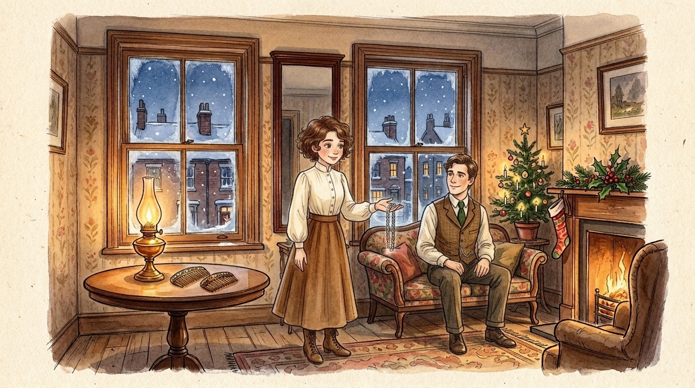

“Dell, let’s put our Christmas presents away and keep them awhile. I sold the watch to get the money to buy your combs.”

## 16. The Wisest Gift-Givers of All

Long ago, the Magi — the three wonderfully wise men — traveled beneath a bright star to bring the very first Christmas gifts. Some might say that Della and Jim were foolish to trade away the two greatest treasures of their house. Yet as they sat hand in hand in their warm little parlor while the snow fell outside, they had given each other something far greater than gold or jewels: their whole hearts. And of all who give and receive gifts anywhere in the world, such as they are the wisest. Everywhere they are the wisest. They are the Magi.

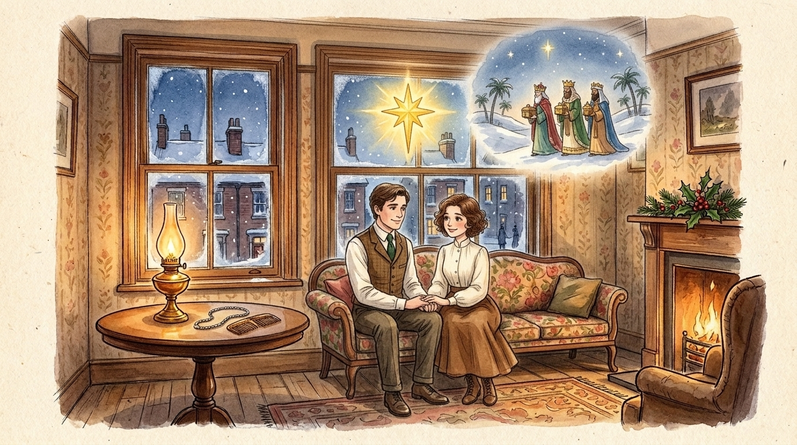

Of all who give and receive gifts, such as they are the wisest. Everywhere they are the wisest. They are the Magi.
