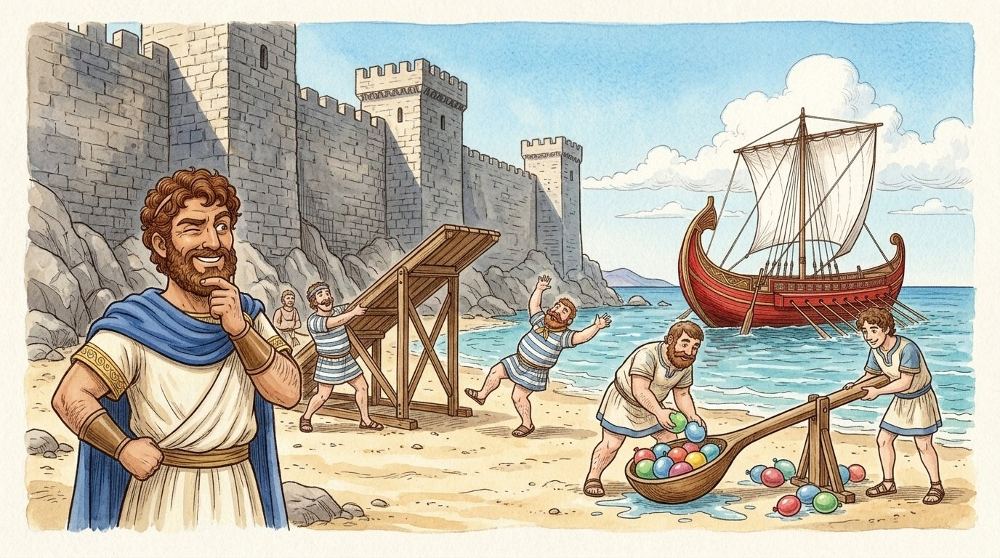
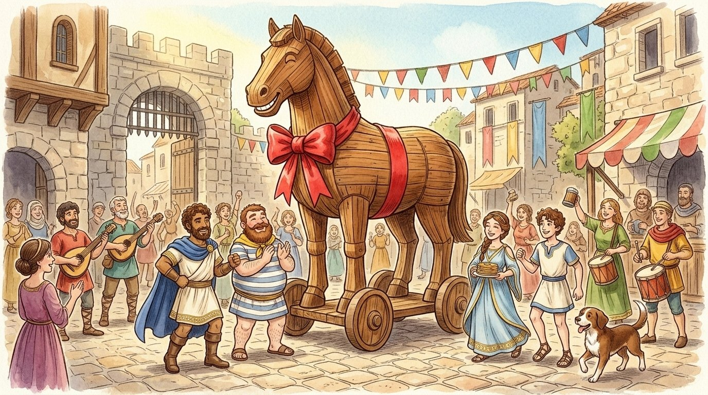
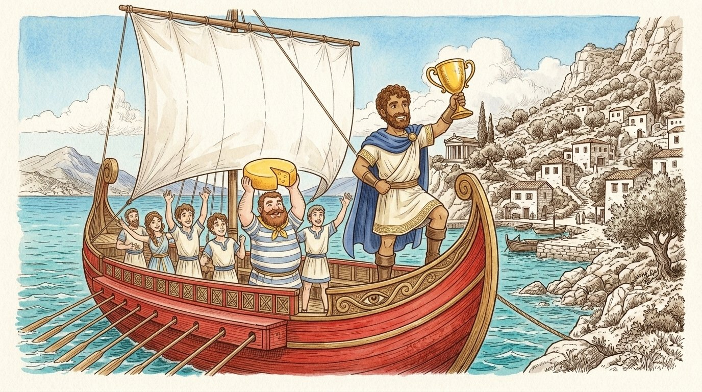
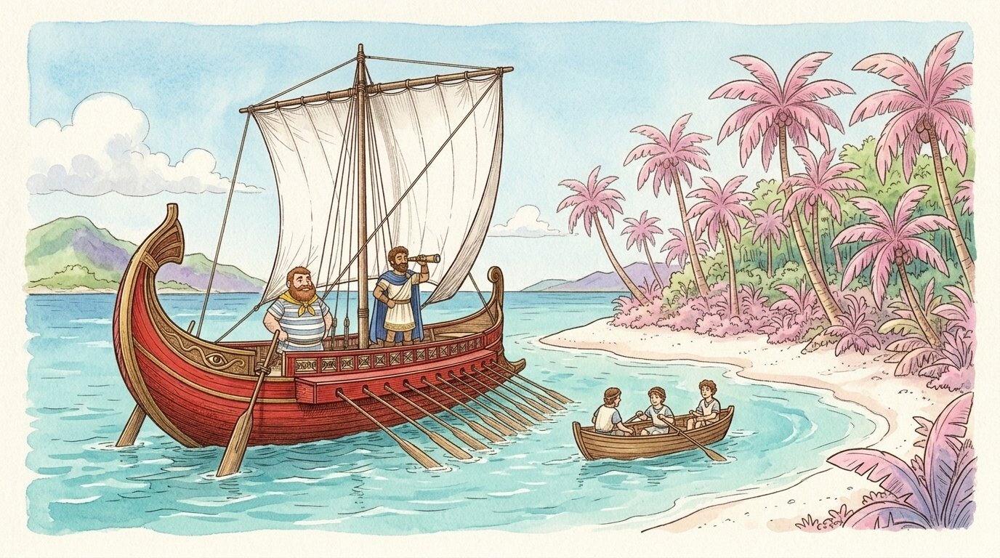
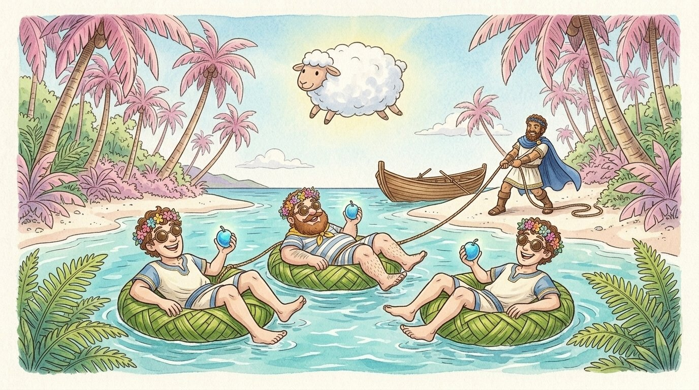
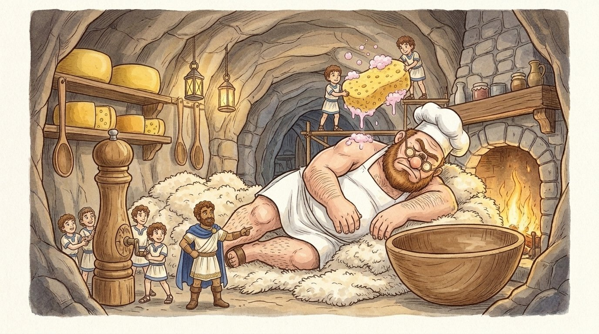
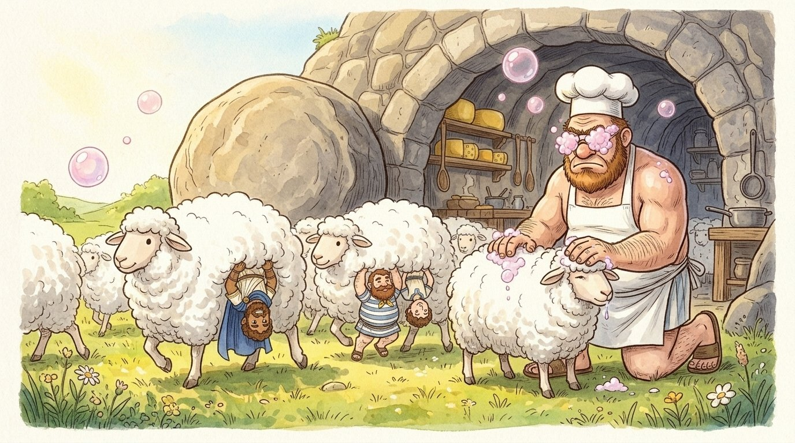

# The Great Island Road Trip: The Odyssey

Adapted from Homer’s Odyssey • A whimsical island-hopping adventure of clever ideas, giant wooden horses, fluffy sheep, and Queen Penelope’s famous honey-nut pancakes.

Source: https://www.gutenberg.org/ebooks/1727

## 1. Chapter 1: The Great Siege of Troy

Long ago, on the sparkling blue waters of the Mediterranean Sea, lived the cleverest captain in the world. His name was Odysseus, and he ruled a sunny, rocky island called Ithaca. Odysseus wasn’t the biggest or the strongest king, but he had a brain that worked like a Swiss watch. Whenever there was a problem that nobody else could solve, Odysseus would tap his chin, squint one eye, and say, "Hold on. I have a ridiculous idea."

For ten long years, Odysseus and his crew of goofy, loyal sailors had been away from home competing in the Great Siege of Troy. It wasn’t a battle of sharp things; it was the ultimate championship of prank wars and castle-capturing. The walls of Troy were fifty feet high and made of solid granite. For ten years, Odysseus and his friends tried catapulting water balloons, building giant springboards, and digging tunnels that accidentally ended up in the royal bakery. Nothing worked.

Whenever there was a problem nobody else could solve, Odysseus tapped his chin and said, "Hold on. I have a ridiculous idea."

## 2. The Giant Smiling Wooden Horse

Finally, on a Tuesday afternoon, Odysseus tapped his chin. "We are going to build a horse," he announced to his first mate, a big, lovable guy named Eurylochus who was always thinking about lunch.

"A horse, Captain?" Eurylochus asked, scratching his beard. "Like a pony?"

"No," said Odysseus. "A wooden horse the size of a three-story barn. We’ll put it on giant wooden squeaky wheels, paint a big bow on the front that says CONGRATULATIONS, YOU WIN! , and hide inside its belly with a hundred party horns and silly-string blasters."

And that is exactly what they did. They hammered together old ship planks, climbed inside through a secret trapdoor in the horse’s tummy, and waited. When the Trojans looked over their giant stone wall and saw the beaches empty except for a massive, smiling wooden horse, they cheered! They rolled the heavy horse right through their front gates and threw a massive dance party.

They built a smiling wooden horse the size of a three-story barn on giant squeaky wooden wheels and rolled it right through the front gates.

## 3. The Golden Trophy and Setting Sail

At midnight, when the Trojans were all worn out from dancing and fast asleep on the cobblestones, CLICK! went the trapdoor. Odysseus and his crew dropped down on ropes, blew their brass horns, and covered the entire town square in brightly colored banners. The King of Troy woke up, laughed until his sides hurt, and handed Odysseus the Golden Trophy of Troy.

"Alright, boys!" Odysseus cheered, standing on the bow of his flagship, a sleek wooden galley painted bright red with big white sails. "Set a course for Ithaca! My wife Penelope is probably making her famous honey-nut pancakes, and my son Telemachus is probably tall enough to ride a donkey by now. With a good wind, we’ll be home by Friday!"

Everyone cheered. Eurylochus unpacked a celebratory wheel of cheddar cheese. Nobody knew that Friday was going to take ten whole years to arrive.

"Set a course for Ithaca!" Odysseus cheered, waving the Golden Trophy from the bow of his bright red flagship.

## 4. Chapter 2: The Island of Pink Palm Trees

For the first three days, the wind was polite and pushed their red ship smoothly across the waves. On the fourth day, however, the sky turned the color of grape jelly, and a howling gale spun their ship around like a plastic tub toy. For forty-eight hours, nobody could see a thing except flying sea spray.

When the clouds finally parted, the compass had bounced overboard, and the ship was floating beside a strange, tropical island covered in glowing pink palm trees. The air smelled like warm cinnamon rolls and vanilla frosting.

"Ooh," said Eurylochus, his stomach rumbling so loudly it echoed off the cliffs. "Captain, we’re out of fresh water, and my cheese wheel fell in the bilge. Let’s go see who’s baking!"

Odysseus squinted through his brass spyglass. "Stay on the ship. I’ll send three scouts—Polites, Elpenor, and Little Tim—to ask for directions and fill the water barrels. Be back in twenty minutes!"

The three scouts hopped into a rowboat, paddled to the sugary white beach, and wandered into the pink jungle. Twenty minutes passed. Then forty minutes. Then two hours.

"They probably found a buffet," Eurylochus grumbled.

When the clouds parted, the red ship was floating beside a strange tropical island covered in glowing pink palm trees.

## 5. The Super-Sleepy Berry Eaters

Odysseus strapped a coil of rope to his belt and rowed ashore himself. When he pushed aside the giant fern leaves, he stopped dead in his tracks. In the middle of a sunny clearing was a natural lazy river filled with floating inner tubes woven from palm fronds. Lounging on the tubes were the island locals, wearing flower crowns and eating glowing, neon-blue berries the size of plums.

Right in the middle of the pond were Polites, Elpenor, and Little Tim. They had kicked off their boots, put on coconut-shell sunglasses, and were floating around in circles with huge, goofy grins on their faces.

"Boys!" Odysseus barked. "We have to go home to Ithaca! Remember? Our families? The pancakes?"

Polites took a big bite of a glowing blue Lotus Berry. "Ithaca?" he yawned, his voice moving in slow motion. "Who needs Ithaca, Cap? Look at this cloud. It looks like a fluffy marshmallow sheep. Have a berry, Cap. It tastes like a nap."

"No!" said Little Tim, giggling at a butterfly. "Let’s never row again! Rowing makes my arms tired. Let’s just float here until we turn into prunes!"

Odysseus realized the glowing Lotus Berries were magical procrastination fruit. One bite, and you forgot your homework, your chores, and your own address—all you wanted to do was lounge around and watch clouds forever.

Holding his breath so he wouldn't inhale the sweet berry juice, Odysseus pulled out his rope. Like a master cowboy, he twirled a lasso and snagged all three inner tubes at once.

"Hey! You're ruining the vibe!" Elpenor whined as Odysseus dragged the three giggling, yawning sailors down the beach like a train of pool floats. He tossed them into the rowboat, tied them gently to the rowing benches so they wouldn't jump back into the water to chase butterflies, and shouted to the rest of the crew, "Row! Row before we all decide to take a three-year nap!"

Within ten minutes, the Lotus Berry magic wore off, and the three scouts blinked, looked at their flower crowns, and asked why they were tied to the benches.

Like a master cowboy, Odysseus snagged all three palm-frond inner tubes at once and towed his sleepy scouts back to the boat.

## 6. Chapter 3: The Grumpy One-Eyed Chef

After escaping the sleepy island, the crew rowed until their stomachs sounded like a pack of howling wolves. Just before sunset, they spotted a rugged island dotted with lush green meadows and hundreds of the fluffiest, roundest sheep anyone had ever seen. Each sheep looked like a giant walking cotton ball on four tiny black legs.

High up in the cliffside was the entrance to a colossal stone cave. Warm orange firelight flickered inside, and the delicious smell of toasted garlic bread drifted down to the water.

"Garlic bread!" Eurylochus gasped, tears of joy in his eyes. "Only a civilized gentleman bakes garlic bread! Let’s go introduce ourselves and bring him a gift!"

Odysseus filled a giant leather thermos with his finest, sweetest, triple-thick grape nectar—a drink so sugary and rich that a single cup could make a bull elephant curl up for a twelve-hour food coma. Together with twelve sailors, Odysseus climbed the stone steps the size of dining tables and walked into the cave.

Everything inside was oversized. The cheese wheels on the shelves were as big as tractor tires. The wooden soup spoons were the size of canoes. Before Odysseus could say, "Wait a minute, the guy who lives here wears size-ninety shoes," heavy footsteps shook the mountain. THUMP. THUMP. THUMP.

Into the cave walked Polyphemus the Cyclops. He was thirty feet tall, wore a stained white chef’s apron, and had one gigantic, grumpy eyeball right in the center of his forehead above a bulbous nose. Behind him trotted his flock of giant, marshmallow-fluffy sheep. Without even noticing the tiny sailors hiding behind his salt shaker, Polyphemus rolled a massive round boulder across the front door to keep the draft out.

BOOM. The cave was sealed tight. Not even twenty men could budge that rock.

Into the oversized kitchen cave walked thirty-foot-tall Polyphemus the Cyclops in his stained white chef’s apron, followed by his giant marshmallow-fluffy sheep.

## 7. A Food Critic Named Nobody and the Giant Pepper Mill

Then, Polyphemus sniffed the air. He looked down through his thick, single-lens reading glasses and spotted Odysseus and his crew standing near a giant wedge of Swiss cheese.

"BAAAAH!" roared the Cyclops, his voice rattling their teeth. "TINY KITCHEN THIEVES! Are you here to steal my prize-winning sheep and my secret sourdough starter?! I’m going to put you all in tiny cages and make you wash my giant soup pots for the rest of your lives!"

He scooped up two sailors in his massive oven-mitted hands and plopped them into a giant wicker vegetable basket, latching the lid. The rest of the crew dove under a colossal wooden rolling table, trembling like gelatin.

Odysseus stepped out from beneath the table, waving a white handkerchief. "Whoa, hold on, Master Chef! We aren't thieves! We’re traveling food critics! My name is... uh... Nobody ! Yes, my mom named me Nobody! And I brought you the rarest vintage of Triple-Sweet Grape Nectar in the seven seas to wash down your dinner!"

Polyphemus stopped and blinked his giant eye. "Food critics? Named Nobody? Well... let me taste this nectar."

Odysseus uncorked the giant thermos and poured the thick purple juice into the Cyclops’s mixing bowl. Polyphemus gulped it down in one swallow, smacked his lips, and let out a colossal burp that blew everyone’s hats off.

"Delicious!" the Cyclops yawned, his giant eyelid instantly drooping down like a heavy window shade. "Look here, Nobody... because you brought me dessert, I’ll let you wash the dishes last ... right after I take a quick... little... snooze..."

CRASH! Polyphemus tipped backward onto his giant pile of sheepskin rugs and began to snore. Every snore sounded like a chainsaw cutting through a tin roof.

"Captain!" Eurylochus whispered as they let their friends out of the wicker basket. "How do we get out? We can't move that boulder! Only the Cyclops is strong enough to roll it aside!"

Odysseus tapped his chin. He looked at the snoring giant, then at a massive wooden pepper mill the size of a tree trunk sitting on the kitchen counter, and then at the giant sheep. "Boys, grab that giant pepper grinder and a bucket of warm soapy dishwater. We need him to open that door for us—without seeing us!"

Working like a pit crew, the sailors hoisted the giant pepper mill over the Cyclops's face while another group balanced a giant sponge soaked in tear-free baby shampoo and spicy paprika right over his forehead. On the count of three, they cranked the grinder!

Working like a pit crew, the sailors hoisted the tree-trunk-sized wooden pepper mill and a bucket of bubbly dishwater over the snoring chef.

## 8. Sneaking Out Under the Fluffy Sheep

A cloud of super-fine black pepper and soapy bubbles rained right onto the Cyclops's face and nose.

"AH... AH... ACHOOOOOOO! " Polyphemus sneezed so hard he bounced off the floor, and a giant glob of harmless, bubbly soap foam splattered right across his single reading-glass lens and over his eyebrow, gluing his giant eyelid shut with sticky marshmallow-root sap Odysseus had mixed into the suds!

"MY EYE! MY GLASSES!" Polyphemus bellowed, stumbling around the cave with his eyes squeezed shut against the tickly soap bubbles and sneezing fits. He roared so loudly that the other Cyclops neighbors from across the mountain jogged over and banged on the outside of the boulder.

"Hey, Polyphemus!" shouted a neighbor Cyclops. "Keep it down, it's ten o'clock! Who's bothering you in there? Who's tricking you?!"

"NOBODY!" Polyphemus yelled back, wiping at the sticky foam on his face. "NOBODY TRICKED ME! NOBODY PUT SOAP IN MY EYE!"

There was a long pause outside the rock. "Well, if nobody is bothering you," shouted the neighbor, "then wash your face and go to bed!" And the neighbors stomped back home.

Odysseus grinned and gave his crew a thumbs-up. Next came part two of the plan. While the grumpy giant sat in the corner grumbling and trying to find his towel, Odysseus tied the giant, super-fluffy sheep together in sets of three using braided willow vines. Under the belly of each middle sheep, a sailor held onto the thick, curly wool like a monkey on a trapeze. Odysseus grabbed onto the thickest, woolliest ram of all.

When morning came, the sheep began to bleat loudly to go outside and eat grass. Still blinded by the sticky sap and soap suds, Polyphemus grumbled, rolled the giant boulder away from the door, and knelt in the doorway. As each sheep trotted out, he patted its back to make sure the tiny sailors weren't riding on top. He had no idea they were hanging underneath like furry hammocks!

Once clear of the cave, the sailors dropped off the sheep, herded a few of the fluffy wool-balls onto their boat to use as soft pillows, and pushed off from the shore.

"Hey, Chef!" Odysseus cupped his hands and shouted across the water. "If anyone asks who outsmarted you with a pepper grinder and a bar of soap, tell them it wasn't Nobody—it was Captain Odysseus of Ithaca!"

Polyphemus roared in frustration and chucked a giant round boulder of stale sourdough bread into the ocean. The splash created a massive wave that surfed Odysseus’s red ship five miles out to sea!

As each giant sheep trotted out the cave door, Polyphemus patted its back—never guessing that Odysseus and his crew were hanging underneath like furry hammocks!

## 9. Chapter 4: The Bag of Hurricane Winds

Sailing away from the Cyclops, the crew landed on a floating bronze island ruled by Aeolus, the jolly Keeper of the Winds. Aeolus wore a suit made of billowing sails and had hair that blew in four directions at once. He loved Odysseus's stories so much that he gave the captain a very special parting gift: a plump leather bowling bag tied shut with a glowing silver cord.

"Inside this bag," Aeolus whispered, "I have vacuum-sealed the North Wind, the East Wind, and the South Wind—every storm and hurricane in the world! I only left the gentle West Wind outside to blow you straight home to Ithaca. Whatever you do, do not unzip the bag until your ship is tied to your own dock!"

For nine days and nine nights, the gentle West Wind pushed the red ship across glassy waters. Odysseus was so worried someone would touch the bag that he stayed at the steering oar for two hundred hours straight without a wink of sleep.

On the tenth morning, Ithaca appeared on the horizon! They were so close they could see the smoke rising from their own chimneys and smell Penelope’s cinnamon pancakes. Exhausted and relieved, Odysseus finally slumped over the steering wheel and fell fast asleep.

Instantly, Eurylochus and the crew gathered around the plump leather bag sitting on the deck.

"Look at that bag," Eurylochus whispered, poking it. "The King of the Winds gave it to the Captain, and he hasn't offered to share a single piece! I bet it’s full of gold coins and chocolate doubloons!"

"Just take a tiny peek," urged Polites. "We'll take one chocolate coin each and tie the silver string right back up!"

Slowly, carefully, Eurylochus pulled the glowing silver bow. FZZZZZZT!

The bag flew wide open. Out erupted a screaming, swirling tornado of hurricane winds! They hadn't opened a bag of gold; they had unleashed a Category Five sneeze! The winds blasted the ship backward at a hundred miles an hour, blowing them all the way back across the ocean until Ithaca vanished into a tiny dot.

Odysseus woke up with his beard blown straight over his head. "WHO TOUCHED THE BAG?!" he yelled over the howling gale.

Eurylochus sheepishly held up the empty leather sack. "In my defense, Captain, it really looked like it had snacks in it."

"In my defense, Captain, it really looked like it had snacks in it!" said Eurylochus as the bag of hurricane winds blasted the ship backward.

## 10. Circe’s Banquet and the Manners-Magic

When the winds finally died down, they washed ashore on the enchanted island of Aeaea, home to the glamorous sorceress Circe. Circe lived in a sparkling marble palace surrounded by surprisingly friendly woodland creatures—lions that rolled over for belly rubs and wolves that wagged their tails like golden retrievers.

Eurylochus led half the crew up to the palace to ask for help. Circe welcomed them with a dazzling smile and set out a banquet table overflowing with forty-layer lasagna, triple-fudge brownies, and fizzy root beer floats. While cautious Eurylochus hid behind a curtain because he thought it looked too good to be true, the other twenty sailors dove into the buffet like a pack of vacuum cleaners, forgetting their manners entirely.

Circe shook her head disapprovingly. "Look at you! Chewing with your mouths open, elbows on the table, not a single 'please' or 'thank you'! If you're going to eat like little piggies, you might as well look the part!"

She waved her sparkling crystal wand. POOF! POOF! POOF!

Every single sailor popped out of his boots and turned into a plump, pink, squealing potbellied piglet wearing a tiny sailor hat! They still had their human brains, so they looked down at their trotters in horror, let out a chorus of panicked OINKS , and got shooed into a luxury mud pen out back.

Eurylochus sprinted back to the beach so fast his sandals smoked. "Captain! A lady in a purple dress just turned the boys into bacon-on-the-hoof!"

"If you're going to eat like little piggies, you might as well look the part!" said Circe, waving her sparkling crystal wand.

## 11. Hermes’s Mint Gum and the Bluebird Mirror

Odysseus grabbed his walking stick and marched up the hill to rescue his crew. Halfway through the woods, a teenager wearing a golden winged bicycle helmet and flying sneakers dropped out of a tree. It was Hermes, the messenger god.

"Whoa there, Captain," Hermes said, doing a mid-air kickflip on his winged shoes. "If you march in there and eat her brownies, you'll be oinking by 3:00 PM. Here, chew on this." Hermes pulled a tiny root with a glowing white flower out of the dirt. "It’s called Moly —magical garlic mint. As long as you chew this gum, her pig-magic will bounce right off you!"

Odysseus popped the minty flower into his mouth and strolled into Circe’s dining room. Circe handed him a giant root beer float, waited for him to take a sip, and tapped him on the nose with her wand. "Off to the pigsty with you!" she sang.

FIZZLE. Sparks flew out of the wand like a dud sparkler. Odysseus didn't even grow a curly tail. Instead, he pulled out a giant silver mirror from his backpack and held it up, reflecting the leftover magic beam right back toward Circe’s elaborate, three-foot-tall beehive hairdo, turning the top of her hair into a nest of chirping bluebirds!

"My hair!" Circe gasped, patting the chirping birds. "Nobody has ever resisted my manners-magic! You must be the famous Odysseus!"

"That's me," Odysseus said politely, wiping his mouth with a napkin. "Please, Madam Circe, if I promise my crew will use coasters and napkins, would you kindly turn them back into sailors?"

Impressed by his politeness and quick wit, Circe tapped the piglets in the courtyard. POP! POP! POP! The twenty sailors stood up, brushed the mud off their knees, and immediately said, "Thank you, ma'am," in unison. Circe even packed them a picnic basket and gave them a magical map to navigate the final stretch of the Monster Sea.

Odysseus held up a shiny silver mirror, reflecting the leftover magic beam right into Circe’s beehive hairdo and turning it into a nest of chirping bluebirds!

## 12. Chapter 5: The Earplug Concert

Following Circe’s map, the red ship approached the twin hazards of the Narrow Strait. First up was the Island of the Sirens.

Now, in the old stories, people thought the Sirens were scary, but the truth was much worse: they were a three-piece magical pop band whose music was so unbearably catchy that any sailor who heard their song would steer his ship right onto the rocks just to buy front-row tickets and dance forever!

"Alright, team," Odysseus announced, hauling out a giant yellow block of softened beeswax. "Nobody is allowed to listen to the Siren Tour! Roll up two big balls of wax and plug your ears until you can't hear a single note!"

"What about you, Captain?" asked Eurylochus, already molding two big yellow wax plugs. "Someone has to listen to make sure we’re past the island!"

"Tie me to the mainmast with fifty feet of nautical rope," Odysseus ordered. "I want to hear what all the fuss is about. But if I start dancing, wiggling my eyebrows, or begging you to untie me so I can join the band, just tie MORE rope around me and row faster!"

As the ship glided past the flower-covered rocks of Siren Island, three winged performers wearing sparkly robes hopped up to golden seashell microphones and launched into the catchiest techno-sea-shanty in history.

Even tied to the wooden mast, Odysseus’s toes immediately started tapping. Within ten seconds, his eyes went wide with excitement.

"BOYS!" Odysseus shouted over the music. "UNTIE ME! THIS SONG IS AN ABSOLUTE BANGER! WE HAVE TO STOP AND BUY THE ALBUM! TURN THE SHIP AROUND, I NEED AN AUTOGRAPH!"

Eurylochus couldn't hear a word. He just saw his captain wiggling his hips against the mast and mouthing the words to the chorus. Giving Odysseus a polite thumbs-up, Eurylochus wrapped three more coils of rope around the captain's middle and signaled the crew to row like turbo-engines. Once they were two miles past the island, the music faded, Odysseus stopped wiggling, and the crew popped the wax out of their ears.

"Whew," Odysseus panted, rubbing his rope-marked arms. "Never let me near a jukebox again."

"THIS SONG IS AN ABSOLUTE BANGER!" Odysseus shouted, tapping his toes at the mainmast while Eurylochus—with yellow beeswax plugging his ears—gave him a polite thumbs-up.

## 13. The Giant Drainpipe and the Peanut-Butter Catapult

Suddenly, the water ahead began to rumble. They had reached the Narrows, guarded on the left by Charybdis—a colossal living whirlpool that acted like a five-hundred-foot bathtub drain, gulping down half the ocean and burping it back up three times a day—and on the right by Scylla, a six-headed sea dragon who lived in a high cliff cave and loved snatching snacks off passing boats like a seagull at a boardwalk.

"Look at the size of that whirlpool!" Eurylochus yelled as the water swirled into a giant funnel. "If we go left, we'll get flushed down to China! If we go right, that six-headed lizard is going to grab us!"

Odysseus looked down into the galley kitchen. "How many loaves of Circe’s extra-chewy peanut-butter bread do we have left?"

"Six giant loaves, Captain!"

"Bring them on deck and load the bow catapults!" Odysseus steered the ship along the right cliffside, just out of reach of the roaring whirlpool's giant watery burp. High above, Scylla’s six long, scaly necks poked out of the fog, sniffing the ship.

"FIRE THE PB&J!" Odysseus roared.

TWANG! TWANG! TWANG! Six giant, super-sticky loaves of peanut-butter bread launched into the air. Each of Scylla's six heads snapped one out of the sky. Instantly, the ultra-thick peanut butter glued all six of the sea monster's jaws together! While the giant six-headed lizard sat on the cliff going "Mmph! Mmmph! Glomph!" and trying to lick the peanut butter off the roofs of her six mouths, Odysseus and his crew rowed right underneath her tail and out into the calm, open sea!

While Scylla’s six heads tried to lick the sticky peanut-butter bread off the roofs of their mouths, Odysseus and his crew rowed right past the giant whirlpool into the open sea!

## 14. Chapter 6: The Grandpa Disguise and Faithful Argos

After surviving a stormy shipwreck where Odysseus had to paddle the last fifty miles on an inflatable raft made of lashed-together drift logs, he finally washed ashore on the sandy beaches of Ithaca! Twenty years had passed since he first set sail.

Before running straight up to his castle, Odysseus met his old friend Athena, the goddess of wisdom, who was disguised as a shepherd.

"Hold your horses, Odysseus," Athena warned, tapping her staff. "While you were gone, a hundred greedy, lazy guys called the Suitors moved into your living room! They think you're lost at sea, so they're eating all your groceries, leaving their dirty socks on the sofa, and competing to see who gets to become the new King of Ithaca! Today, your wife Penelope is holding an archery contest to finally get rid of them. Whoever can string your old bow and shoot a suction-cup arrow cleanly through the round rings of twelve axe handles lined up in a row wins!"

"Nobody can bend my old bow except me!" Odysseus grinned. "It has a two-hundred-pound draw weight! Wait... if I walk in wearing my royal cape, those hundred freeloaders will lock the doors!"

Athena smiled and tapped Odysseus on the head with an olive branch. SHIMMER! Instantly, Odysseus was disguised as a shaky, wrinkled old grandpa wearing a patched tweed bathrobe and fuzzy slippers.

When Odysseus shuffled into his own palace dining hall, he found a heartwarming surprise waiting by the front door: his faithful old hound dog, Argos, who was now twenty years old with white fur around his muzzle. Even through the magical grandpa disguise, Argos sniffed once, recognized his best friend’s scent, and wagged his tail so hard his whole back end wiggled before curling up on Odysseus's foot.

Even through the magical grandpa bathrobe disguise, faithful old Argos recognized his best friend’s scent and wagged his tail so hard his whole back end wiggled.

## 15. The Ultimate Twelve-Ring Trick Shot

Inside the hall, Odysseus's son Telemachus—now a tall, brave young man—was trying to get the rowdy Suitors to use coasters. One by one, the arrogant, muscle-bound Suitors stepped up to try and bend Odysseus’s legendary wooden bow.

The loudest Suitor, a pompous guy named Antinous who was wearing three gold chains and eating Odysseus's favorite grapes, pulled on the bowstring until his face turned the color of a ripe tomato. BOING! The bow didn't budge an inch, and Antinous fell flat on his bottom into a bowl of mashed potatoes.

"This bow is defective!" Antinous whined, wiping potatoes off his chin. "Nobody on Earth can string this thing!"

Odysseus shuffled forward in his fuzzy slippers. "Excuse me, young fellas," he rasped in a creaky grandpa voice. "Mind if an old-timer gives it a whirl? Back in my day, I used to have a pretty good arm."

The Suitors laughed until they cried. "Sure, Grandpa! Try not to pull a hamstring!"

Telemachus, who had already figured out the wink his dad gave him earlier, handed the heavy bow to the old man. With effortless grace, Odysseus hooked one end of the bow against his boot, bent the massive wood like a piece of licorice, and slipped the string into the notch. He plucked the string once. THWUMMMM. It sounded like a sweet musical note.

Before the Suitors could even close their gaping mouths, Odysseus notched a special whistling trick-arrow, pulled it back to his ear, and let it fly.

ZIIIIIP!

The arrow rocketed straight through the tiny circular holes of all twelve axe handles in a single flash, bounced off a brass shield on the far wall, cut the rope holding up the giant velvet banquet curtains, and dropped the massive, heavy fabric like a giant net right over all one hundred Suitors, tangling them up in a single giant bundle alongside a cascade of dumped flour sacks from the pantry rafters!

With effortless grace, Odysseus strung his legendary bow and sent the whistling suction-cup arrow zooming straight through all twelve rings in a single flash!

## 16. The Honey-Nut Pancake Reunion

SHIMMER! Athena waved her hand from the rafters, and the grandpa bathrobe vanished. Standing in the center of the hall in his shining royal tunic was Captain Odysseus!

"The King is back!" cried the tangled Suitors, peeking out from the giant net of velvet curtains like powdered-sugar ghosts. "We're sorry we ate your cheese! Please don't put us in the dungeon!"

"The dungeon?" Odysseus laughed, clapping his hands together as Telemachus stood proudly by his side. "Worse! You guys have twenty years of dirty dishes to wash, the front lawn needs mowing, and you aren't leaving until the castle floors are sparkling!"

As the hundred Suitors scrambled toward the kitchen with mops and sponges, Queen Penelope walked down the grand staircase. She looked at Odysseus, smiled, and walked over with a warm plate stacked ten inches high with golden honey-nut pancakes.

Odysseus hugged his wife and his son, tossed a pancake crust to old Argos, and looked out the window toward the sparkling blue sea. "You know," Odysseus said, taking a big bite, "rowing around the world and outsmarting Cyclopses and six-headed dragons is fine... but there really is no place like home."

"Rowing around the world and outsmarting Cyclopses and six-headed dragons is fine... but there really is no place like home."
