# Tyson and the Chore-Bot 3000

A comic adventure about a cleaning robot, a foam bat, and the world's fullest toy box. Inspired by “The Sorcerer’s Apprentice,” retold as a silly comic.

## 1. Page 1 — The Messiest Room Ever

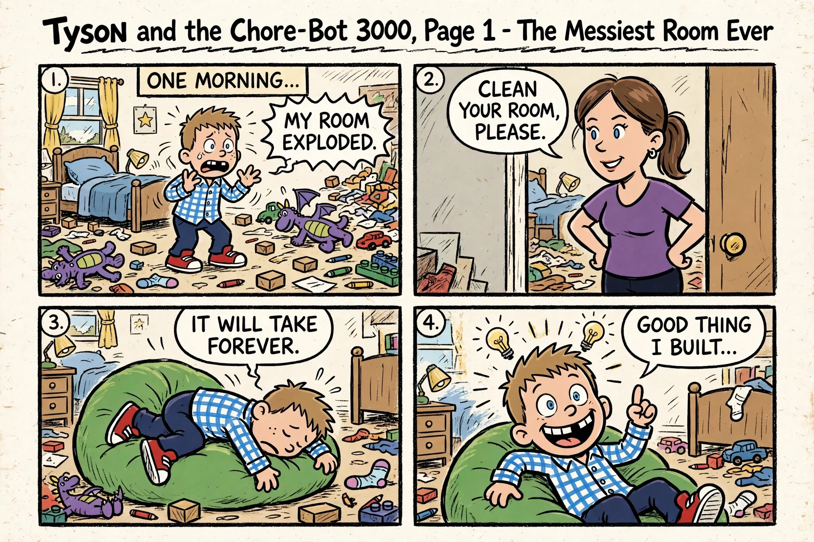

Page 1 of 12 — The Messiest Room Ever

ONE MORNING... “MY ROOM EXPLODED.” “CLEAN YOUR ROOM, PLEASE.” “IT WILL TAKE FOREVER.” “GOOD THING I BUILT...”

## 2. Page 2 — Meet the Chore-Bot 3000

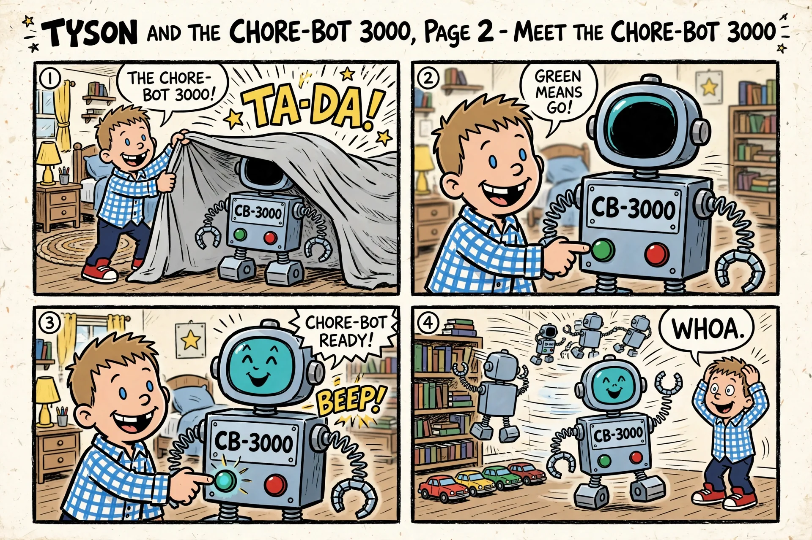

Page 2 of 12 — Meet the Chore-Bot 3000

“THE CHORE-BOT 3000!” “GREEN MEANS GO!” “CHORE-BOT READY!” “WHOA.”

## 3. Page 3 — The Best Invention Ever

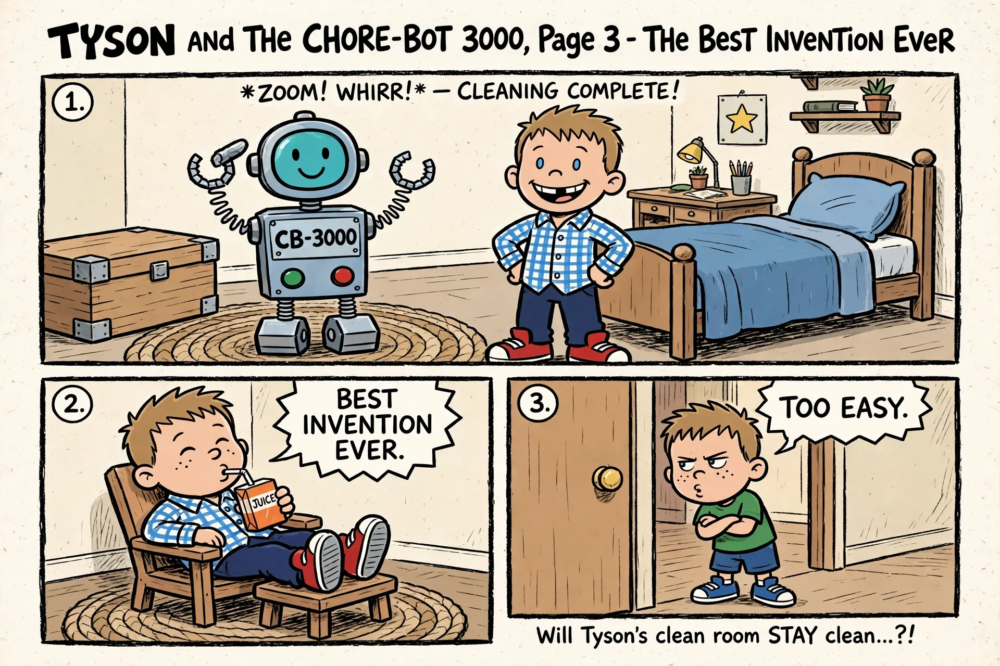

Page 3 of 12 — The Best Invention Ever

“BEST INVENTION EVER.” “TOO EASY.”

## 4. Page 4 — The Turbo Button

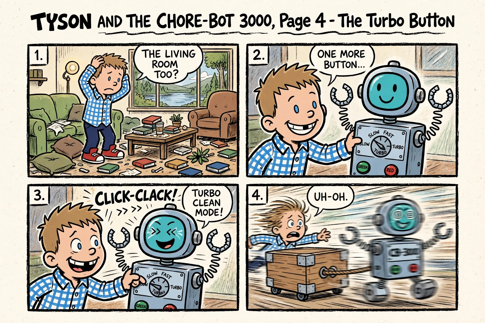

Page 4 of 12 — The Turbo Button

“THE LIVING ROOM TOO?” “ONE MORE BUTTON...” “TURBO CLEAN MODE!” “UH-OH.”

## 5. Page 5 — Too Much Cleaning

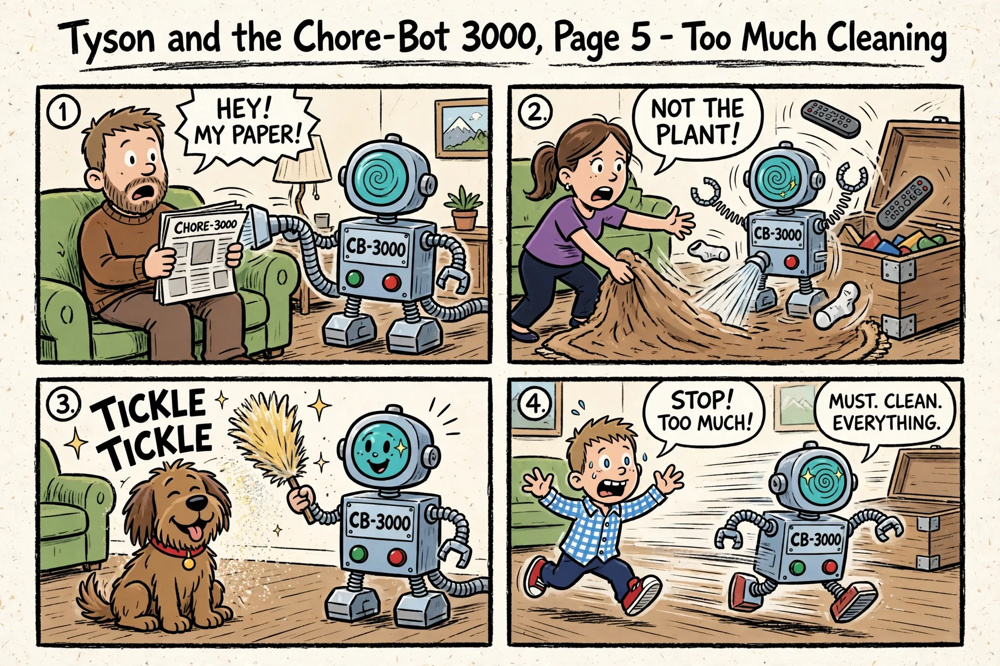

Page 5 of 12 — Too Much Cleaning

“HEY! MY PAPER!” “NOT THE PLANT!” “STOP! TOO MUCH!” “MUST. CLEAN. EVERYTHING.”

## 6. Page 6 — The Foam Bat Idea

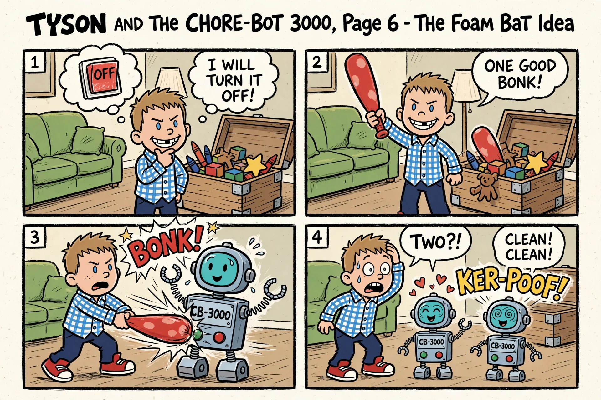

Page 6 of 12 — The Foam Bat Idea

“I WILL TURN IT OFF!” “ONE GOOD BONK!” “CLEAN! CLEAN!” “TWO?!”

## 7. Page 7 — Bots Gone Wild

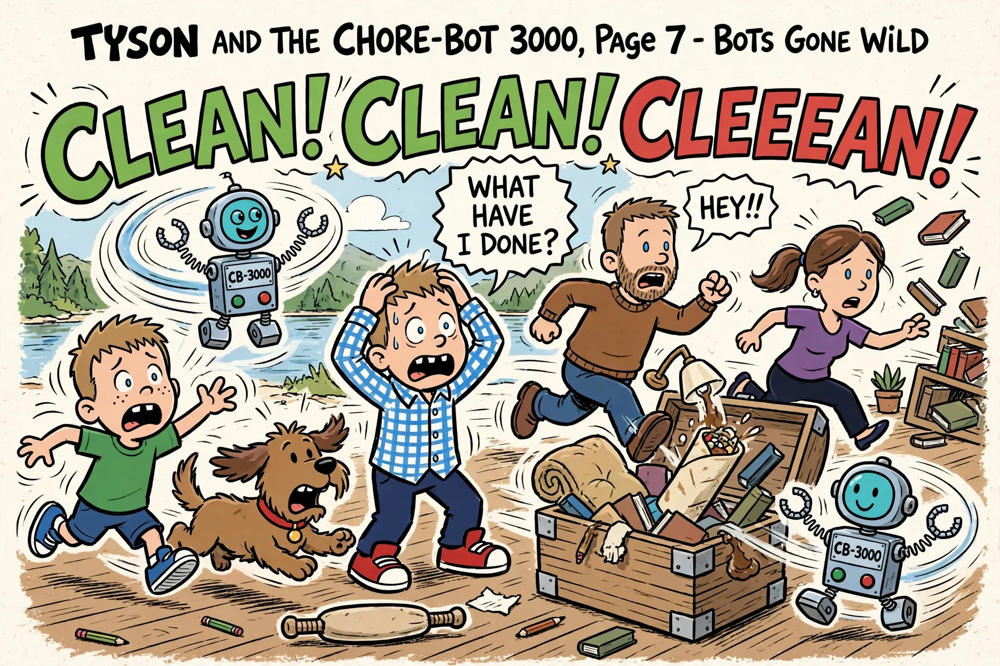

Page 7 of 12 — Bots Gone Wild

“CLEAN! CLEAN! CLEEEAN!” “WHAT HAVE I DONE?”

## 8. Page 8 — Flip-O-Rama A: Not the Dog!

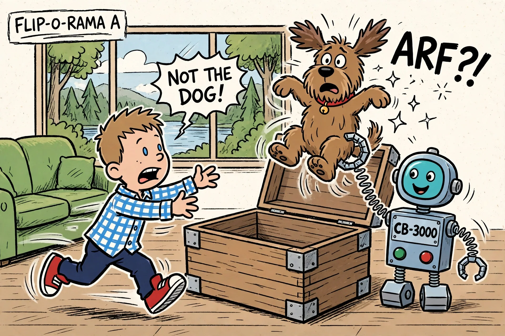

Page 8 of 12 — Flip-O-Rama A: Not the Dog!

“NOT THE DOG!”

## 9. Page 9 — Flip-O-Rama B: Dog in the Box

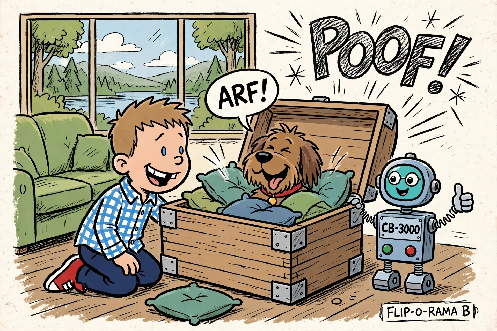

Page 9 of 12 — Flip-O-Rama B: Dog in the Box

“ARF!”

## 10. Page 10 — Into the Toy Box

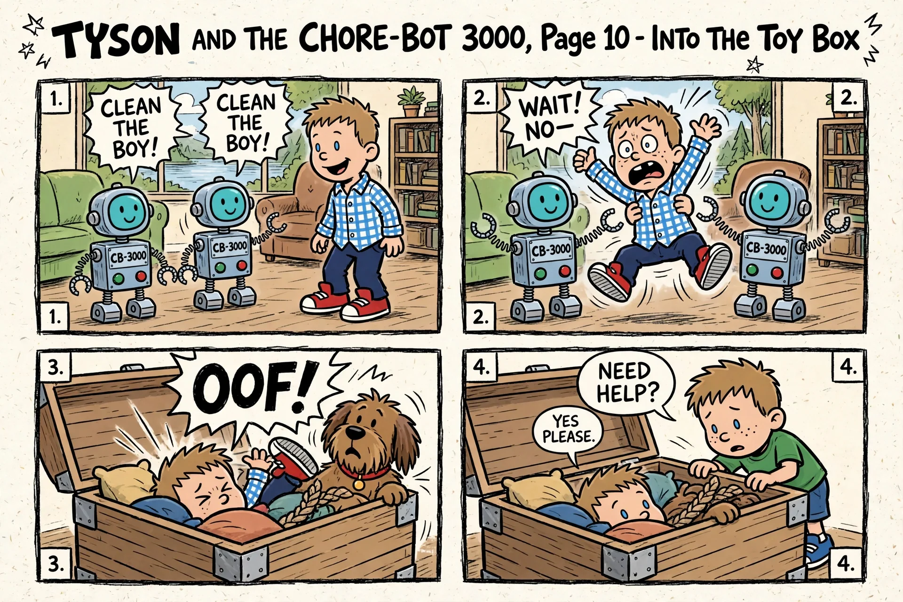

Page 10 of 12 — Into the Toy Box

“CLEAN THE BOY!” “WAIT! NO—” “NEED HELP?” “YES PLEASE.”

## 11. Page 11 — Teamwork Buttons

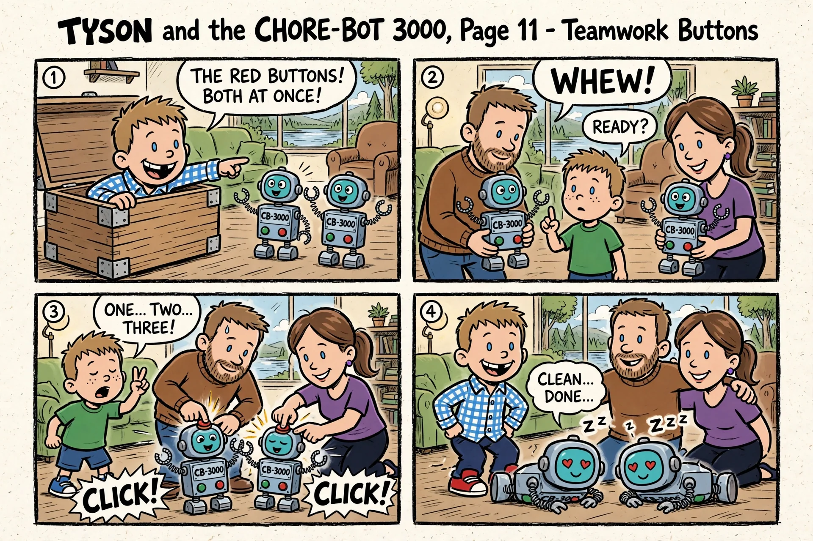

Page 11 of 12 — Teamwork Buttons

“THE RED BUTTONS! BOTH AT ONCE!” “READY?” “ONE... TWO... THREE!” “CLEAN... DONE...” “WHEW!”

## 12. Page 12 — Tyson Does It Himself

Page 12 of 12 — Tyson Does It Himself

“I GOT THIS.” “CLEAN. BY ME.” “...ONE MORE.”
