# Tyson and the Squeak-Thump Secret

A comic mystery about a broken squeaky duck, a guilty conscience, and a very loud tummy. Inspired by “The Tell-Tale Heart,” retold as a silly comic.

## 1. Page 1 — The Forbidden Toy

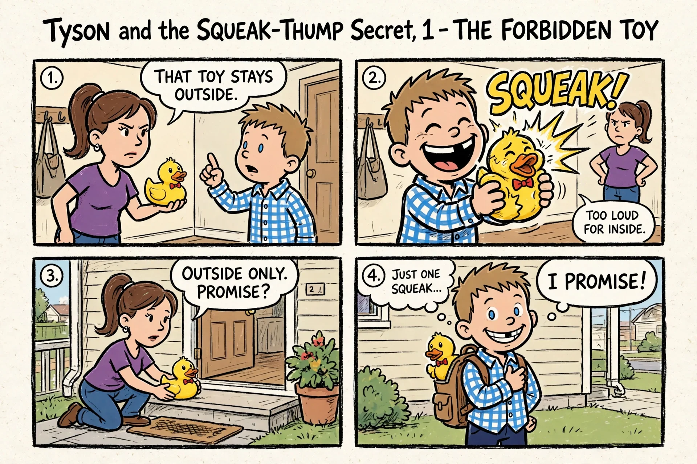

Page 1 of 12 — The Forbidden Toy

“THAT TOY STAYS OUTSIDE.” “TOO LOUD FOR INSIDE.” “OUTSIDE ONLY. PROMISE?” “I PROMISE!” “JUST ONE SQUEAK...”

## 2. Page 2 — One Little Squeak

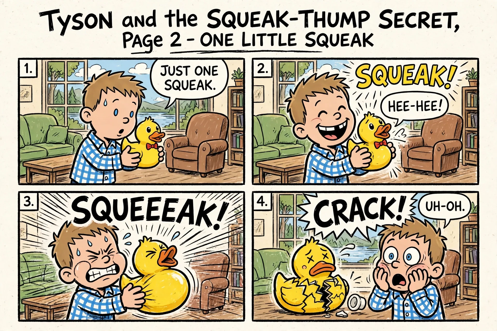

Page 2 of 12 — One Little Squeak

“JUST ONE SQUEAK.” “HEE-HEE!” “UH-OH.”

## 3. Page 3 — Under the Cushions

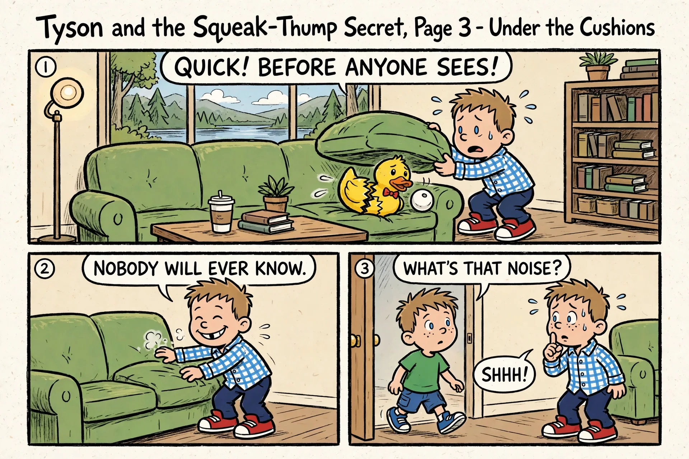

Page 3 of 12 — Under the Cushions

QUICK! BEFORE ANYONE SEES! “NOBODY WILL EVER KNOW.” “WHAT'S THAT NOISE?” “SHHH!”

## 4. Page 4 — The First Squeak-Thump

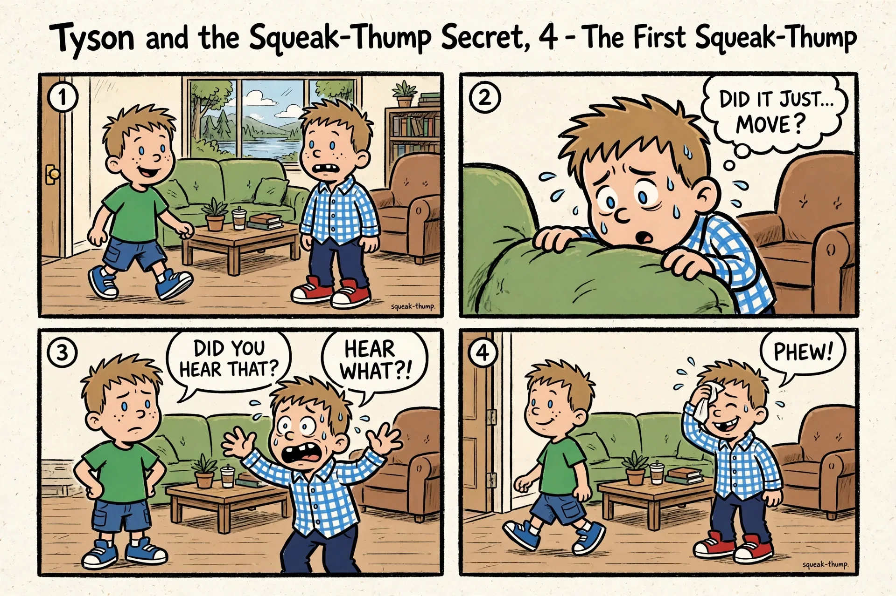

Page 4 of 12 — The First Squeak-Thump

“DID IT JUST... MOVE?” “DID YOU HEAR THAT?” “HEAR WHAT?!” “PHEW!”

## 5. Page 5 — Dad Comes Home

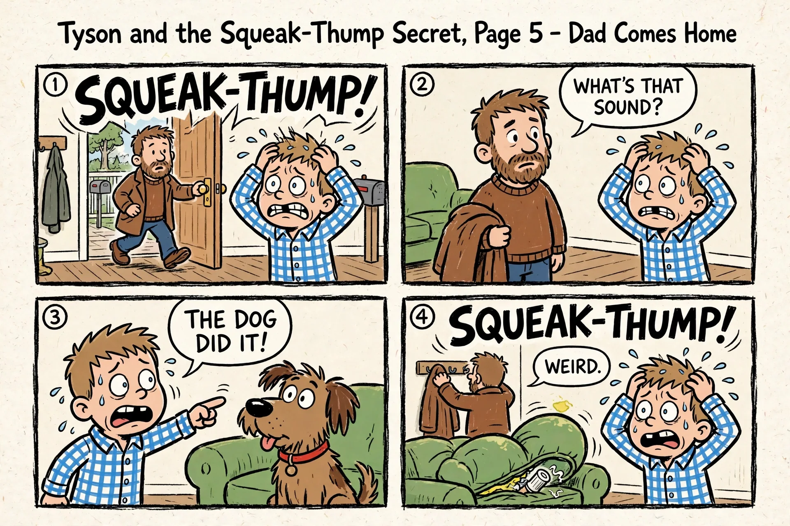

Page 5 of 12 — Dad Comes Home

“WHAT'S THAT SOUND?” “THE DOG DID IT!” “WEIRD.”

## 6. Page 6 — Mom Hears Nothing

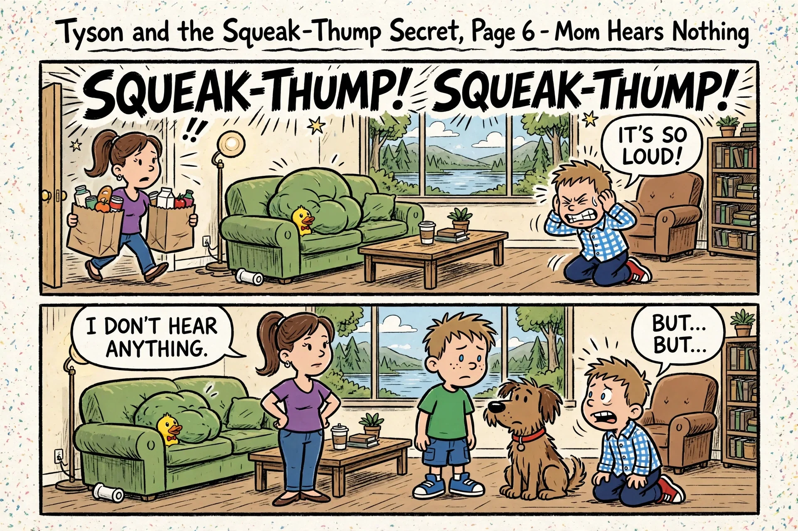

Page 6 of 12 — Mom Hears Nothing

“IT'S SO LOUD!” “I DON'T HEAR ANYTHING.” “BUT... BUT...”

## 7. Page 7 — LOUDER AND LOUDER!

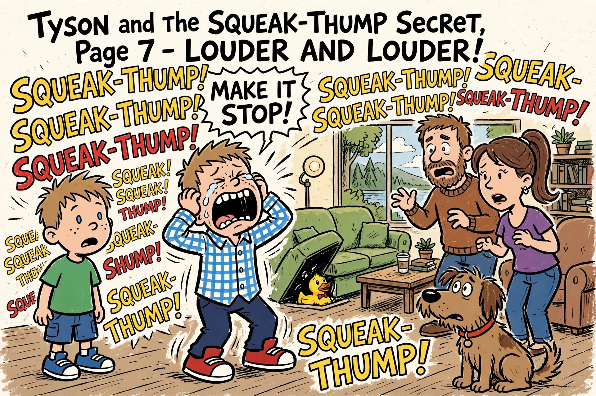

Page 7 of 12 — LOUDER AND LOUDER!

“MAKE IT STOP!”

## 8. Page 8 — Flip-O-Rama A: SQUEAK!

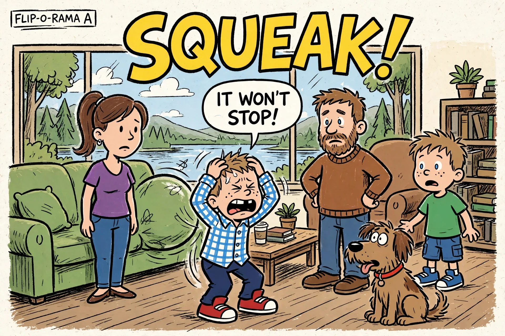

Page 8 of 12 — Flip-O-Rama A: SQUEAK!

“IT WON'T STOP!”

## 9. Page 9 — Flip-O-Rama B: THUMP!

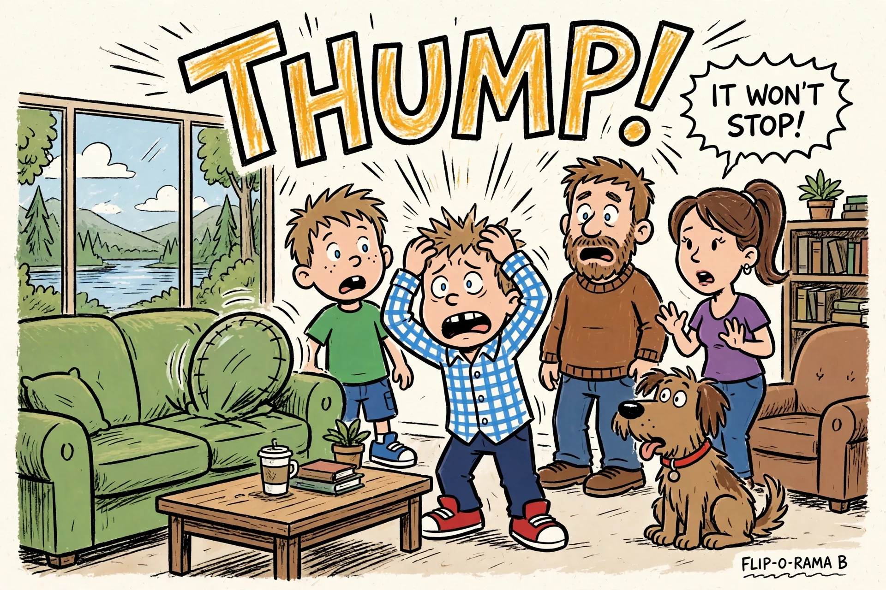

Page 9 of 12 — Flip-O-Rama B: THUMP!

“IT WON'T STOP!”

## 10. Page 10 — The Confession

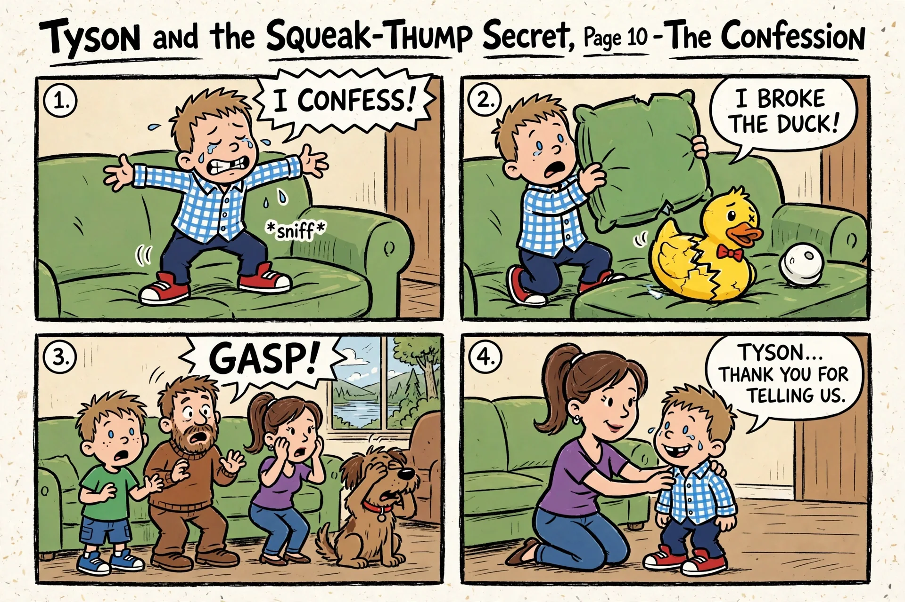

Page 10 of 12 — The Confession

“I CONFESS!” “I BROKE THE DUCK!” “GASP!” “TYSON... THANK YOU FOR TELLING US.”

## 11. Page 11 — Just a Toy

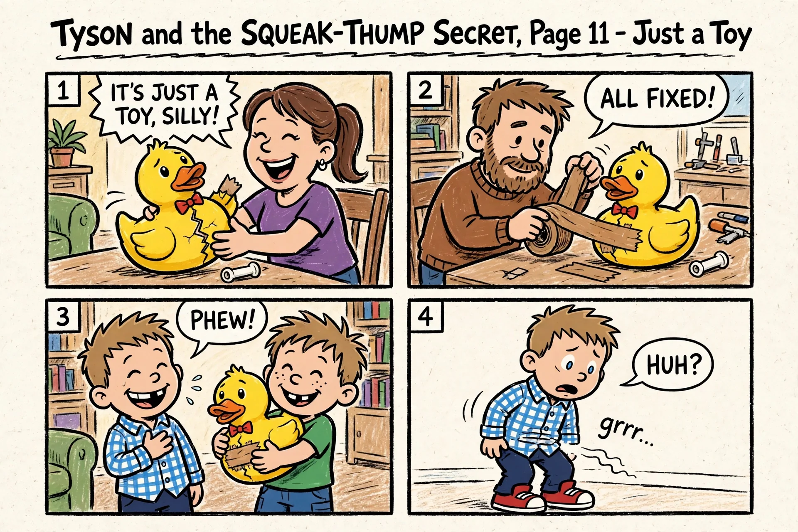

Page 11 of 12 — Just a Toy

“IT'S JUST A TOY, SILLY!” “ALL FIXED!” “PHEW!” “HUH?”

## 12. Page 12 — It Was My Tummy!

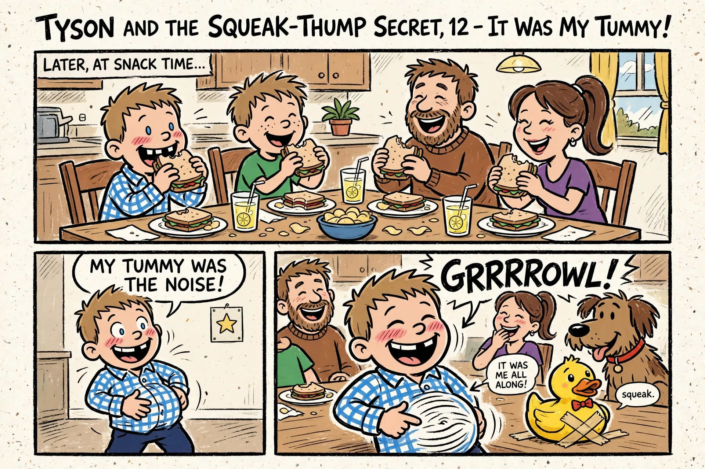

Page 12 of 12 — It Was My Tummy!

“MY TUMMY WAS THE NOISE!” “IT WAS ME ALL ALONG!”
