# Tyson and the Three Silly Wishes

A comic adventure about a mountain of donuts, super-speed, and the best wish of all. Loosely after “The Monkey’s Paw,” retold as a silly comic.

## 1. Page 1 — A Very Boring Morning

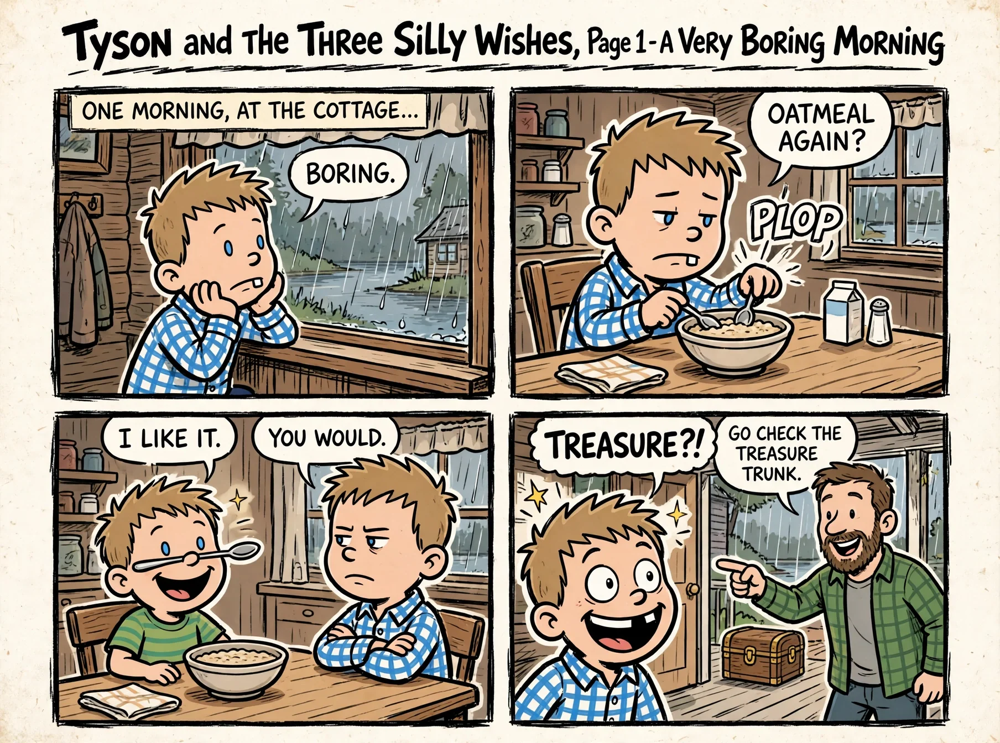

Page 1 of 12 — A Very Boring Morning

ONE MORNING, AT THE COTTAGE... “BORING.” “OATMEAL AGAIN?” “I LIKE IT.” “YOU WOULD.” “GO CHECK THE TREASURE TRUNK.” “TREASURE?!”

## 2. Page 2 — The Treasure Trunk

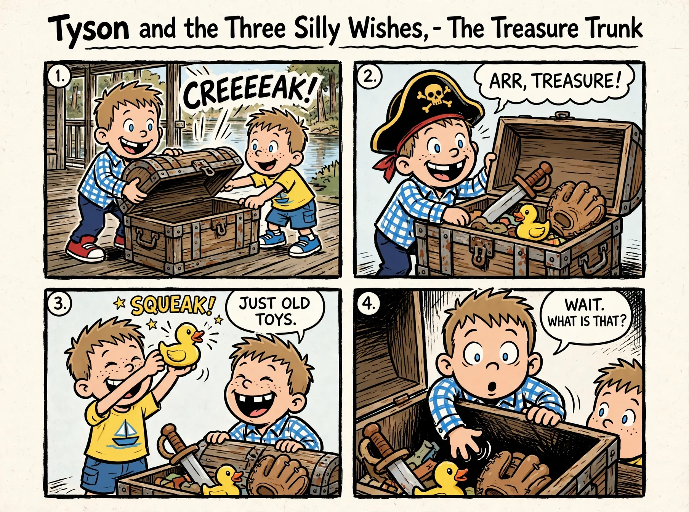

Page 2 of 12 — The Treasure Trunk

“ARR, TREASURE!” “JUST OLD TOYS.” “WAIT. WHAT IS THAT?”

## 3. Page 3 — Three Wishes?!

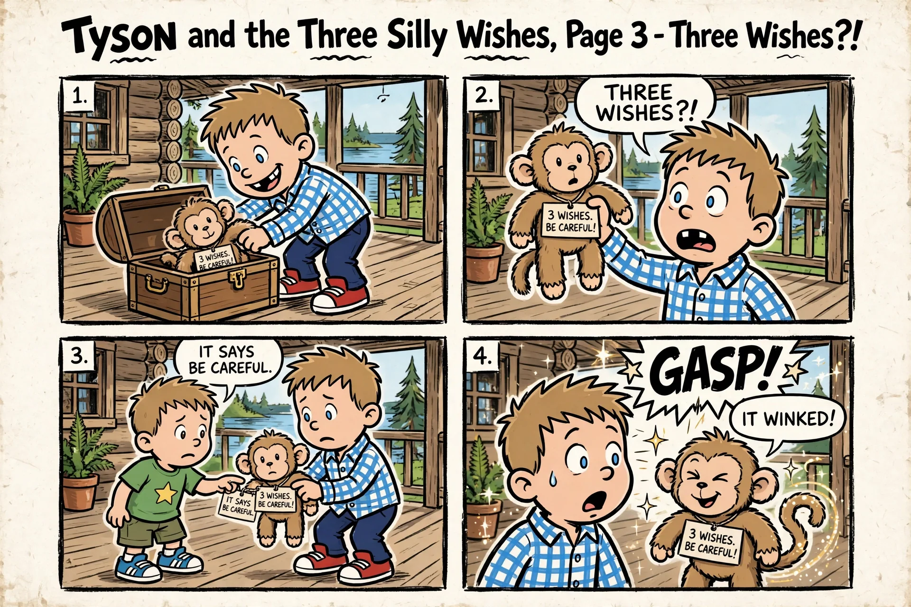

Page 3 of 12 — Three Wishes?!

3 WISHES. BE CAREFUL! “THREE WISHES?!” “IT SAYS BE CAREFUL.” “IT WINKED!”

## 4. Page 4 — Wish Number One

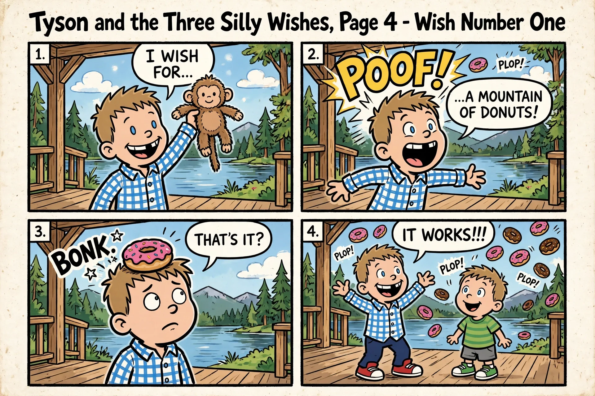

Page 4 of 12 — Wish Number One

“I WISH FOR...” “...A MOUNTAIN OF DONUTS!” “THAT'S IT?” “IT WORKS!!!”

## 5. Page 5 — Donut Mountain

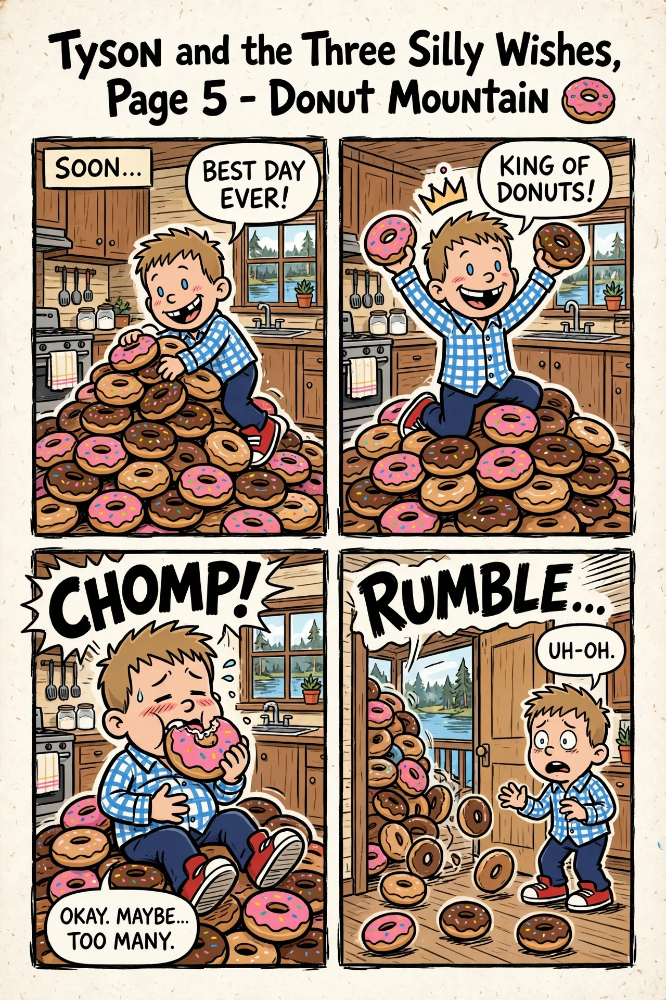

Page 5 of 12 — Donut Mountain

SOON... “BEST DAY EVER!” “KING OF DONUTS!” “OKAY. MAYBE... TOO MANY.” “UH-OH.”

## 6. Page 6 — The Family Finds Out

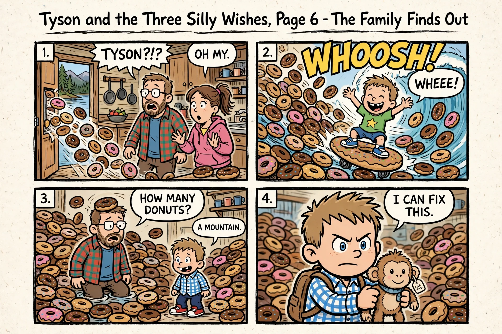

Page 6 of 12 — The Family Finds Out

“TYSON?!?” “OH MY.” “WHEEE!” “HOW MANY DONUTS?” “A MOUNTAIN.” “I CAN FIX THIS.”

## 7. Page 7 — Wish Number Two

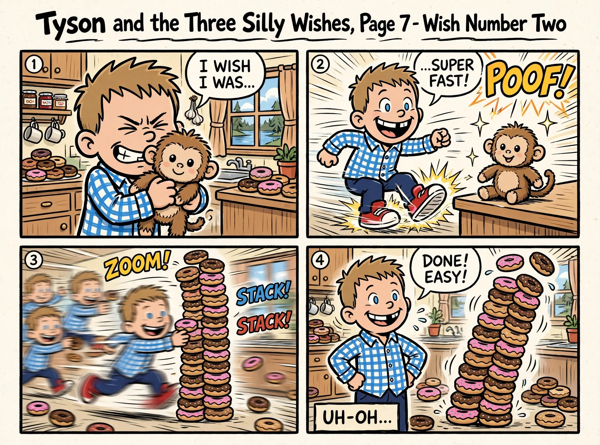

Page 7 of 12 — Wish Number Two

“I WISH I WAS...” “...SUPER FAST!” “DONE! EASY!” UH-OH...

## 8. Page 8 — Flip-O-Rama (Page A)

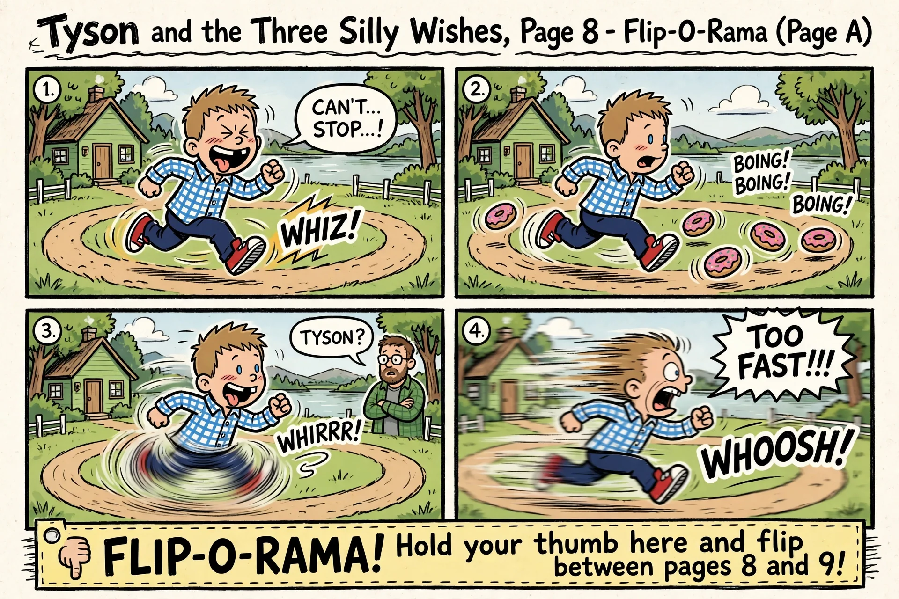

Page 8 of 12 — Flip-O-Rama (Page A)

“CAN'T... STOP...!” “TYSON?” “TOO FAST!!!”

## 9. Page 9 — Flip-O-Rama (Page B) / The Big Realization

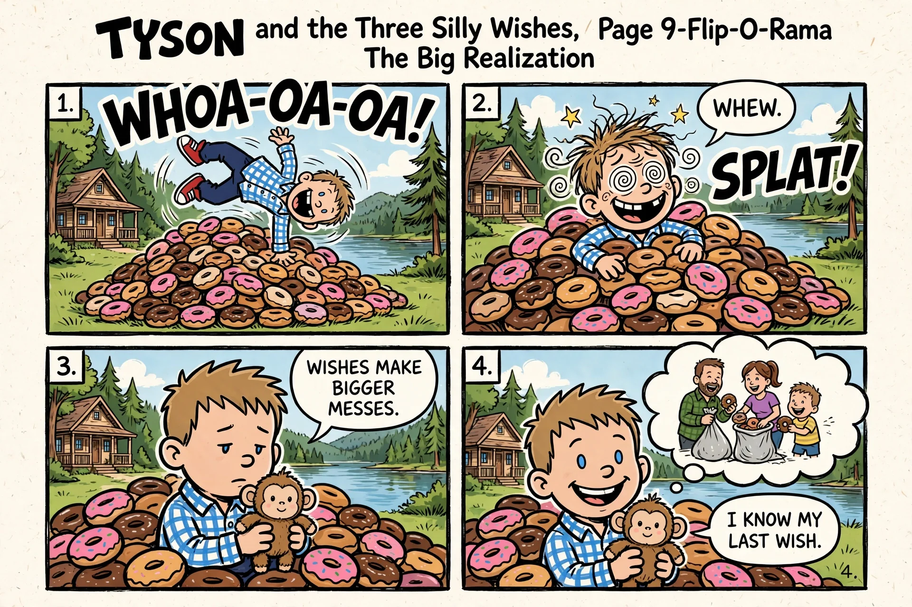

Page 9 of 12 — Flip-O-Rama (Page B) / The Big Realization

“WHEW.” “WISHES MAKE BIGGER MESSES.” “I KNOW MY LAST WISH.”

## 10. Page 10 — Wish Number Three

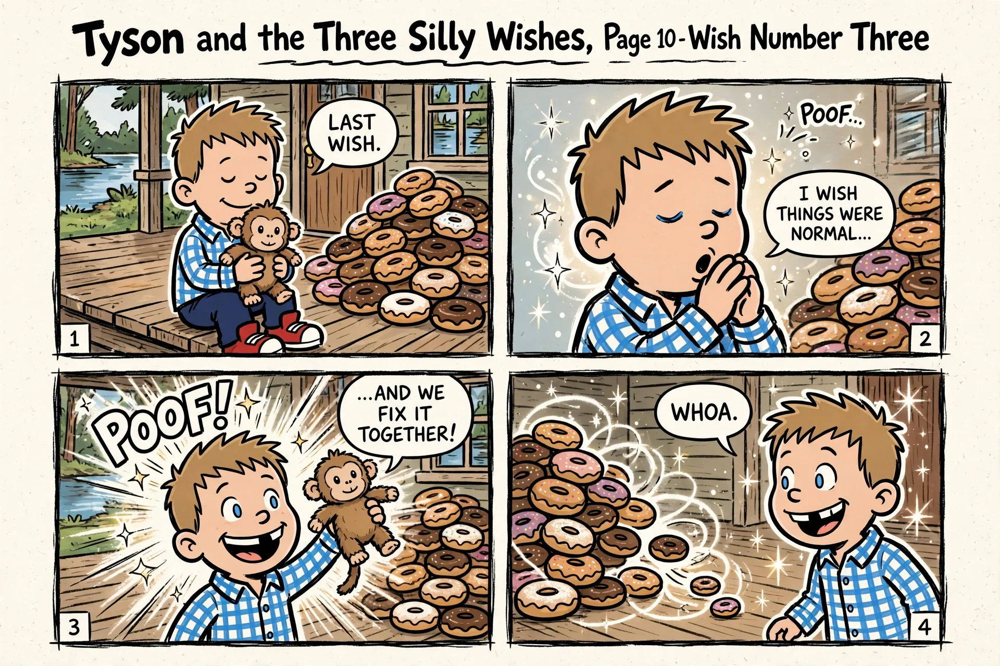

Page 10 of 12 — Wish Number Three

“LAST WISH.” “I WISH THINGS WERE NORMAL...” “...AND WE FIX IT TOGETHER!” “WHOA.”

## 11. Page 11 — Just Right

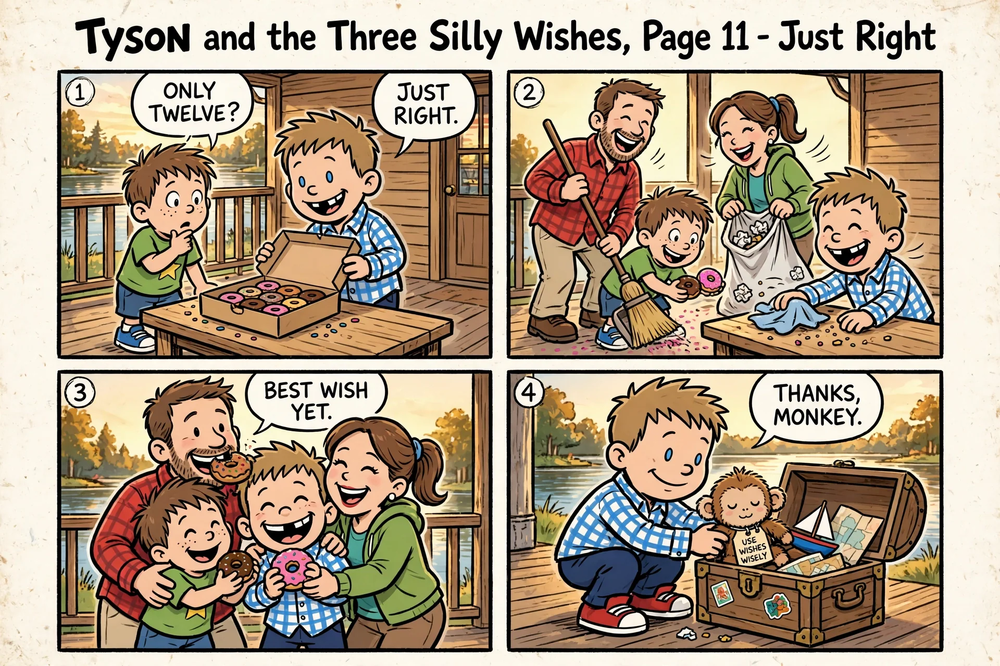

Page 11 of 12 — Just Right

“ONLY TWELVE?” “JUST RIGHT.” “BEST WISH YET.” USE WISHES WISELY. “THANKS, MONKEY.”

## 12. Page 12 — The End... Or Is It?

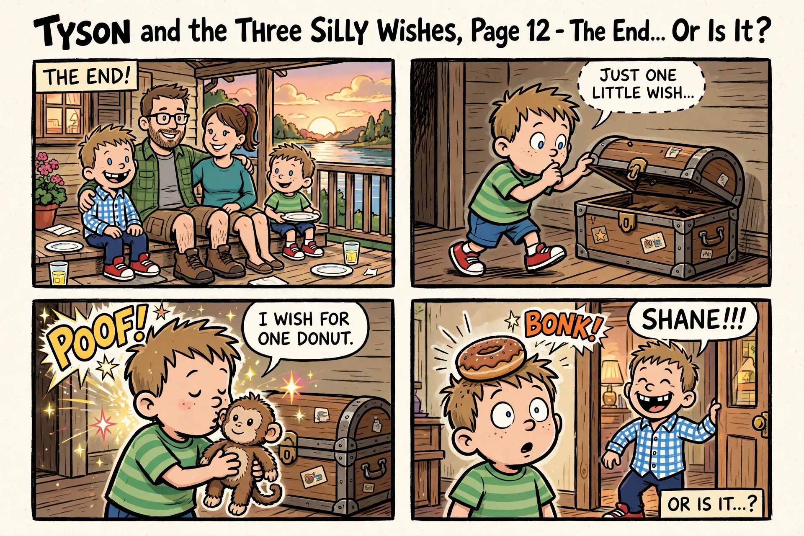

Page 12 of 12 — The End... Or Is It?

THE END! “JUST ONE LITTLE WISH...” “I WISH FOR ONE DONUT.” “SHANE!!!” OR IS IT...?
