# Tyson and the Villains Who Gave Up

A comic about endless tag, 400 knock-knock jokes, and a dance battle that defeats the fun-stoppers. Inspired by “The Ransom of Red Chief,” retold as a silly comic.

## 1. Page 1 — The Fun Stoppers

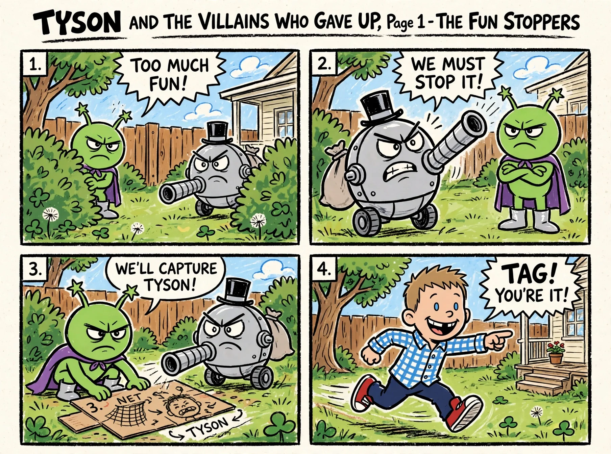

Page 1 of 12 — The Fun Stoppers

“TOO MUCH FUN!” “WE MUST STOP IT!” “WE'LL CAPTURE TYSON!” “TAG! YOU'RE IT!”

## 2. Page 2 — The Capture

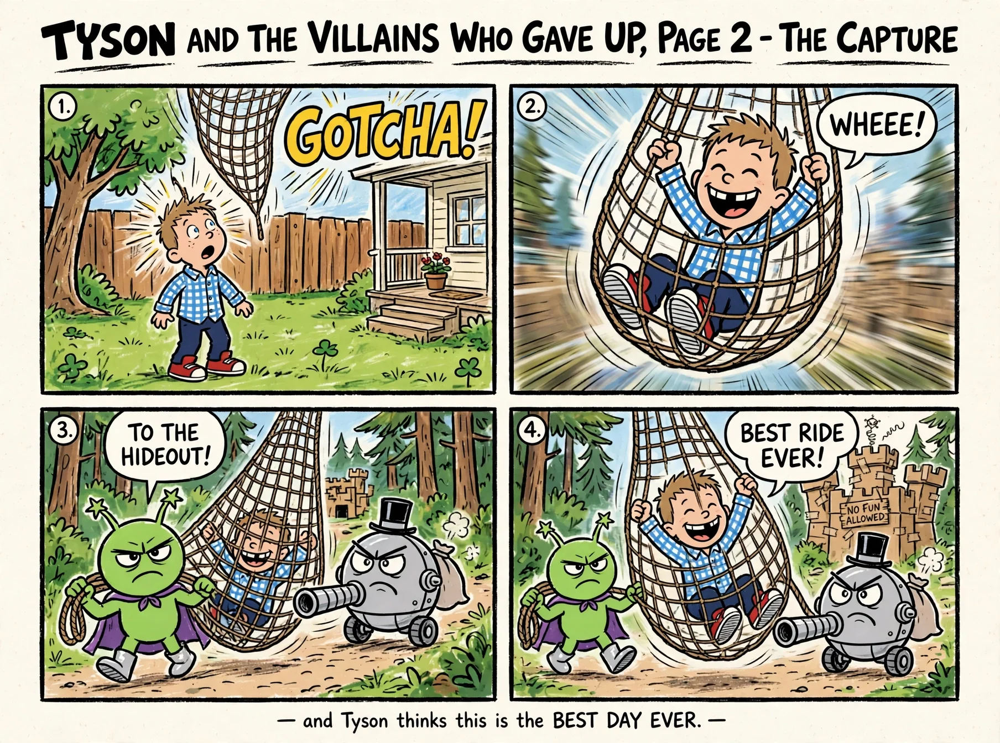

Page 2 of 12 — The Capture

“WHEEE!” “TO THE HIDEOUT!” “BEST RIDE EVER!”

## 3. Page 3 — The Ransom Note

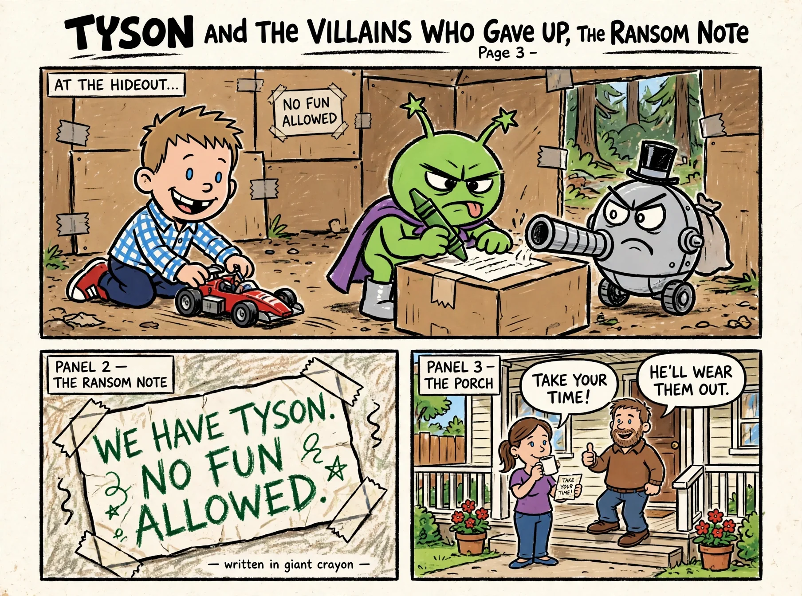

Page 3 of 12 — The Ransom Note

AT THE HIDEOUT... WE HAVE TYSON. NO FUN ALLOWED. “TAKE YOUR TIME!” “HE'LL WEAR THEM OUT.”

## 4. Page 4 — Game One: Tag

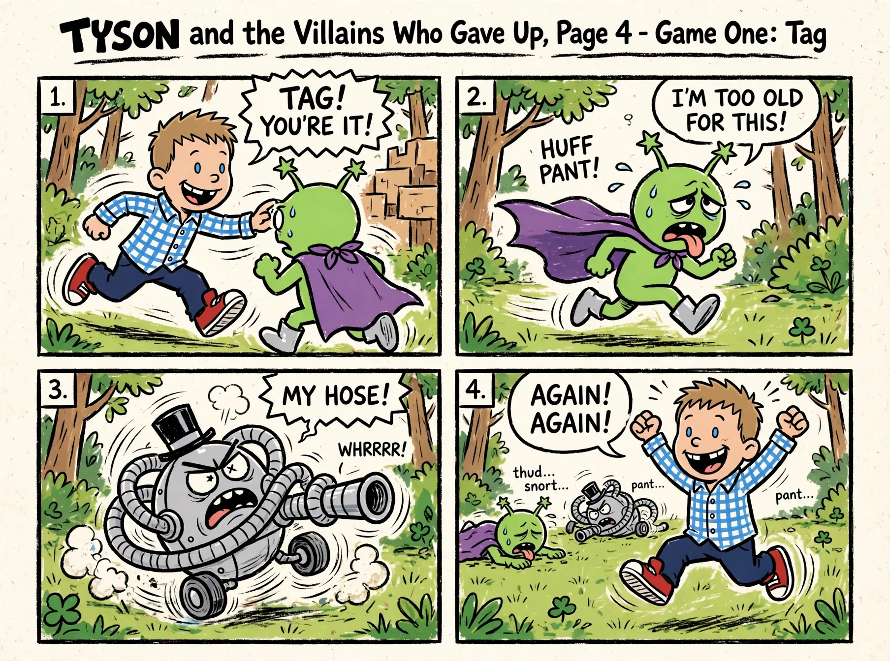

Page 4 of 12 — Game One: Tag

“TAG! YOU'RE IT!” “I'M TOO OLD FOR THIS!” “MY HOSE!” “AGAIN! AGAIN!”

## 5. Page 5 — 400 Knock-Knock Jokes

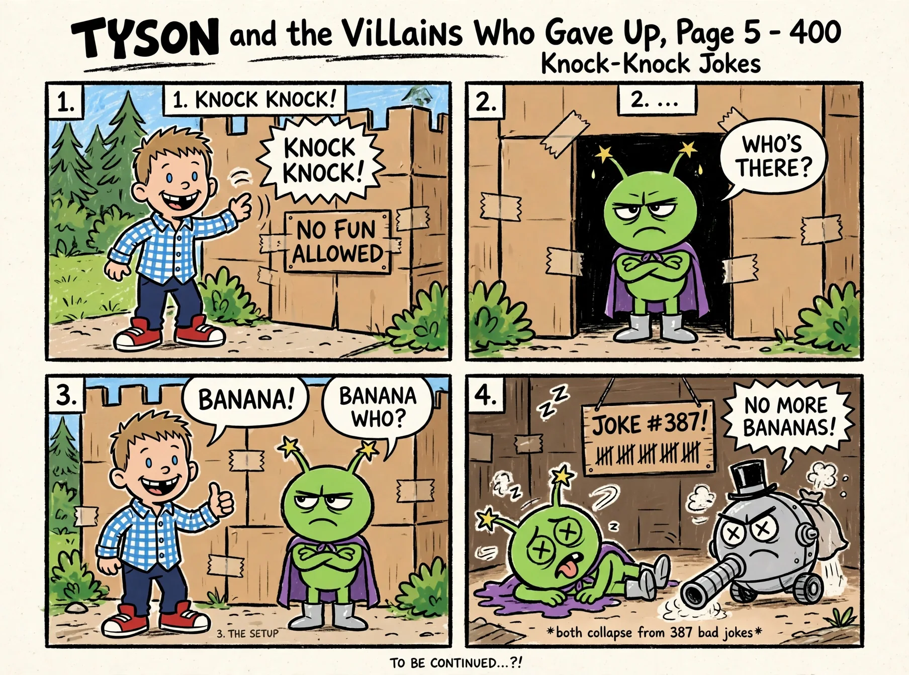

Page 5 of 12 — 400 Knock-Knock Jokes

“KNOCK KNOCK!” “WHO'S THERE?” “BANANA!” “BANANA WHO?” “NO MORE BANANAS!”

## 6. Page 6 — Dance Battle

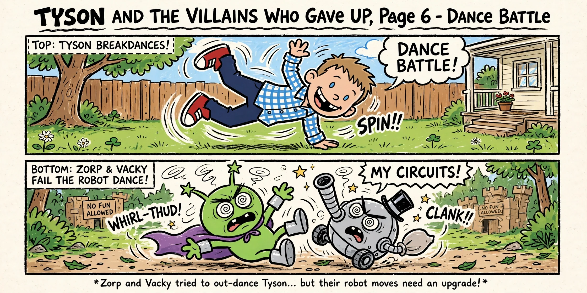

Page 6 of 12 — Dance Battle

“DANCE BATTLE!” “MY CIRCUITS!”

## 7. Page 7 — THE ULTIMATE DANCE-OFF!

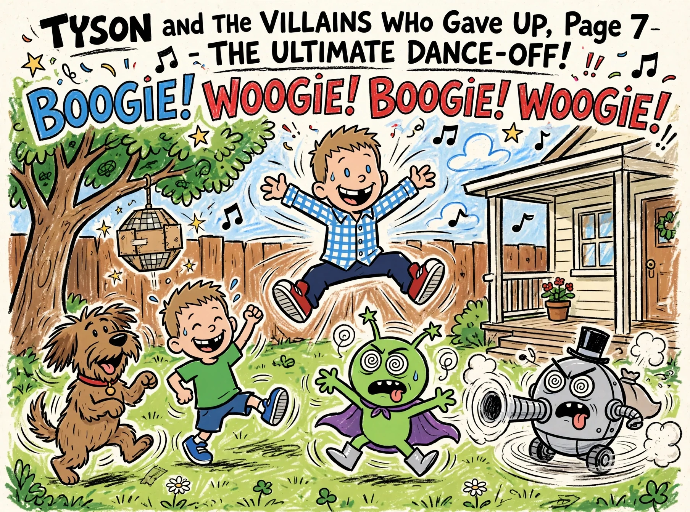

Page 7 of 12 — THE ULTIMATE DANCE-OFF!

THE WHOLE BACKYARD IS DANCING!

## 8. Page 8 — Flip-O-Rama A: BOOGIE!

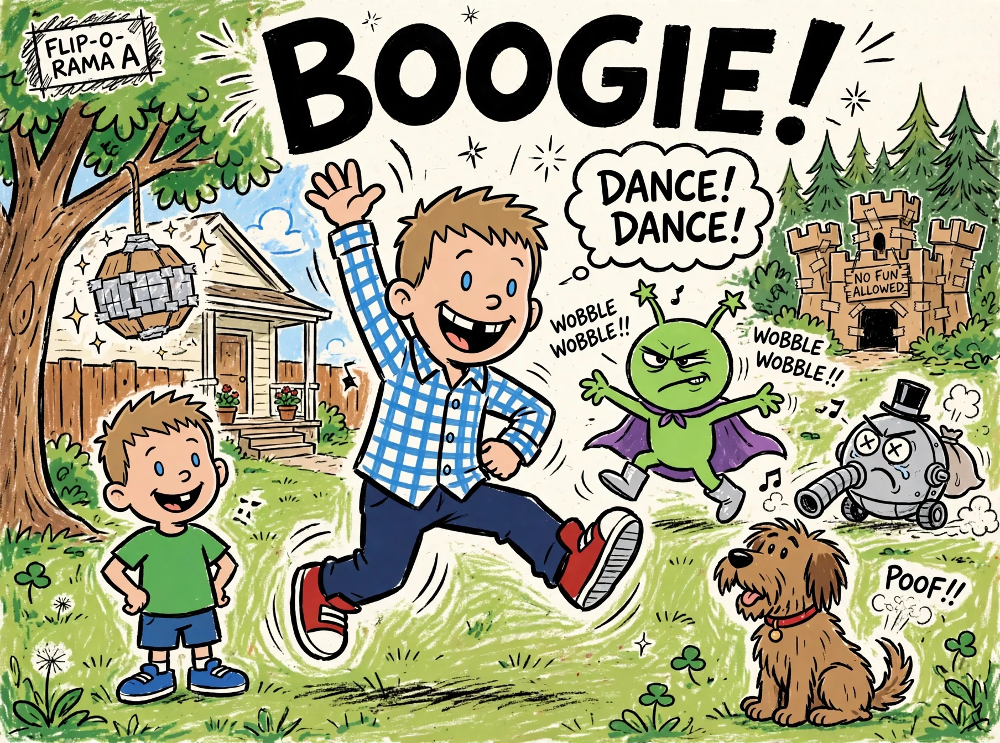

Page 8 of 12 — Flip-O-Rama A: BOOGIE!

“DANCE! DANCE!”

## 9. Page 9 — Flip-O-Rama B: WOOGIE!

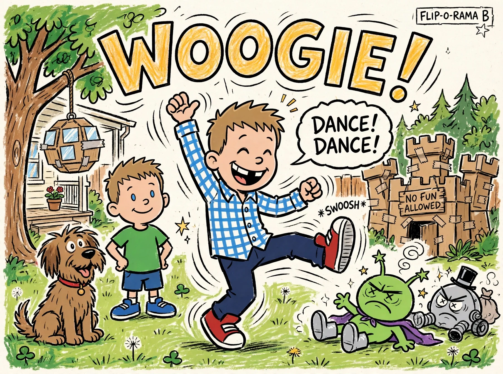

Page 9 of 12 — Flip-O-Rama B: WOOGIE!

“DANCE! DANCE!”

## 10. Page 10 — Please Take Him Back!

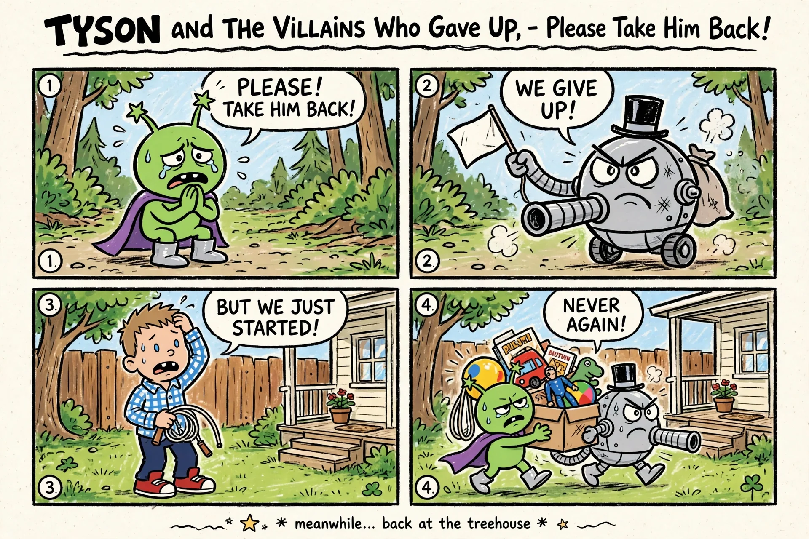

Page 10 of 12 — Please Take Him Back!

“PLEASE! TAKE HIM BACK!” “WE GIVE UP!” “BUT WE JUST STARTED!” “NEVER AGAIN!”

## 11. Page 11 — The Ride Home

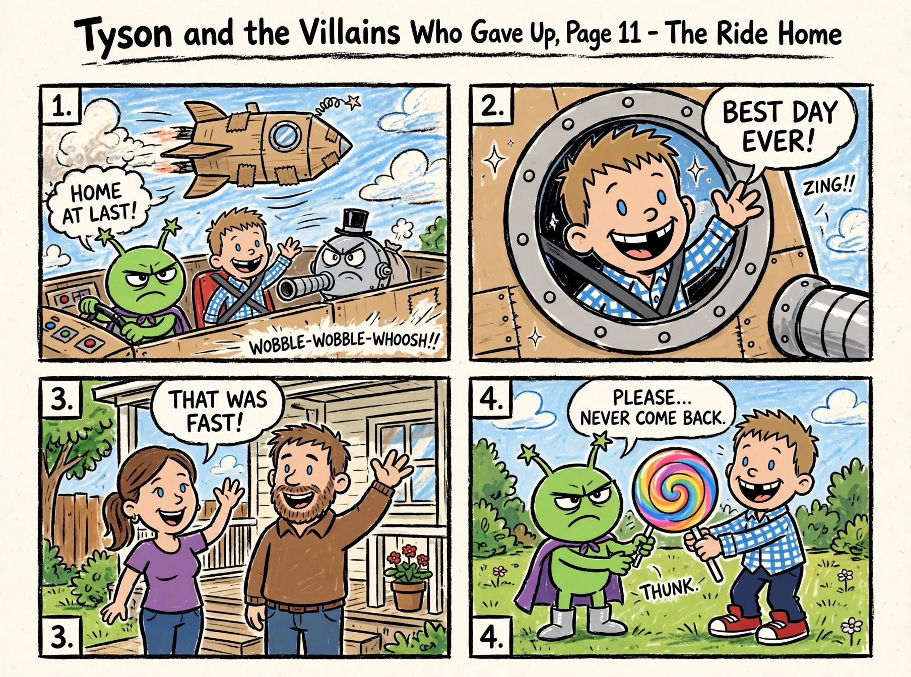

Page 11 of 12 — The Ride Home

“HOME AT LAST!” “BEST DAY EVER!” “THAT WAS FAST!” “PLEASE... NEVER COME BACK.”

## 12. Page 12 — See You Tomorrow!

Page 12 of 12 — See You Tomorrow!

“SEE YOU TOMORROW!” “no more tag...”
